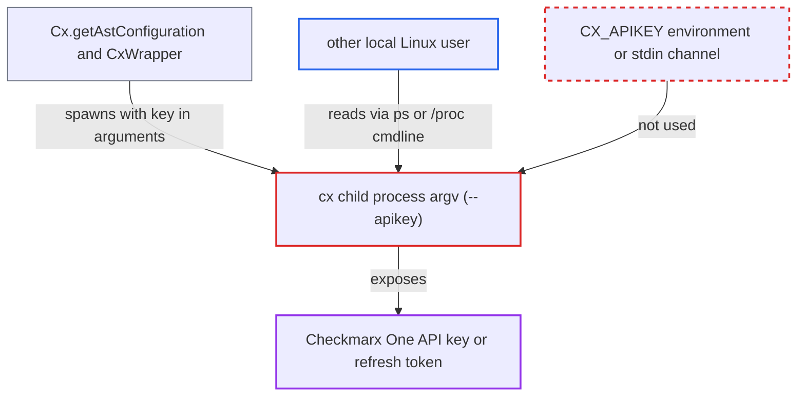

# Checkmarx One credential passed to spawned cx CLI in argv, readable by other local users

| Field | Value |
|---|---|
| ID | `find_0165adrisMM1SU7JjxMFCtRu` |
| Severity | **High** |
| Status | open |
| CWE | CWE-214 — Sensitive information in process arguments |
| Created | 2026-10-22T14:07:49.111200Z |
| Claude Security | https://claude.ai/security/findings/find_0165adrisMM1SU7JjxMFCtRu |

## Description

Another unprivileged user on the same multi-user Linux host can read a developer's Checkmarx One API key or OAuth refresh token. The same applies to the OpenAI key used by the AI chat features. The attack needs a shared Linux host (for example a Remote-SSH dev server) with default procfs, meaning no `hidepid`. The extension puts the credential in `CxConfig.apiKey` in `Cx.getAstConfiguration()`. The report assumes the wrapper then passes it to `cx` as `--apikey`, where `ps` can see it.

1. **the extension code `Cx.getAstConfiguration()`** copies the stored credential into `CxConfig.apiKey`. It reads the API key or OAuth refresh token from VS Code `SecretStorage` and puts it in the config used by every authenticated `new CxWrapper(config)` call. ([`packages/core/src/cx/cx.ts:346-356`](https://github.com/cx-benchmark/ast-vscode-extension/blob/55c034d5a357f2ab653f140c773e5098456060c2/packages/core/src/cx/cx.ts#L346-L356))
2. **the extension** starts `cx` processes during normal IDE use. `authValidate` runs on activation and login, and the realtime scanners (`scanAsca` and the OSS, secrets, IaC and container scans) run whenever documents are opened or changed, so such processes appear often and predictably. ([`packages/core/src/services/authService.ts:413-424`](https://github.com/cx-benchmark/ast-vscode-extension/blob/55c034d5a357f2ab653f140c773e5098456060c2/packages/core/src/services/authService.ts#L413-L424))
3. **the wrapper `@checkmarx/ast-cli-javascript-wrapper` 0.0.164** is assumed to place the key in the `cx` argument list as `--apikey <apiKey>`. This is an assumption, because the wrapper is not in the checkout. It also assumes `CX_APIKEY` is not set in the child environment. The `cx` CLI does accept `--apikey` as a persistent root flag. ([`internal/commands/root.go:108`](https://github.com/cx-benchmark/ast-cli/blob/fd7806d4fa55005863ea1cb272ed9e9aadd49866/internal/commands/root.go#L108))
4. **a local attacker account** reads the argument list of the running `cx` process. The attacker polls `/proc/<pid>/cmdline` or runs `ps -eo args`. On default Linux procfs, any local user can read these.
5. **a local attacker account** reuses the captured credential against Checkmarx One. The credential is long-lived and authenticates to the victim's tenant.

## Assessment

The attacker is another unprivileged account on the same Linux host as the victim's extension host, such as a shared dev server reached over Remote-SSH or a shared build box. Both extensions declare `extensionKind: ["workspace"]`, so under Remote-SSH the extension and its `cx` children run on that remote machine. The victim only has to use the IDE normally, and no protection has to be bypassed. The host must be multi-user Linux with default procfs (no `hidepid`). On macOS and Windows, unprivileged users cannot read another user's process arguments, so only same-user processes see the key there, and they already have equivalent access. The finding also rests on the unverified assumption about how the wrapper builds the `cx` command.

Impact: A local attacker learns the victim's Checkmarx One API key or OAuth refresh token, and the OpenAI key used by the AI Security Champion flows (`sastChat`, `kicsChat`). The host itself suffers no integrity or availability impact.

Subsequent-system impact: The credential is long-lived and authenticates to the victim's Checkmarx One tenant. With it the attacker can read the projects, scans and results the victim can access. The attacker can also act as the victim, for example by creating scans or changing triage states.

## Recommendation

`cx.ts` passes the credential to the CLI only through `CxConfig.apiKey`. The wrapper sends it as the `--apikey` argument of each spawned `cx` process, and on Linux other local users can read that argument list through `/proc/<pid>/cmdline`.

Fix criteria: No spawned process carries the Checkmarx One credential or the AI chat key in its argument list. The credentials go through the child environment (`CX_APIKEY`), stdin, or an owner-only temporary file, with the wrapper updated or bypassed as needed. To verify, list processes as a different Linux user during activation, `auth validate` and a realtime scan, and confirm that no `cx` process shows the key.

## Evidence

**https://github.com/cx-benchmark/ast-vscode-extension**

- [`packages/core/src/cx/cx.ts:346-356`](https://github.com/cx-benchmark/ast-vscode-extension/blob/55c034d5a357f2ab653f140c773e5098456060c2/packages/core/src/cx/cx.ts#L346-L356)
- [`packages/core/src/cx/cx.ts:894-899`](https://github.com/cx-benchmark/ast-vscode-extension/blob/55c034d5a357f2ab653f140c773e5098456060c2/packages/core/src/cx/cx.ts#L894-L899)
- [`packages/core/src/services/authService.ts:413-424`](https://github.com/cx-benchmark/ast-vscode-extension/blob/55c034d5a357f2ab653f140c773e5098456060c2/packages/core/src/services/authService.ts#L413-L424)
- [`packages/core/src/cx/cx.ts:816-821`](https://github.com/cx-benchmark/ast-vscode-extension/blob/55c034d5a357f2ab653f140c773e5098456060c2/packages/core/src/cx/cx.ts#L816-L821)
- [`packages/checkmarx/package.json:19-21`](https://github.com/cx-benchmark/ast-vscode-extension/blob/55c034d5a357f2ab653f140c773e5098456060c2/packages/checkmarx/package.json#L19-L21)

**https://github.com/cx-benchmark/ast-cli**

- [`internal/commands/root.go:108`](https://github.com/cx-benchmark/ast-cli/blob/fd7806d4fa55005863ea1cb272ed9e9aadd49866/internal/commands/root.go#L108)
- [`internal/params/envs.go:20`](https://github.com/cx-benchmark/ast-cli/blob/fd7806d4fa55005863ea1cb272ed9e9aadd49866/internal/params/envs.go#L20)

