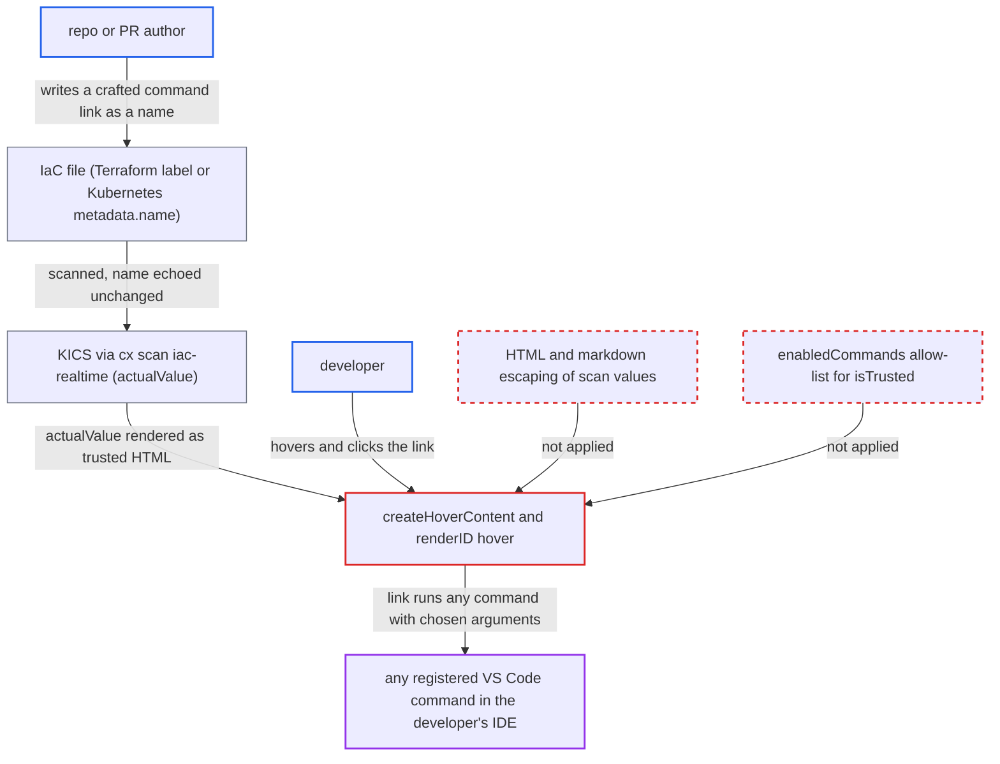

# IaC realtime hover renders scanned-file values from KICS actual_value as trusted HTML command links

| Field | Value |
|---|---|
| ID | `find_01TXLhfc7bBAvbAxgK62ThVc` |
| Severity | **High** |
| Status | open |
| CWE | CWE-79 — HTML injection |
| Created | 2026-10-22T14:03:38.313865Z |
| Claude Security | https://claude.ai/security/findings/find_01TXLhfc7bBAvbAxgK62ThVc |

## Description

An attacker who writes an infrastructure-as-code file can make the developer's VS Code run any registered command with attacker-chosen arguments. The developer must open the repo in a trusted workspace with IaC realtime on, then hover the flagged line and click a fake link. The hover builder `IacScannerCommand.createHoverContent` puts unescaped scan text (`actualValue`) into a trusted, HTML-enabled `MarkdownString`.

1. **attacker** puts a `command:` link into a name in an IaC file. The link goes into a Terraform resource label or a Kubernetes `metadata.name` or container name, which are free-form text that KICS later quotes.
2. **KICS and the CLI `cx scan iac-realtime`** echo the name in `actual_value` and return it as `actualValue`. The CLI copies KICS `loc.ActualValue` into `ActualValue` and prints it as JSON with no sanitising. ([`internal/services/realtimeengine/iacrealtime/mapper.go:41-47`](https://github.com/cx-benchmark/ast-cli/blob/fd7806d4fa55005863ea1cb272ed9e9aadd49866/internal/services/realtimeengine/iacrealtime/mapper.go#L41-L47))
3. **`IacScannerService.updateProblems`** stores `result.actualValue` unchanged as hover data for the flagged line. The same line also gets a diagnostic, so `getHover` finds an active IaC diagnostic and renders the hover. ([`packages/core/src/realtimeScanners/scanners/iac/iacScannerService.ts:282-295`](https://github.com/cx-benchmark/ast-vscode-extension/blob/55c034d5a357f2ab653f140c773e5098456060c2/packages/core/src/realtimeScanners/scanners/iac/iacScannerService.ts#L282-L295))
4. **`renderID`** joins `hoverData.actualValue` into the hover text without escaping. `title`, `actualValue` and `description` are all concatenated verbatim, so the attacker's HTML or markdown stays live. ([`packages/core/src/realtimeScanners/scanners/iac/iacScannerCommand.ts:97-102`](https://github.com/cx-benchmark/ast-vscode-extension/blob/55c034d5a357f2ab653f140c773e5098456060c2/packages/core/src/realtimeScanners/scanners/iac/iacScannerCommand.ts#L97-L102))
5. **`createHoverContent`** renders that text in a `MarkdownString` with `supportHtml = true` and `isTrusted = true`. `isTrusted` is a plain boolean, not an `enabledCommands` allow-list, so `command:` links to any command id are kept and can run. ([`packages/core/src/realtimeScanners/scanners/iac/iacScannerCommand.ts:64-81`](https://github.com/cx-benchmark/ast-vscode-extension/blob/55c034d5a357f2ab653f140c773e5098456060c2/packages/core/src/realtimeScanners/scanners/iac/iacScannerCommand.ts#L64-L81))
6. **developer** hovers the flagged line and clicks the injected link. The link looks like the extension's own `Fix with ...` buttons, which are built the same way as raw `command:` links, so VS Code runs the named command with the link's JSON arguments. ([`packages/core/src/utils/utils.ts:386-392`](https://github.com/cx-benchmark/ast-vscode-extension/blob/55c034d5a357f2ab653f140c773e5098456060c2/packages/core/src/utils/utils.ts#L386-L392))

## Assessment

The attacker authors a repository or pull request that the developer opens with the extension and IaC realtime enabled. The welcome page turns this on for AI-enabled tenants. Docker or Podman must be running. The extension declares no untrusted-workspace support, so the folder must be trusted. The attacker needs no account. A KICS query must be triggered that echoes the crafted name in `actual_value`. This assumes the pinned KICS image v2.1.20 keeps echoing resource labels and `metadata.name` as the repository's sample results show. It also assumes VS Code treats `isTrusted = true` as allowing all `command:` links. The developer must hover the flagged line and click the link. The ignore-file path (`.vscode/.checkmarxIgnored` `PackageName` and `description`) feeds the same template. Today it does not render, because `getHover` only renders when an active IaC diagnostic exists on that line, and ignored entries are only added to lines without one. `title` and `description` come from KICS query metadata and are not attacker-controlled.

Impact: One click runs any registered VS Code command with attacker-chosen JSON arguments, as the developer. Examples are sending shell input to the integrated terminal, installing an extension, opening or editing files, and calling the extension's own `openAIChat` and `ignorePackage` commands with forged data. This is code execution on the developer's machine within the user's privileges.

## Recommendation

(1) Scan output taken from the scanned file (`actualValue`, and defensively `title`, `description` and the ignore-file fields) is put into an HTML-enabled `MarkdownString` unescaped. Attacker text therefore becomes `<a href="command:...">` markup or markdown links.

Fix criteria: Every value from scan results or workspace files is HTML- and markdown-escaped, or added with `appendText`, before it reaches the hover. A `.tf` file or Kubernetes YAML whose resource name is `<a href="command:workbench.action.terminal.sendSequence?...">x</a>` or `[x](command:...)` shows in the hover as literal text. No new clickable link appears.

(2) `md.isTrusted = true` lets any link in the hover run any registered command. One injection therefore reaches the whole command surface.

Fix criteria: Trust is limited to the extension's own hover commands, as in `isTrusted = { enabledCommands: [openAIChat, viewDetails, ignorePackage, ignoreAll] }`. A `command:` link in the hover to any other command id is not executed.

## Evidence

**https://github.com/cx-benchmark/ast-vscode-extension**

- [`packages/core/src/realtimeScanners/scanners/iac/iacScannerCommand.ts:97-102`](https://github.com/cx-benchmark/ast-vscode-extension/blob/55c034d5a357f2ab653f140c773e5098456060c2/packages/core/src/realtimeScanners/scanners/iac/iacScannerCommand.ts#L97-L102)
- [`packages/core/src/realtimeScanners/scanners/iac/iacScannerCommand.ts:64-81`](https://github.com/cx-benchmark/ast-vscode-extension/blob/55c034d5a357f2ab653f140c773e5098456060c2/packages/core/src/realtimeScanners/scanners/iac/iacScannerCommand.ts#L64-L81)
- [`packages/core/src/utils/utils.ts:386-392`](https://github.com/cx-benchmark/ast-vscode-extension/blob/55c034d5a357f2ab653f140c773e5098456060c2/packages/core/src/utils/utils.ts#L386-L392)
- [`packages/core/src/realtimeScanners/scanners/iac/iacScannerService.ts:282-295`](https://github.com/cx-benchmark/ast-vscode-extension/blob/55c034d5a357f2ab653f140c773e5098456060c2/packages/core/src/realtimeScanners/scanners/iac/iacScannerService.ts#L282-L295)

**https://github.com/cx-benchmark/ast-cli**

- [`internal/services/realtimeengine/iacrealtime/mapper.go:41-47`](https://github.com/cx-benchmark/ast-cli/blob/fd7806d4fa55005863ea1cb272ed9e9aadd49866/internal/services/realtimeengine/iacrealtime/mapper.go#L41-L47)

