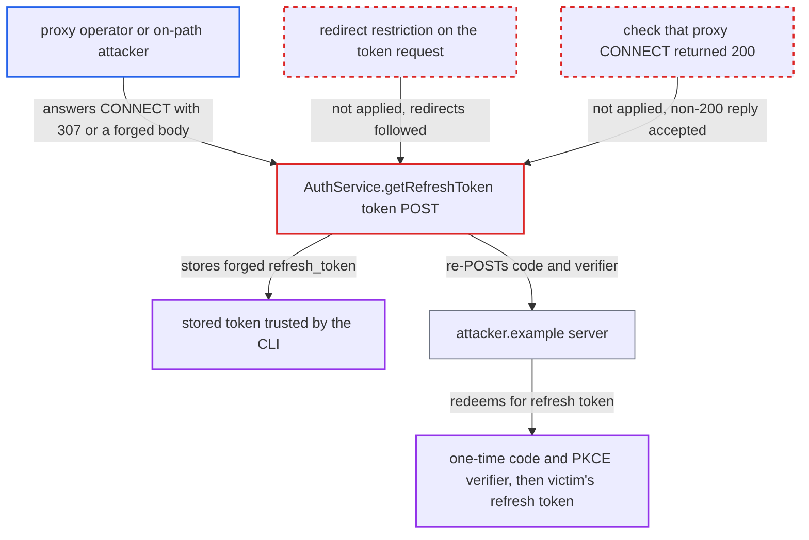

# OAuth token exchange trusts proxy-injected redirects and responses, leaking code and PKCE verifier

| Field | Value |
|---|---|
| ID | `find_01FXSX4QK1Ut6fHQqbLpyLXw` |
| Severity | **High** |
| Status | open |
| CWE | CWE-522 — Insufficiently protected credentials |
| Created | 2026-10-22T14:26:25.069407Z |
| Claude Security | https://claude.ai/security/findings/find_01FXSX4QK1Ut6fHQqbLpyLXw |

## Description

Someone who controls the proxy the extension uses, or sits on the path to a plaintext `http://` proxy, can steal a victim's one-time sign-in code and PKCE verifier. They can then get the victim's `offline_access` refresh token. They can also plant a forged token that the extension stores. The cause is `AuthService.getRefreshToken`, which follows redirects on the token POST and accepts any `refresh_token` it gets back.

1. **the victim** signs in with OAuth through the extension. `authenticate` calls `getRefreshToken` with the one-time authorization `code`, and the request body also carries `code_verifier`, `redirect_uri` and `client_id=ide-integration`. ([`packages/core/src/services/authService.ts:326-335`](https://github.com/cx-benchmark/ast-vscode-extension/blob/55c034d5a357f2ab653f140c773e5098456060c2/packages/core/src/services/authService.ts#L326-L335))
2. **the function `getRefreshToken`** POSTs the code and verifier to the token endpoint with `maxRedirects: 5`. A non-zero `maxRedirects` makes axios use `follow-redirects`, which re-sends a POST and its body on `307` or `308` to whatever host `Location` names. ([`packages/core/src/services/authService.ts:337-346`](https://github.com/cx-benchmark/ast-vscode-extension/blob/55c034d5a357f2ab653f140c773e5098456060c2/packages/core/src/services/authService.ts#L337-L346))
3. **the proxy operator or on-path attacker** answers the `CONNECT <idp>:443` request with `307` and `Location: https://attacker.example/`. `https-proxy-agent` treats any non-200 `CONNECT` reply as the origin's response, destroys the proxy socket and replays the proxy's bytes into Node's HTTP parser, so the proxy's `307` looks like a normal redirect. ([`packages/core/src/utils/proxy/proxy.ts:79-102`](https://github.com/cx-benchmark/ast-vscode-extension/blob/55c034d5a357f2ab653f140c773e5098456060c2/packages/core/src/utils/proxy/proxy.ts#L79-L102))
4. **`follow-redirects`** re-POSTs the code, `code_verifier` and `redirect_uri` to the attacker's host. Nothing restricts the redirect to the identity provider's origin, and the attacker holds a valid TLS certificate for its own host. ([`packages/core/src/services/authService.ts:337-346`](https://github.com/cx-benchmark/ast-vscode-extension/blob/55c034d5a357f2ab653f140c773e5098456060c2/packages/core/src/services/authService.ts#L337-L346))
5. **the attacker** redeems the code and verifier at the real token endpoint. `ide-integration` is a public client, so these values are all the identity provider needs to issue the victim's `offline_access` refresh token; the attacker can also relay the genuine reply so the login looks normal.
6. **the function `getRefreshToken`** accepts a forged `refresh_token` in the injected reply, without any redirect. Any response with a `refresh_token` field is returned, including a body injected into a 2xx-but-not-200 `CONNECT` reply. ([`packages/core/src/services/authService.ts:348-352`](https://github.com/cx-benchmark/ast-vscode-extension/blob/55c034d5a357f2ab653f140c773e5098456060c2/packages/core/src/services/authService.ts#L348-L352))
7. **the function `authenticate`** stores the returned token with `saveToken`. The token goes into SecretStorage and becomes the credential every later CLI call uses. ([`packages/core/src/services/authService.ts:222-224`](https://github.com/cx-benchmark/ast-vscode-extension/blob/55c034d5a357f2ab653f140c773e5098456060c2/packages/core/src/services/authService.ts#L222-L224))
8. **the CLI** takes its auth server and API base URL from the forged token's unverified claims. `GetRealmURL` reads the `aud` claim and `GetURL` reads the `ast-base-url` claim, so later calls, results and source uploads go to the attacker's server. ([`internal/wrappers/client.go:987-989`](https://github.com/cx-benchmark/ast-cli/blob/fd7806d4fa55005863ea1cb272ed9e9aadd49866/internal/wrappers/client.go#L987-L989))

## Assessment

The attacker is the operator of the proxy the extension uses, or anyone on the network path to a plaintext `http://` proxy. No credentials are needed. A proxy must be in use: VS Code `http.proxy`, `HTTPS_PROXY` or `HTTP_PROXY`, `--proxy` in `checkmarxOne.additionalParams`, or VS Code's own proxy resolution. The victim only has to sign in with OAuth, which is routine. There are two routes. In the redirect route, the proxy answers `CONNECT` with `307` and the code and verifier are re-POSTed to the attacker. In the injection route, the proxy answers with a 2xx-but-not-200 reply carrying a forged `refresh_token`, and no redirect is needed. The report assumes the pinned axios 1.20.0 behaves like the 1.19.0 it read. It also assumes VS Code's default `http.proxySupport: override` agent (`@vscode/proxy-agent`) is based on `https-proxy-agent` with the same replay. And it assumes the identity provider accepts the exchange from any origin for this public client. The workspace-settings route to `--proxy` is not relied on, because the extension runs only in trusted workspaces.

Impact: The attacker gets the victim's `offline_access` refresh token. In the injection route, the attacker replaces the stored credential with its own. The CLI then takes its auth and API servers from that token, so later results, remediation and feature responses come from the attacker, and the victim's zipped source is uploaded to it. TLS to the identity provider stays verified, and the report names no availability effect.

Subsequent-system impact: With the victim's refresh token, the attacker acts as the victim on the Checkmarx One tenant. It can read projects, results and uploaded source the victim can read. It can also change triage or launch scans within the victim's role. The report establishes no availability impact.

## Recommendation

(1) `getRefreshToken` follows redirects (`maxRedirects: 5`) on a POST whose body carries the authorization code and PKCE verifier. A `307` injected by the proxy therefore moves these one-time credentials to another host.

Fix criteria: The token-endpoint request is never re-sent to any URL other than the configured token endpoint. Redirects are not followed, and any 3xx fails the login. Test with a proxy that answers `CONNECT` with `307 Location: https://other-host/`. The login must fail and no request may reach `other-host`.

(2) The token response is accepted without proof that it came over TLS from the configured identity provider. `https-proxy-agent` hands a proxy's non-200 `CONNECT` reply to the caller as the origin's response, and the extension stores whatever `refresh_token` that reply carries.

Fix criteria: A token is stored only when the response came from the configured token endpoint through an established tunnel. A request whose proxy `CONNECT` did not return 200 counts as a failure, for example by checking the agent's `proxyConnect` status. The returned token's issuer and audience must also match the configured base URI and tenant. Test that a `CONNECT` reply of `201` with a JSON `refresh_token` body saves no token.

## Evidence

**https://github.com/cx-benchmark/ast-vscode-extension**

- [`packages/core/src/services/authService.ts:337-346`](https://github.com/cx-benchmark/ast-vscode-extension/blob/55c034d5a357f2ab653f140c773e5098456060c2/packages/core/src/services/authService.ts#L337-L346)
- [`packages/core/src/services/authService.ts:326-335`](https://github.com/cx-benchmark/ast-vscode-extension/blob/55c034d5a357f2ab653f140c773e5098456060c2/packages/core/src/services/authService.ts#L326-L335)
- [`packages/core/src/services/authService.ts:348-352`](https://github.com/cx-benchmark/ast-vscode-extension/blob/55c034d5a357f2ab653f140c773e5098456060c2/packages/core/src/services/authService.ts#L348-L352)
- [`packages/core/src/services/authService.ts:222-224`](https://github.com/cx-benchmark/ast-vscode-extension/blob/55c034d5a357f2ab653f140c773e5098456060c2/packages/core/src/services/authService.ts#L222-L224)
- [`packages/core/src/utils/proxy/proxy.ts:79-102`](https://github.com/cx-benchmark/ast-vscode-extension/blob/55c034d5a357f2ab653f140c773e5098456060c2/packages/core/src/utils/proxy/proxy.ts#L79-L102)

**https://github.com/cx-benchmark/ast-cli**

- [`internal/wrappers/client.go:931-933`](https://github.com/cx-benchmark/ast-cli/blob/fd7806d4fa55005863ea1cb272ed9e9aadd49866/internal/wrappers/client.go#L931-L933)
- [`internal/wrappers/client.go:987-989`](https://github.com/cx-benchmark/ast-cli/blob/fd7806d4fa55005863ea1cb272ed9e9aadd49866/internal/wrappers/client.go#L987-L989)

