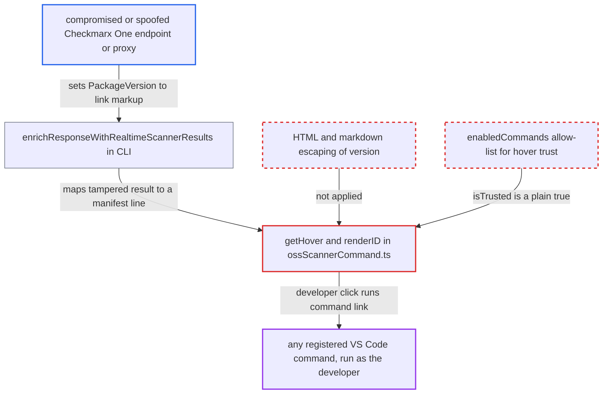

# OSS realtime hover renders server-supplied package version as trusted HTML command links

| Field | Value |
|---|---|
| ID | `find_017hZa5B1A2kP3hEwKSY5ybq` |
| Severity | **High** |
| Status | open |
| CWE | CWE-79 — Cross-site scripting |
| Created | 2026-10-22T14:07:48.974122Z |
| Claude Security | https://claude.ai/security/findings/find_017hZa5B1A2kP3hEwKSY5ybq |

## Description

A party who can tamper with the Checkmarx One realtime-scanner response can make the IDE run any VS Code command with chosen arguments. That leads to code execution as the developer. It needs a developer to open a workspace with an unpinned or `latest` dependency, hover the flagged line and click an injected link. `getHover()` and `renderID()` put the server-supplied `version` unescaped into a MarkdownString with `isTrusted = true`.

1. **attacker controlling the realtime-scanner response** returns a flagged package whose `PackageVersion` holds link markup. The response uses `Status: High` (or another risk status) and a `command:` link as `PackageVersion`. The CLI copies `PackageVersion` from this response. ([`internal/services/realtimeengine/ossrealtime/oss-realtime.go:152-183`](https://github.com/cx-benchmark/ast-cli/blob/fd7806d4fa55005863ea1cb272ed9e9aadd49866/internal/services/realtimeengine/ossrealtime/oss-realtime.go#L152-L183))
2. **the CLI function `enrichResponseWithRealtimeScannerResults()`** attaches the manifest line to the tampered result through the `latest` fallback. The exact `(manager, name, version)` lookup misses, so `getPackageEntryFromPackageMap()` falls back to the manifest entry with version `latest`. This works for any unpinned or `latest` dependency. ([`internal/services/realtimeengine/ossrealtime/oss-realtime.go:152-183`](https://github.com/cx-benchmark/ast-cli/blob/fd7806d4fa55005863ea1cb272ed9e9aadd49866/internal/services/realtimeengine/ossrealtime/oss-realtime.go#L152-L183))
3. **the extension's `handleProblemStatus()`** creates a diagnostic on that line and stores the result fields unchanged. `packageName`, `version` and `status` go into `hoverMessages`, the store `getHover()` reads. A diagnostic on the line is what lets the hover render. ([`packages/core/src/realtimeScanners/scanners/oss/ossScannerService.ts:670-711`](https://github.com/cx-benchmark/ast-vscode-extension/blob/55c034d5a357f2ab653f140c773e5098456060c2/packages/core/src/realtimeScanners/scanners/oss/ossScannerService.ts#L670-L711))
4. **the hover builder `getHover()` and `renderID()`** renders the version inside a trusted, HTML-enabled MarkdownString. `renderID()` concatenates `packageName`, `version` and `status` without escaping. With `isTrusted = true`, any `command:` link in that text is live. ([`packages/core/src/realtimeScanners/scanners/oss/ossScannerCommand.ts:102-113`](https://github.com/cx-benchmark/ast-vscode-extension/blob/55c034d5a357f2ab653f140c773e5098456060c2/packages/core/src/realtimeScanners/scanners/oss/ossScannerCommand.ts#L102-L113))
5. **developer** hovers the flagged line and clicks the injected link. VS Code runs the named command with the JSON arguments from the link. An injected link labelled like `Fix with Checkmarx` looks the same as the extension's real buttons. ([`packages/core/src/utils/utils.ts:386-392`](https://github.com/cx-benchmark/ast-vscode-extension/blob/55c034d5a357f2ab653f140c773e5098456060c2/packages/core/src/utils/utils.ts#L386-L392))

## Assessment

The attacker controls the realtime-scanner response, for example through a compromised or spoofed Checkmarx One endpoint or a proxy that can tamper with it. The developer opens a workspace whose manifest has an unpinned or `latest` dependency. The extension then runs `cx scan oss-realtime` automatically. The payload only needs the manifest's `packageName` and a valid `status` value, so `PackageVersion` is the field the attacker controls. The developer must hover the flagged line and click the link. The payload stays live until the file is rescanned, because a later scan within the 4-hour cache TTL shows the manifest's `latest` instead. The report assumes `github.com/Checkmarx/manifest-parser` v0.1.5, which is not vendored, reports unpinned or `latest` dependencies with version `latest`. The containers hover in `containersScannerCommand.ts` has the same unescaped, trusted rendering. The server cannot choose its name or tag, because `isSameImage()` only attaches locations when they match the image reference in the scanned file. Markup there would have to come from the repository file and also be flagged vulnerable by the server. The ignore-file path never renders, because `getHover()` requires a diagnostic on the line.

Impact: One click runs any registered VS Code command with attacker-chosen arguments in the developer's IDE. The report's examples are installing an attacker-published extension, sending shell input to the integrated terminal, or driving `openAIChat` and `ignorePackage` with forged data. The report describes the result as code execution as the developer on their workstation.

## Recommendation

(1) `packageName`, `version` and `status` (and `imageName` and `imageTag` in the containers hover) go into an HTML-enabled MarkdownString without any HTML or markdown escaping. Server or repository text can therefore become `command:` links.

Fix criteria: Every value from scan results or workspace files is HTML- and markdown-escaped, or added with `appendText`, before it reaches the OSS and containers hovers. Test with a realtime response whose `PackageVersion` is an anchor or a `[x](command:...)` link, such as one that points at `workbench.action.terminal.sendSequence`, for a `latest` dependency. The hover must show the text literally and add no clickable link.

(2) `md.isTrusted = true` allows every command id. One injection therefore reaches the whole VS Code command surface, not just the extension's four hover actions.

Fix criteria: Hover trust is limited to the extension's own commands, as in `isTrusted = { enabledCommands: [openAIChat, viewDetails, ignorePackage, ignoreAll] }`. A `command:` link to any other id in an OSS or containers hover does not run.

## Evidence

**https://github.com/cx-benchmark/ast-vscode-extension**

- [`packages/core/src/realtimeScanners/scanners/oss/ossScannerCommand.ts:102-113`](https://github.com/cx-benchmark/ast-vscode-extension/blob/55c034d5a357f2ab653f140c773e5098456060c2/packages/core/src/realtimeScanners/scanners/oss/ossScannerCommand.ts#L102-L113)
- [`packages/core/src/realtimeScanners/scanners/oss/ossScannerCommand.ts:49-90`](https://github.com/cx-benchmark/ast-vscode-extension/blob/55c034d5a357f2ab653f140c773e5098456060c2/packages/core/src/realtimeScanners/scanners/oss/ossScannerCommand.ts#L49-L90)
- [`packages/core/src/realtimeScanners/scanners/oss/ossScannerService.ts:670-711`](https://github.com/cx-benchmark/ast-vscode-extension/blob/55c034d5a357f2ab653f140c773e5098456060c2/packages/core/src/realtimeScanners/scanners/oss/ossScannerService.ts#L670-L711)
- [`packages/core/src/utils/utils.ts:386-392`](https://github.com/cx-benchmark/ast-vscode-extension/blob/55c034d5a357f2ab653f140c773e5098456060c2/packages/core/src/utils/utils.ts#L386-L392)
- [`packages/core/src/realtimeScanners/scanners/containers/containersScannerCommand.ts:66-104`](https://github.com/cx-benchmark/ast-vscode-extension/blob/55c034d5a357f2ab653f140c773e5098456060c2/packages/core/src/realtimeScanners/scanners/containers/containersScannerCommand.ts#L66-L104)

**https://github.com/cx-benchmark/ast-cli**

- [`internal/services/realtimeengine/ossrealtime/oss-realtime.go:152-183`](https://github.com/cx-benchmark/ast-cli/blob/fd7806d4fa55005863ea1cb272ed9e9aadd49866/internal/services/realtimeengine/ossrealtime/oss-realtime.go#L152-L183)

