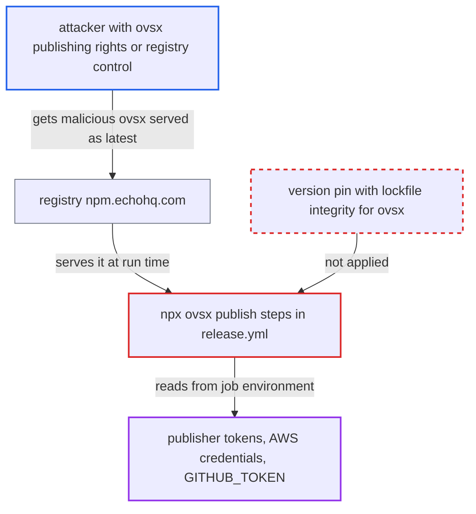

# Release job runs unpinned npx ovsx with marketplace, AWS and GitHub secrets in scope

| Field | Value |
|---|---|
| ID | `find_0147mpht5F8NZZcLHvR7PGGo` |
| Severity | **High** |
| Status | open |
| CWE | CWE-829 — Untrusted functionality inclusion |
| Created | 2026-10-22T14:01:20.799483Z |
| Claude Security | https://claude.ai/security/findings/find_0147mpht5F8NZZcLHvR7PGGo |

## Description

An attacker who can publish a malicious `ovsx` package, or who controls what the configured registry serves for it, can run code in the extension release job. That code can steal the marketplace tokens, the AWS credentials and the GitHub token. It runs on the next release with `publish: true`. The cause is `npx ovsx publish` in `.github/workflows/release.yml` (lines 545 and 556): `ovsx` is not pinned, so the latest version is fetched at run time.

1. **attacker** gets a malicious `ovsx` version published or served as `latest`. This needs a compromised npm publishing right for `ovsx`, or control over what the configured registry serves. It happens outside this project.
2. **maintainer** runs the routine release with `publish: true`. The two Open VSX publish steps call `npx ovsx publish <vsix> --pat ${OPEN_VSX_TOKEN}` from the repository root. ([`.github/workflows/release.yml:537-556`](https://github.com/cx-benchmark/ast-vscode-extension/blob/55c034d5a357f2ab653f140c773e5098456060c2/.github/workflows/release.yml#L537-L556))
3. **`npx`** finds no local `ovsx` and falls back to a fresh download. No manifest or `package-lock.json` declares `ovsx`, and `npm run ci:all` installs only the three packages, so nothing pins a version or an integrity hash. ([`package.json:1-45`](https://github.com/cx-benchmark/ast-vscode-extension/blob/55c034d5a357f2ab653f140c773e5098456060c2/package.json#L1-L45))
4. **`npx`** downloads `ovsx@latest` from `https://npm.echohq.com/` and runs its bin. The report assumes npm 10.x installs without a prompt in CI. `ignore-scripts=true` blocks install hooks but not the package's own bin. ([`.npmrc:1-16`](https://github.com/cx-benchmark/ast-vscode-extension/blob/55c034d5a357f2ab653f140c773e5098456060c2/.npmrc#L1-L16))
5. **the downloaded `ovsx` process** inherits every job-wide secret in the environment. These are `MARKET_TOKEN`, `OPEN_VSX_TOKEN`, the AWS session credentials and `GITHUB_TOKEN`, plus the OIDC request token. The step env adds `ECHO_LIBRARIES_ACCESS_KEY`. ([`.github/workflows/release.yml:488-502`](https://github.com/cx-benchmark/ast-vscode-extension/blob/55c034d5a357f2ab653f140c773e5098456060c2/.github/workflows/release.yml#L488-L502))
6. **attacker's code** takes the credentials and tampers with the release. It can exfiltrate the tokens, replace the `.vsix` it is asked to publish, and use the `GITHUB_TOKEN` that has `contents: write` and `pull-requests: write`. ([`.github/workflows/release.yml:93-101`](https://github.com/cx-benchmark/ast-vscode-extension/blob/55c034d5a357f2ab653f140c773e5098456060c2/.github/workflows/release.yml#L93-L101))

## Assessment

The attacker must be able to publish an `ovsx` version to npm, for example through a maintainer or token compromise, or control what the configured registry serves for `ovsx`. This happens outside the project, and nothing is needed on the project's side. A maintainer then runs the normal release with `publish: true`, and `npx ovsx` runs the attacker's code with no prompt. The report assumes npm 10.x (bundled with Node `22.11.0`) auto-confirms `npx` installs in CI. It cannot tell whether the Echo registry curates or delays upstream `ovsx` releases. If the `cx-public-ubuntu-x64` runner image ships a global `ovsx`, the image fixes the version, which the repository still does not pin.

Impact: The attacker gets code execution in the release job after the artifacts are built. It can read both marketplace publisher tokens, the AWS session credentials, the registry key and a repository write token, and it can replace the `.vsix` being published. Availability is affected only in a limited way, for example by deleting releases or tags.

Subsequent-system impact: With `MARKET_TOKEN` and `OPEN_VSX_TOKEN`, the attacker can publish arbitrary versions of the Checkmarx extensions. Those versions auto-update into users' IDEs. There they run with access to source code and the Checkmarx credentials the extension stores.

## Recommendation

(1) The Open VSX publish steps (`.github/workflows/release.yml:545`, `:556`) run `ovsx` resolved to `latest` at run time, because it is not a declared, lockfile-pinned dependency. The code that receives the publishing secrets is whatever the registry serves at that moment.

Fix criteria: The publishing tool is a dependency pinned to an exact version with lockfile integrity, or a vendored, checksum-verified artifact. The repository then fixes the code that runs during publish. No step in the release job runs `npx` (or `npm@latest`) on a package spec that the lockfile does not resolve.

(2) Publisher tokens, AWS credentials and the repository token are exposed to the whole job (`.github/workflows/release.yml:93-101`, `488-502`) instead of only to the step that needs each one. Any tool that runs in a publish step can therefore take all of them.

Fix criteria: Each publish step receives only its own token, set in that step's env. The AWS credentials and `GITHUB_TOKEN` are not in the environment of the marketplace publishing tools. Inspecting the environment that `npx ovsx` and `npx vsce` receive confirms this.

## Evidence

**https://github.com/cx-benchmark/ast-vscode-extension**

- [`.github/workflows/release.yml:537-556`](https://github.com/cx-benchmark/ast-vscode-extension/blob/55c034d5a357f2ab653f140c773e5098456060c2/.github/workflows/release.yml#L537-L556)
- [`package.json:1-45`](https://github.com/cx-benchmark/ast-vscode-extension/blob/55c034d5a357f2ab653f140c773e5098456060c2/package.json#L1-L45)
- [`.npmrc:1-16`](https://github.com/cx-benchmark/ast-vscode-extension/blob/55c034d5a357f2ab653f140c773e5098456060c2/.npmrc#L1-L16)
- [`.github/workflows/release.yml:488-502`](https://github.com/cx-benchmark/ast-vscode-extension/blob/55c034d5a357f2ab653f140c773e5098456060c2/.github/workflows/release.yml#L488-L502)
- [`.github/workflows/release.yml:93-101`](https://github.com/cx-benchmark/ast-vscode-extension/blob/55c034d5a357f2ab653f140c773e5098456060c2/.github/workflows/release.yml#L93-L101)
- [`packages/checkmarx/package-lock.json:993-997`](https://github.com/cx-benchmark/ast-vscode-extension/blob/55c034d5a357f2ab653f140c773e5098456060c2/packages/checkmarx/package-lock.json#L993-L997)

