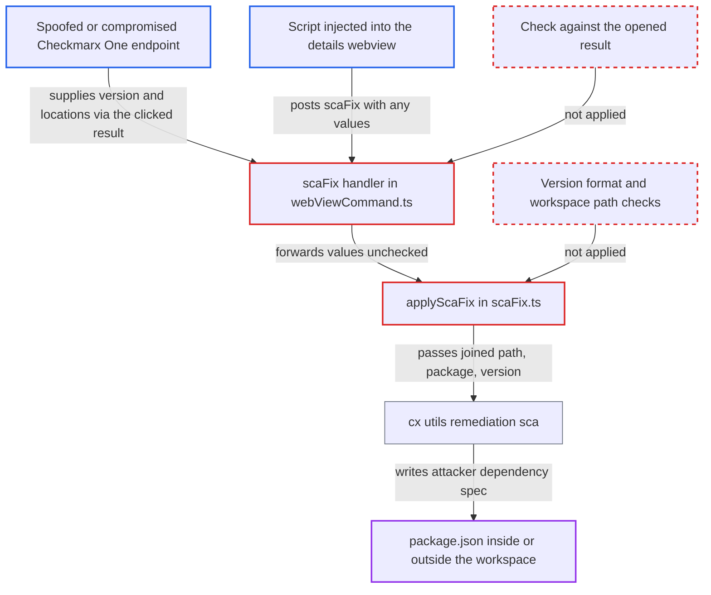

# SCA quick-fix writes untrusted manifest path and dependency spec into package.json

| Field | Value |
|---|---|
| ID | `find_011cMoXoYGbB2LFLWQrzyPtp` |
| Severity | **High** |
| Status | open |
| CWE | CWE-829 — Untrusted dependency inclusion |
| Created | 2026-10-22T14:04:26.037752Z |
| Claude Security | https://claude.ai/security/findings/find_011cMoXoYGbB2LFLWQrzyPtp |

## Description

A spoofed or compromised Checkmarx One server can make the SCA "Upgrade To Version" quick fix write an attacker-chosen dependency source into a `package.json`. It can also point the write at a file outside the workspace. The developer must click the fix. Nothing checks the version or the path in `applyScaFix` or in the CLI.

1. **Attacker-controlled Checkmarx One endpoint** returns an SCA result with a malicious version and optional path. `recommendedVersion` is something like `npm:attacker-pkg@1.0.0` for a dependency the project declares, and `locations` may hold `../../other/package.json`.
2. **the CLI function `updateDependencyPaths`** copies the server's `locations` into the result and marks the quick fix as available. It sets `SupportsQuickFix` whenever each location merely contains `package.json`, so `..` paths and absolute paths still qualify. ([`internal/commands/result.go:3142-3152`](https://github.com/cx-benchmark/ast-cli/blob/fd7806d4fa55005863ea1cb272ed9e9aadd49866/internal/commands/result.go#L3142-L3152))
3. **the renderer in `models/results.ts`** writes the server values into `data-version`, `data-package` and `data-file`. The values come from `scaNode.recommendedVersion`, `dependencyPaths[0][0].name` and the whole `locations` array, joined with commas. ([`packages/core/src/models/results.ts:960-1055`](https://github.com/cx-benchmark/ast-vscode-extension/blob/55c034d5a357f2ab653f140c773e5098456060c2/packages/core/src/models/results.ts#L960-L1055))
4. **the script `media/view.js`** posts a `scaFix` message when the developer clicks the upgrade control. It sends the dataset values unchanged. ([`packages/core/media/view.js:61-110`](https://github.com/cx-benchmark/ast-vscode-extension/blob/55c034d5a357f2ab653f140c773e5098456060c2/packages/core/media/view.js#L61-L110))
5. **the `scaFix` case in `webViewCommand.ts`** passes `data.package`, `data.file` and `data.version` from the message to `applyScaFix`. It ignores the `result` object it holds, so it cannot tell whether the values match that result. ([`packages/core/src/commands/webViewCommand.ts:281-283`](https://github.com/cx-benchmark/ast-vscode-extension/blob/55c034d5a357f2ab653f140c773e5098456060c2/packages/core/src/commands/webViewCommand.ts#L281-L283))
6. **the function `applyScaFix`** joins the file onto the workspace folder and calls `cx.scaRemediation`. It only checks that `packageFile` and `version` are non-empty. It does not check that the resolved path stays in the workspace or that `version` is a version. ([`packages/core/src/sca/scaFix.ts:14-25`](https://github.com/cx-benchmark/ast-vscode-extension/blob/55c034d5a357f2ab653f140c773e5098456060c2/packages/core/src/sca/scaFix.ts#L14-L25))
7. **the CLI command `cx utils remediation sca`** rewrites the manifest with the given string as the dependency value. The path check is only that the name contains `package.json`. The comma-split `--package-files` list lets later entries arrive as absolute paths, and `replace` stores `r.PackageVersion` as given. ([`internal/wrappers/remediation/package-remediation-npm.go:39-55`](https://github.com/cx-benchmark/ast-cli/blob/fd7806d4fa55005863ea1cb272ed9e9aadd49866/internal/wrappers/remediation/package-remediation-npm.go#L39-L55))
8. **the developer** runs the next routine `npm install`. npm fetches and runs the attacker's package, assuming npm's default handling of aliases, URL and git specs and install scripts.

## Assessment

The main attacker is a compromised or spoofed Checkmarx One endpoint. It returns an SCA result for a dependency the project declares, with a malicious `recommendedVersion` and optionally `locations` such as `../../other/package.json`. The developer must open the result and click "Upgrade To Version". The target file's path must contain `package.json`, and the file must declare the named package. A path outside the workspace can also arrive as a later comma-separated entry in `locations`, such as an absolute path, because `--package-files` splits on commas and only the first entry is joined to the workspace. The second way in is any script running in the details webview, which has `enableScripts: true` and no CSP. It can post the same `scaFix` message with arbitrary values and no click. The report ties this to a separate XSS candidate, `cand_01Vd1eGgFUX8fXsfdTmfdEPm`.

Impact: The attacker chooses where a dependency in a `package.json` comes from, inside the workspace or outside it. The next `npm install` then runs attacker code as the developer, assuming npm's default behaviour. The report rates this as full compromise of that account's data and host integrity.

## Recommendation

(1) `applyScaFix` and the CLI treat the recommended version as an opaque string and store it as the npm dependency spec. An alias, URL, git or file spec from the server or the webview therefore becomes code the package manager fetches and runs.

Fix criteria: Only a syntactically valid semver version can be written as the new dependency value. The extension rejects anything else before calling the CLI, and `cx utils remediation sca` rejects it again. Test: give a result whose `recommendedVersion` is `npm:x@1.0.0`, `https://h/x.tgz` or `file:../x`. The quick fix refuses it and `package.json` stays unchanged.

(2) The manifest path from the server's `locations` is joined with `path.join` without any containment check. Comma-joined locations reach the CLI's comma-splitting `--package-files`, and the CLI accepts any path containing `package.json`. The write can therefore land outside the workspace.

Fix criteria: Every manifest path the CLI receives, after comma splitting, normalisation and symlink resolution, lies inside the workspace folder that owns the result and has the literal basename `package.json`. Otherwise no file is read or written. Test: give `locations` of `../../other/package.json` and `["package.json","/abs/dir/package.json"]`. Neither causes a write outside the workspace.

(3) The `scaFix` handler trusts the package, file and version in the webview message. Any script in the details webview can therefore choose arbitrary values.

Fix criteria: The handler takes package, location and version from the `result` the panel was opened for, or rejects a message whose values differ from it. Test: a crafted `postMessage({command:'scaFix', …})` with values not in the result causes no CLI invocation.

## Evidence

**https://github.com/cx-benchmark/ast-vscode-extension**

- [`packages/core/src/sca/scaFix.ts:14-25`](https://github.com/cx-benchmark/ast-vscode-extension/blob/55c034d5a357f2ab653f140c773e5098456060c2/packages/core/src/sca/scaFix.ts#L14-L25)
- [`packages/core/src/commands/webViewCommand.ts:281-283`](https://github.com/cx-benchmark/ast-vscode-extension/blob/55c034d5a357f2ab653f140c773e5098456060c2/packages/core/src/commands/webViewCommand.ts#L281-L283)
- [`packages/core/src/models/results.ts:960-1055`](https://github.com/cx-benchmark/ast-vscode-extension/blob/55c034d5a357f2ab653f140c773e5098456060c2/packages/core/src/models/results.ts#L960-L1055)
- [`packages/core/media/view.js:61-110`](https://github.com/cx-benchmark/ast-vscode-extension/blob/55c034d5a357f2ab653f140c773e5098456060c2/packages/core/media/view.js#L61-L110)
- [`packages/core/src/cx/cx.ts:719-739`](https://github.com/cx-benchmark/ast-vscode-extension/blob/55c034d5a357f2ab653f140c773e5098456060c2/packages/core/src/cx/cx.ts#L719-L739)

**https://github.com/cx-benchmark/ast-cli**

- [`internal/commands/util/remediation.go:164-220`](https://github.com/cx-benchmark/ast-cli/blob/fd7806d4fa55005863ea1cb272ed9e9aadd49866/internal/commands/util/remediation.go#L164-L220)
- [`internal/wrappers/remediation/package-remediation-npm.go:39-55`](https://github.com/cx-benchmark/ast-cli/blob/fd7806d4fa55005863ea1cb272ed9e9aadd49866/internal/wrappers/remediation/package-remediation-npm.go#L39-L55)
- [`internal/commands/result.go:3142-3152`](https://github.com/cx-benchmark/ast-cli/blob/fd7806d4fa55005863ea1cb272ed9e9aadd49866/internal/commands/result.go#L3142-L3152)

