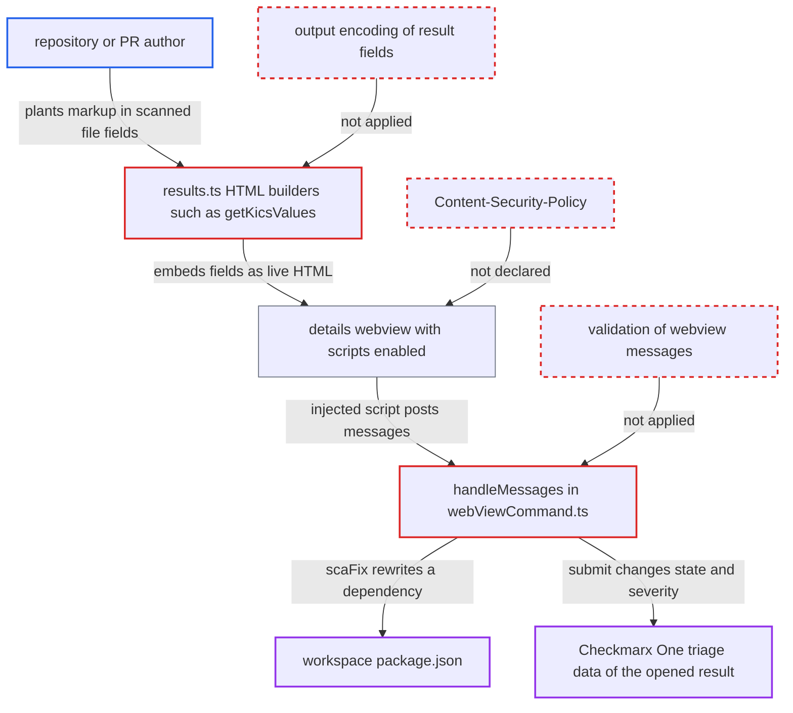

# Scan result fields concatenated unescaped into script-enabled, CSP-less result details webview (XSS)

| Field | Value |
|---|---|
| ID | `find_01P7Rq1tj1vdHanHZLdUHJsF` |
| Severity | **High** |
| Status | open |
| CWE | CWE-79 — Cross-site scripting |
| Created | 2026-10-22T14:03:08.397058Z |
| Claude Security | https://claude.ai/security/findings/find_01P7Rq1tj1vdHanHZLdUHJsF |

## Description

A person who writes a scanned repository or pull request can run script in a developer's VS Code details panel when the developer opens a scan result. That script can make the extension edit the workspace `package.json` and change triage state on Checkmarx One. The result fields are put into the panel's HTML without encoding, and the panel has no Content-Security-Policy.

1. **repository author** puts HTML markup in a file that the victim's tenant will scan. A KICS `value` repeats the offending IaC line word for word, so an `` tag in a Dockerfile `RUN` line becomes the result's `value`. SAST node names and file names also come from the repository. ([`packages/core/src/models/results.ts:353-371`](https://github.com/cx-benchmark/ast-vscode-extension/blob/55c034d5a357f2ab653f140c773e5098456060c2/packages/core/src/models/results.ts#L353-L371))
2. **CLI `exportJSONResults`** writes the result fields to `ast-results.json` without escaping. `decodeHTMLEntitiesInResults` first reverses the escaping that was applied to `description` and node names. KICS values, file names and SCA fields were never escaped. ([`internal/commands/result.go:1882-1894`](https://github.com/cx-benchmark/ast-cli/blob/fd7806d4fa55005863ea1cb272ed9e9aadd49866/internal/commands/result.go#L1882-L1894))
3. **extension** loads each result with `new AstResult(rawObj)` and shows it in the tree. No sanitising happens on this path, and selecting the result opens the details panel. ([`packages/core/src/views/resultsProviders.ts:155`](https://github.com/cx-benchmark/ast-vscode-extension/blob/55c034d5a357f2ab653f140c773e5098456060c2/packages/core/src/views/resultsProviders.ts#L155))
4. **`getKicsValues()`** concatenates `data.value` and `data.expectedValue` into the panel's HTML. Values are neither HTML-encoded nor attribute-encoded, so the attacker's tag stays a live tag. Other builders, such as `kicsDetails()`, `getSastDetails()` and `generalTab()`, do the same with other fields. ([`packages/core/src/models/results.ts:353-371`](https://github.com/cx-benchmark/ast-vscode-extension/blob/55c034d5a357f2ab653f140c773e5098456060c2/packages/core/src/models/results.ts#L353-L371))
5. **details webview in `astDetailsView.ts`** runs the injected markup as script. The panel is created with `enableScripts: true`, its document declares no Content-Security-Policy, and an inline script exposes `acquireVsCodeApi()` as the global `vscode`. The injected code can therefore call `vscode.postMessage`. ([`packages/core/src/views/resultsView/astDetailsView.ts:293-392`](https://github.com/cx-benchmark/ast-vscode-extension/blob/55c034d5a357f2ab653f140c773e5098456060c2/packages/core/src/views/resultsView/astDetailsView.ts#L293-L392))
6. **`handleMessages` in `webViewCommand.ts`** acts on the injected messages without validating them. `scaFix` passes `data.package`, `data.file` and `data.version` on. `references` passes `data.link` of any scheme to `openExternal`, `showFile` opens files, and `submit` calls `triageSubmit` with a state and severity chosen by the attacker. ([`packages/core/src/commands/webViewCommand.ts:234-283`](https://github.com/cx-benchmark/ast-vscode-extension/blob/55c034d5a357f2ab653f140c773e5098456060c2/packages/core/src/commands/webViewCommand.ts#L234-L283))
7. **`applyScaFix`** rewrites a dependency in the workspace `package.json` to the attacker's string. The webview-supplied file is joined onto the workspace root and the CLI sets the named dependency to the given version verbatim, for example `git+https://attacker/x.git`. ([`packages/core/src/sca/scaFix.ts:8-25`](https://github.com/cx-benchmark/ast-vscode-extension/blob/55c034d5a357f2ab653f140c773e5098456060c2/packages/core/src/sca/scaFix.ts#L8-L25))

## Assessment

The attacker writes repository or PR content that the victim's tenant scans. No account on the victim's side is needed. The developer then loads the scan in VS Code and clicks the result, which is a routine step. The fields that carry the payload include the KICS `value`, `expectedValue` and `filename`, the SAST `node.name` and `node.fileName`, `result.label`, `result.description`, SCA fields and secret-detection fields. Many of these are set by the repository author, while others are set by the server or tenant. A spoofed or compromised Checkmarx endpoint is a second way in, because it can supply any field.

Impact: Script runs in the details webview and can drive the extension's message handlers. It can rewrite a dependency in the developer's workspace `package.json`, so attacker code runs at the next `npm install`. It can open any URI with `openExternal` and open local files with `showFile`. It can also send the panel's DOM, including result data and masked-secret entries, over the network. The webview itself cannot read the filesystem or the stored tokens.

Subsequent-system impact: Through `submit`, the script makes the extension call `cx.triageUpdate` on Checkmarx One with the victim's credentials. It can set any state and severity on the displayed result, for example Not Exploitable. This is limited to the result that was opened.

## Recommendation

(1) `models/results.ts` and `utils/interface/details.ts` put untrusted result fields into the webview's HTML text and attributes without encoding them for where they land.

Fix criteria: Every result-derived value in HTML text is HTML-entity encoded. Every value in an attribute (`data-*`, `id`, `href`, `class`, `value`) is attribute-encoded, and `href` is limited to http(s). `descriptionHTML` passes an allow-list sanitiser. A result whose KICS `value`, file name, SAST node name and query name contain `">` renders that text literally and no script runs.

(2) The details webview document in `astDetailsView.ts` has no Content-Security-Policy, so any injected markup becomes script that can call `vscode.postMessage` and use the network.

Fix criteria: The document declares a CSP with `default-src 'none'`, `script-src 'nonce-…'` and resource sources limited to `webview.cspSource`. The inline `acquireVsCodeApi()` script is nonced or moved into `view.js`. An injected inline handler is blocked by the CSP.

(3) The handlers in `webViewCommand.ts` trust `data.link`, `data.file`, `data.package`, `data.version` and the triage fields that the webview sends, without checking them against the opened result.

Fix criteria: Each payload is checked against the result the panel was opened for. Only links in that result's references open, and only over http(s). Only that result's own package, manifest location and recommended version can reach `scaFix`, and the manifest resolves inside the workspace. A crafted `postMessage` with a `file:` link, a `../` path or a foreign version is rejected.

## Evidence

**https://github.com/cx-benchmark/ast-vscode-extension**

- [`packages/core/src/models/results.ts:353-371`](https://github.com/cx-benchmark/ast-vscode-extension/blob/55c034d5a357f2ab653f140c773e5098456060c2/packages/core/src/models/results.ts#L353-L371)
- [`packages/core/src/models/results.ts:325-405`](https://github.com/cx-benchmark/ast-vscode-extension/blob/55c034d5a357f2ab653f140c773e5098456060c2/packages/core/src/models/results.ts#L325-L405)
- [`packages/core/src/utils/interface/details.ts:134-140`](https://github.com/cx-benchmark/ast-vscode-extension/blob/55c034d5a357f2ab653f140c773e5098456060c2/packages/core/src/utils/interface/details.ts#L134-L140)
- [`packages/core/src/views/resultsView/astDetailsView.ts:293-392`](https://github.com/cx-benchmark/ast-vscode-extension/blob/55c034d5a357f2ab653f140c773e5098456060c2/packages/core/src/views/resultsView/astDetailsView.ts#L293-L392)
- [`packages/core/src/commands/webViewCommand.ts:234-283`](https://github.com/cx-benchmark/ast-vscode-extension/blob/55c034d5a357f2ab653f140c773e5098456060c2/packages/core/src/commands/webViewCommand.ts#L234-L283)
- [`packages/core/src/sca/scaFix.ts:8-25`](https://github.com/cx-benchmark/ast-vscode-extension/blob/55c034d5a357f2ab653f140c773e5098456060c2/packages/core/src/sca/scaFix.ts#L8-L25)
- [`packages/core/src/views/resultsProviders.ts:155`](https://github.com/cx-benchmark/ast-vscode-extension/blob/55c034d5a357f2ab653f140c773e5098456060c2/packages/core/src/views/resultsProviders.ts#L155)

**https://github.com/cx-benchmark/ast-cli**

- [`internal/commands/result.go:1882-1894`](https://github.com/cx-benchmark/ast-cli/blob/fd7806d4fa55005863ea1cb272ed9e9aadd49866/internal/commands/result.go#L1882-L1894)

