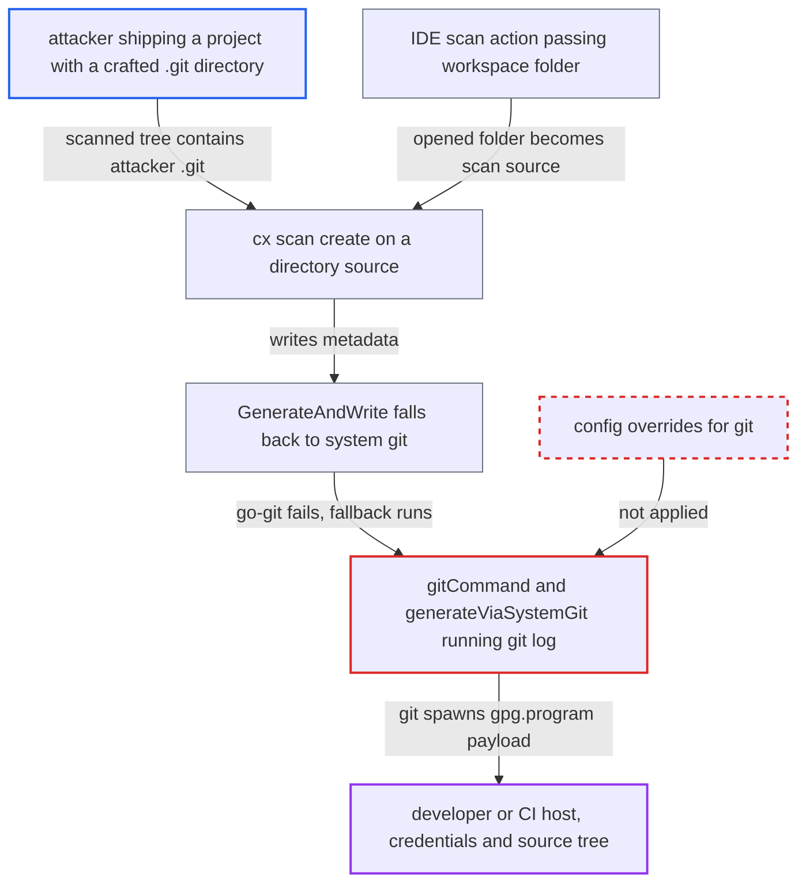

# System-git fallback runs git log in scanned repo, executing gpg.program from attacker .git/config

| Field | Value |
|---|---|
| ID | `find_01U8qH1oNjdf9zhXkAwdqrpX` |
| Severity | **High** |
| Status | open |
| CWE | CWE-829 — Untrusted functionality inclusion |
| Created | 2026-10-22T14:02:46.794747Z |
| Claude Security | https://claude.ai/security/findings/find_01U8qH1oNjdf9zhXkAwdqrpX |

## Description

An attacker who supplies a project containing its own `.git` directory can run a program of their choice on the machine of the developer or CI job that scans it with `cx scan create`. The program runs with that user's privileges. The cause is `gitCommand` in `internal/commands/gitmetadata.go`, which runs system `git` inside the scanned folder and trusts its `.git/config`.

1. **attacker** ships a project with a crafted `.git` directory. The config has `repositoryformatversion = 0` plus an `[extensions]` key such as `noop`, or a `shallow` file, along with `log.showSignature = true` and `gpg.program = ./payload`. HEAD carries a `gpgsig` header and an executable `payload` is in the tree.
2. **developer or CI job** runs `cx scan create -s <dir>` on the extracted project. For any non-SBOM directory source that is not a user-provided zip, the scan code calls `GenerateAndWrite` on that directory before zipping. The IDE reaches the same path by passing the opened workspace folder as the scan source. ([`internal/commands/scan.go:2350-2362`](https://github.com/cx-benchmark/ast-cli/blob/fd7806d4fa55005863ea1cb272ed9e9aadd49866/internal/commands/scan.go#L2350-L2362))
3. **`GenerateAndWrite`** falls back to system git when go-git fails. The `[extensions]` key triggers `does not support extension` and the shallow boundary triggers `object not found`, so the shipped `.git` directory decides when the fallback runs. ([`internal/commands/gitmetadata.go:53-79`](https://github.com/cx-benchmark/ast-cli/blob/fd7806d4fa55005863ea1cb272ed9e9aadd49866/internal/commands/gitmetadata.go#L53-L79))
4. **`gitCommand`** starts the system `git` binary in the scanned directory. The child process inherits the environment and gets no `-c` overrides or `GIT_CONFIG_*` settings, so the scanned repository's `.git/config` is trusted. ([`internal/commands/gitmetadata.go:255-265`](https://github.com/cx-benchmark/ast-cli/blob/fd7806d4fa55005863ea1cb272ed9e9aadd49866/internal/commands/gitmetadata.go#L255-L265))
5. **`generateViaSystemGit`** runs `git log`, which checks the commit signature. With `log.showSignature` on, git verifies the `gpgsig` header by spawning `gpg.program`, and the `--pretty=format:` output does not turn that check off. The attacker's `./payload` therefore runs. ([`internal/commands/gitmetadata.go:197-229`](https://github.com/cx-benchmark/ast-cli/blob/fd7806d4fa55005863ea1cb272ed9e9aadd49866/internal/commands/gitmetadata.go#L197-L229))

## Assessment

The attacker needs a scanned tree that contains an attacker-written `.git` directory, for example a third-party code drop, a release archive or an image layer that includes `.git`. A developer or CI job then scans it with `cx scan create -s <dir>`, or opens it as a folder in the IDE, which passes it to the same command. The host needs `git` on PATH. Two things limit it. With a plain `git clone`, `.git/config` is generated locally, so the attacker does not control it. User-provided zip sources skip this code. As an alternative to `gpg.program`, `gpg.format = ssh` with `gpg.ssh.program` also works.

Impact: The attacker gets arbitrary command execution on the developer or CI host, with the privileges of the user running `cx`. That includes reading the stored Checkmarx credentials and the source tree, and changing anything that user can write. The code puts no limit on the spawned program.

## Recommendation

The system `git` child process inherits the scanned repository's `.git/config` as trusted configuration, so repository content chooses which programs git executes. This breaks the property that scanned repositories never cause code execution.

Fix criteria: Either the system-git fallback is removed and a go-git failure is treated as 'no metadata', which the surrounding code already tolerates. Or git runs with repository and worktree configuration neutralised and reads only plumbing output. That means `GIT_CONFIG_NOSYSTEM=1` and explicit `-c` overrides for `log.showSignature=false`, `core.fsmonitor=`, `core.hooksPath=`, `gpg.program=` and the ssh/x509 variants, plus `core.pager=cat`. Test with a repository whose `.git/config` sets `log.showSignature`, `gpg.program` and `extensions.worktreeConfig`. `cx scan create -s <dir>` must complete without the configured program ever being spawned.

## Evidence

**https://github.com/cx-benchmark/ast-cli**

- [`internal/commands/gitmetadata.go:255-265`](https://github.com/cx-benchmark/ast-cli/blob/fd7806d4fa55005863ea1cb272ed9e9aadd49866/internal/commands/gitmetadata.go#L255-L265)
- [`internal/commands/gitmetadata.go:197-229`](https://github.com/cx-benchmark/ast-cli/blob/fd7806d4fa55005863ea1cb272ed9e9aadd49866/internal/commands/gitmetadata.go#L197-L229)
- [`internal/commands/gitmetadata.go:53-79`](https://github.com/cx-benchmark/ast-cli/blob/fd7806d4fa55005863ea1cb272ed9e9aadd49866/internal/commands/gitmetadata.go#L53-L79)
- [`internal/commands/scan.go:2350-2362`](https://github.com/cx-benchmark/ast-cli/blob/fd7806d4fa55005863ea1cb272ed9e9aadd49866/internal/commands/scan.go#L2350-L2362)
- [`internal/commands/gitmetadata.go:372-380`](https://github.com/cx-benchmark/ast-cli/blob/fd7806d4fa55005863ea1cb272ed9e9aadd49866/internal/commands/gitmetadata.go#L372-L380)

**https://github.com/cx-benchmark/ast-vscode-extension**

- [`packages/core/src/views/resultsView/createScanProvider.ts:65-71`](https://github.com/cx-benchmark/ast-vscode-extension/blob/55c034d5a357f2ab653f140c773e5098456060c2/packages/core/src/views/resultsView/createScanProvider.ts#L65-L71)

