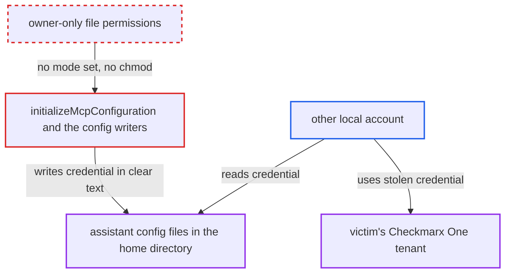

# Token Based MCP setup writes the Checkmarx One credential into other-readable AI assistant config files

| Field | Value |
|---|---|
| ID | `find_01EQg7kszdG78uqG4hCPSRT2` |
| Severity | **High** |
| Status | open |
| CWE | CWE-732 — Incorrect permission assignment |
| Created | 2026-10-22T14:04:56.617333Z |
| Claude Security | https://claude.ai/security/findings/find_01EQg7kszdG78uqG4hCPSRT2 |

## Description

Another local account on the same machine can read a user's Checkmarx One API key or OAuth refresh token from plain-text AI assistant config files. This needs the user to be logged in with MCP in Token Based mode, and a home directory that other accounts can enter. `initializeMcpConfiguration()` copies the credential out of SecretStorage and writes it with default file permissions.

1. **the user** logs in to the extension with MCP enabled for the tenant. After each successful login, `schedulePostAuth()` calls `initializeMcpConfiguration()`; the `Install MCP` command does the same. ([`packages/checkmarx/src/webview/authenticationWebview.ts:197-221`](https://github.com/cx-benchmark/ast-vscode-extension/blob/55c034d5a357f2ab653f140c773e5098456060c2/packages/checkmarx/src/webview/authenticationWebview.ts#L197-L221))
2. **`initializeMcpConfiguration()`** copies the stored credential into `headers.Authorization` of an MCP server entry. The value is the Checkmarx One API key or the OAuth refresh token, taken from SecretStorage and written verbatim, and the entry is passed to every resolved target. ([`packages/core/src/services/mcpSettingsInjector.ts:610-654`](https://github.com/cx-benchmark/ast-vscode-extension/blob/55c034d5a357f2ab653f140c773e5098456060c2/packages/core/src/services/mcpSettingsInjector.ts#L610-L654))
3. **`updateMcpJsonFile`, `writeToClaudeConfig` and `writeCodexTomlBlock`** write the entry to config files in the user's home directory with default permissions. `fs.mkdirSync` and `fs.writeFileSync` are called with no `mode` and nothing calls `chmod`, so new files get umask defaults (typically `0644`) and existing files keep their old mode. ([`packages/core/src/services/mcpSettingsInjector.ts:401-428`](https://github.com/cx-benchmark/ast-vscode-extension/blob/55c034d5a357f2ab653f140c773e5098456060c2/packages/core/src/services/mcpSettingsInjector.ts#L401-L428))
4. **another local account** reads a config file such as `~victim/.cursor/mcp.json` or `~victim/.codex/config.toml`. This works when the home directory lets other accounts in, and the attacker copies the `Authorization` value.
5. **another local account** uses the copied credential as the victim against Checkmarx One. The credential stays valid until it is revoked.

## Assessment

The attacker is another local account on the same machine. The victim must be logged in with MCP enabled for the tenant in Token Based mode. That mode is the only valid one in the Developer Assist extension, where it is the default. In the Checkmarx extension it is a selectable option, and the default is `OAuth`. The target file must belong to a tool the victim uses: Cursor, Windsurf, Kiro, or the Claude or Codex extension. Either the extension created the file with default permissions, or it was already readable by others. The home directory must also let other accounts in, which is the macOS default and true on several Linux distributions. Logging out removes Token Based entries, because `uninstallMcp(context, true)` keeps only OAuth-sourced entries. The credential stays exposed while the user is logged in. It stays exposed indefinitely if the extension is removed without logging out. The VS Code targets (user `settings.json` and `Code/User/mcp.json`) sit in VS Code's user-data directory, which is assumed to be private to the owner. The clearly exposed copies are the dot-directory files.

Impact: The attacker obtains the user's full Checkmarx One credential in clear text, the same one the extension otherwise keeps in SecretStorage. Reading the files changes nothing on the host.

Subsequent-system impact: The stolen API key or refresh token authenticates as the victim to their Checkmarx One tenant and its MCP server until it is revoked. The holder can read the projects, results and uploaded source the victim can read. The holder can also change triage and scans as the victim. All of this is limited to the victim's tenant roles.

## Recommendation

(1) `updateMcpJsonFile`, `writeToClaudeConfig` and `writeCodexTomlBlock` write files containing the credential, and create their parent directories, with default permissions. Other local accounts can therefore read the clear-text credential.

Fix criteria: Every file the extension writes that holds the credential is readable and writable only by its owner (POSIX `0600`). This includes a pre-existing file that had a looser mode. Directories the extension creates for these files are owner-only. To check, log in in Token Based mode with Cursor, Claude or Codex present. Then confirm that none of the generated files is group- or world-readable. These files include `~/.cursor/mcp.json`, `~/.claude.json`, `~/.claude/settings.json` and `~/.codex/config.toml`.

(2) The account's long-lived API key or refresh token is copied out of SecretStorage into several clear-text files. A leak of any one copy hands over the whole account credential.

Fix criteria: Where the assistant supports it, MCP is configured without embedding a credential (OAuth/DCR). Where a token has to be embedded, it is short-lived or limited to MCP, not the account API key or refresh token. To check, confirm that a copied `Authorization` value cannot be used against the general Checkmarx One APIs, or that it expires.

## Evidence

**https://github.com/cx-benchmark/ast-vscode-extension**

- [`packages/core/src/services/mcpSettingsInjector.ts:610-654`](https://github.com/cx-benchmark/ast-vscode-extension/blob/55c034d5a357f2ab653f140c773e5098456060c2/packages/core/src/services/mcpSettingsInjector.ts#L610-L654)
- [`packages/core/src/services/mcpSettingsInjector.ts:401-428`](https://github.com/cx-benchmark/ast-vscode-extension/blob/55c034d5a357f2ab653f140c773e5098456060c2/packages/core/src/services/mcpSettingsInjector.ts#L401-L428)
- [`packages/core/src/services/mcpSettingsInjector.ts:679-695`](https://github.com/cx-benchmark/ast-vscode-extension/blob/55c034d5a357f2ab653f140c773e5098456060c2/packages/core/src/services/mcpSettingsInjector.ts#L679-L695)
- [`packages/core/src/services/mcpSettingsInjector.ts:158-173`](https://github.com/cx-benchmark/ast-vscode-extension/blob/55c034d5a357f2ab653f140c773e5098456060c2/packages/core/src/services/mcpSettingsInjector.ts#L158-L173)
- [`packages/checkmarx/src/webview/authenticationWebview.ts:197-221`](https://github.com/cx-benchmark/ast-vscode-extension/blob/55c034d5a357f2ab653f140c773e5098456060c2/packages/checkmarx/src/webview/authenticationWebview.ts#L197-L221)
- [`packages/project-ignite/package.json:205-215`](https://github.com/cx-benchmark/ast-vscode-extension/blob/55c034d5a357f2ab653f140c773e5098456060c2/packages/project-ignite/package.json#L205-L215)

