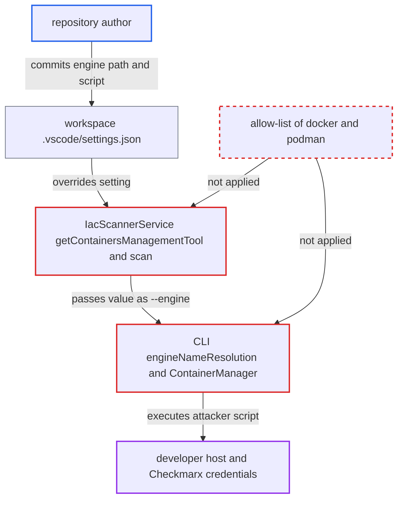

# Workspace setting selects IaC container engine executable; CLI executes it

| Field | Value |
|---|---|
| ID | `find_01BKfGfXxLR6RiRsVA7brALY` |
| Severity | **High** |
| Status | open |
| CWE | CWE-426 — Untrusted search path |
| Created | 2026-10-22T14:05:32.003443Z |
| Claude Security | https://claude.ai/security/findings/find_01BKfGfXxLR6RiRsVA7brALY |

## Description

A repository author can run any program they choose on a developer's machine, with that developer's privileges. This needs a developer who is signed in to Checkmarx, has trusted the cloned repository, and opens an IaC file in it. The extension passes the workspace-overridable setting `Containers Management Tool` unchecked to the CLI, and the CLI's `engineNameResolution` then runs it.

1. **repository author** commits a `.vscode/settings.json` and an executable script. The settings turn on `Activate IAC Realtime` and set `Containers Management Tool` to the script's path, such as `./.vscode/docker`. Both settings have no `scope`, so workspace values override the user's. ([`packages/checkmarx/package.json:1014-1030`](https://github.com/cx-benchmark/ast-vscode-extension/blob/55c034d5a357f2ab653f140c773e5098456060c2/packages/checkmarx/package.json#L1014-L1030))
2. **developer** opens a Dockerfile, `.tf` or `.yaml` file in the trusted clone. The extension scans IaC files automatically when they are opened or edited, so no further action is needed. ([`packages/core/src/realtimeScanners/scanners/iac/iacScannerService.ts:147-152`](https://github.com/cx-benchmark/ast-vscode-extension/blob/55c034d5a357f2ab653f140c773e5098456060c2/packages/core/src/realtimeScanners/scanners/iac/iacScannerService.ts#L147-L152))
3. **the method `getContainersManagementTool()`** reads the setting from the merged workspace configuration. The value is not checked against `docker` or `podman`. ([`packages/core/src/realtimeScanners/scanners/iac/iacScannerService.ts:100-106`](https://github.com/cx-benchmark/ast-vscode-extension/blob/55c034d5a357f2ab653f140c773e5098456060c2/packages/core/src/realtimeScanners/scanners/iac/iacScannerService.ts#L100-L106))
4. **the extension's `scan()`** passes the raw string to `cx.iacScanResults`, which runs `cx scan iac-realtime --engine <value>`. The attacker's path therefore becomes the `--engine` argument of the CLI. ([`packages/core/src/realtimeScanners/scanners/iac/iacScannerService.ts:147-152`](https://github.com/cx-benchmark/ast-vscode-extension/blob/55c034d5a357f2ab653f140c773e5098456060c2/packages/core/src/realtimeScanners/scanners/iac/iacScannerService.ts#L147-L152))
5. **the CLI function `engineNameResolution`** accepts the path as a valid engine. `exec.LookPath` returns any value containing a slash unchanged, as long as the file is executable. ([`internal/services/realtimeengine/iacrealtime/iac-realtime.go:153-157`](https://github.com/cx-benchmark/ast-cli/blob/fd7806d4fa55005863ea1cb272ed9e9aadd49866/internal/services/realtimeengine/iacrealtime/iac-realtime.go#L153-L157))
6. **the CLI method `ContainerManager.EnsureImageAvailable`** runs the resolved file with `exec.Command`. It runs `<engine> image inspect checkmarx/kics:...` right away. On failure it also runs `<engine> pull` and `<engine> info`. The attacker's script runs as the developer. ([`internal/services/realtimeengine/iacrealtime/container-manager.go:130-146`](https://github.com/cx-benchmark/ast-cli/blob/fd7806d4fa55005863ea1cb272ed9e9aadd49866/internal/services/realtimeengine/iacrealtime/container-manager.go#L130-L146))

## Assessment

The attacker writes a repository that a developer clones, trusts in VS Code and opens with the Checkmarx extension signed in. The repository holds the `.vscode/settings.json` described above, an executable script (git keeps the executable bit) and any IaC file. The extension does not declare `untrustedWorkspaces` support, so once the folder is trusted nothing else protects the developer. A relative path works only if the CLI inherits the workspace as its working directory, for example when VS Code is started with `code .`. An absolute path such as `/workspaces/<repo>/.vscode/docker` works when the clone location is predictable, as in dev containers. The legacy `kics-realtime` path in `kicsRealtimeProvider.ts` passes an empty engine and is not affected. The sibling `containers` scanner has no engine setting.

Impact: The attacker runs arbitrary native code on the developer's machine with the developer's privileges. That gives full control over the host and the credentials the extension stores.

Subsequent-system impact: The script runs in the same user context as the `cx` CLI, which reads the Checkmarx One API key and tokens from its config and secret storage. The attacker can steal these and use them against the Checkmarx One tenant.

## Recommendation

(1) The extension forwards a free-form string, which workspace files can override, as the program the CLI will run. Repository data should never choose what gets executed.

Fix criteria: The extension passes only `docker` or `podman` to the CLI. Any other value is rejected or replaced by the default. The setting is marked `restricted` or machine-scoped so workspace files cannot set it. To check, put `"Containers Management Tool": "./x"` in a workspace `.vscode/settings.json` and confirm the CLI is invoked with `--engine docker`.

(2) The CLI's `--engine` handling accepts any path and executes it. The side that performs the `exec` has no defence of its own.

Fix criteria: `engineNameResolution` accepts only the known names `docker` and `podman`. It resolves them through PATH or the fixed fallback directories and never uses a caller-supplied path. Running `cx scan iac-realtime --engine ./script` fails without executing `./script`.

## Evidence

**https://github.com/cx-benchmark/ast-vscode-extension**

- [`packages/core/src/realtimeScanners/scanners/iac/iacScannerService.ts:100-106`](https://github.com/cx-benchmark/ast-vscode-extension/blob/55c034d5a357f2ab653f140c773e5098456060c2/packages/core/src/realtimeScanners/scanners/iac/iacScannerService.ts#L100-L106)
- [`packages/core/src/realtimeScanners/scanners/iac/iacScannerService.ts:147-152`](https://github.com/cx-benchmark/ast-vscode-extension/blob/55c034d5a357f2ab653f140c773e5098456060c2/packages/core/src/realtimeScanners/scanners/iac/iacScannerService.ts#L147-L152)
- [`packages/checkmarx/package.json:1014-1030`](https://github.com/cx-benchmark/ast-vscode-extension/blob/55c034d5a357f2ab653f140c773e5098456060c2/packages/checkmarx/package.json#L1014-L1030)

**https://github.com/cx-benchmark/ast-cli**

- [`internal/services/realtimeengine/iacrealtime/iac-realtime.go:153-157`](https://github.com/cx-benchmark/ast-cli/blob/fd7806d4fa55005863ea1cb272ed9e9aadd49866/internal/services/realtimeengine/iacrealtime/iac-realtime.go#L153-L157)
- [`internal/services/realtimeengine/iacrealtime/container-manager.go:130-146`](https://github.com/cx-benchmark/ast-cli/blob/fd7806d4fa55005863ea1cb272ed9e9aadd49866/internal/services/realtimeengine/iacrealtime/container-manager.go#L130-L146)

