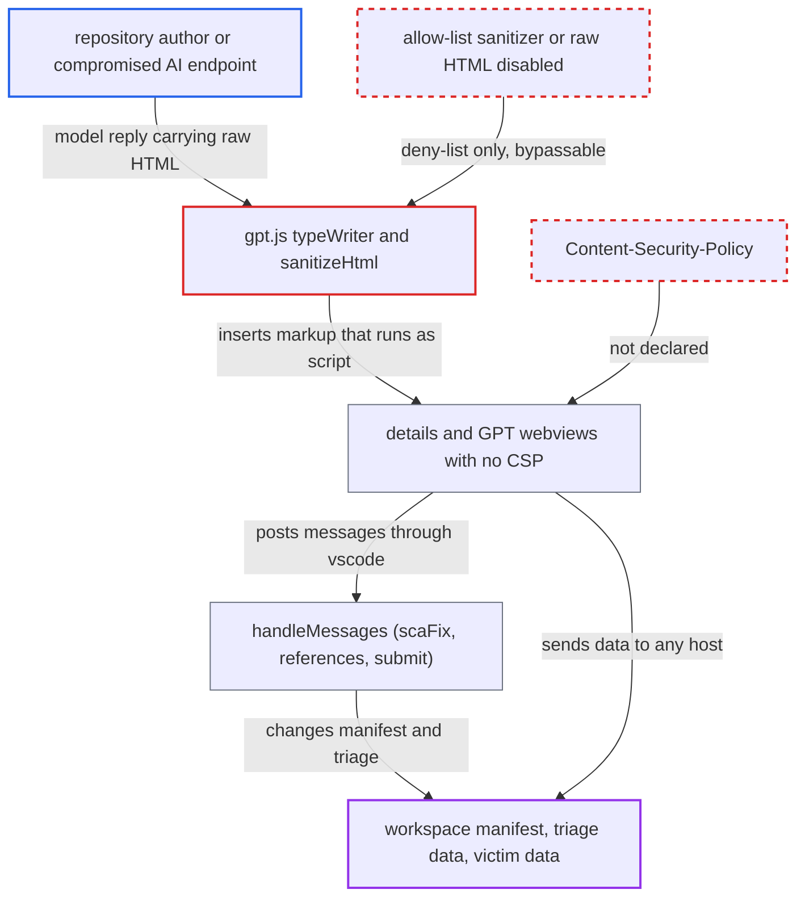

# AI chat replies rendered as HTML through bypassable deny-list sanitizer in CSP-less webviews

| Field | Value |
|---|---|
| ID | `find_01Fyq1kDYAQA8jdn2NZd5hAZ` |
| Severity | **Medium** |
| Status | open |
| CWE | CWE-79 — Cross-site scripting |
| Created | 2026-10-22T14:06:48.431564Z |
| Claude Security | https://claude.ai/security/findings/find_01Fyq1kDYAQA8jdn2NZd5hAZ |

## Description

An attacker can run script in the VS Code webview that shows the AI Security Champion chat. They can do it by getting the AI to reply with raw HTML, either through a planted file in a repository the victim scans or through a compromised AI or Checkmarx endpoint. The script can change triage state, rewrite a manifest dependency and send data to any host. The cause is `gpt.js`, which renders replies through `marked.parse` and a weak deny-list `sanitizeHtml`. Neither webview has a Content-Security-Policy.

1. **repository author** plants instructions in a KICS- or SAST-flagged file. The file tells the model to answer with raw HTML such as an `<iframe srcdoc>` that holds a script calling `parent.eval(...)`. ([`internal/commands/chat-kics.go:26-32`](https://github.com/cx-benchmark/ast-cli/blob/fd7806d4fa55005863ea1cb272ed9e9aadd49866/internal/commands/chat-kics.go#L26-L32))
2. **victim developer** opens the result's AI tab and clicks a suggested question. `cx chat kics` or `cx chat sast` puts the scanned file into the prompt unchanged, and the CLI returns the model's reply unmodified. ([`internal/commands/chat-kics.go:26-32`](https://github.com/cx-benchmark/ast-cli/blob/fd7806d4fa55005863ea1cb272ed9e9aadd49866/internal/commands/chat-kics.go#L26-L32))
3. **the handler in `webViewCommand.ts`** posts the reply, or `e.message` on failure, to the webview as `response`. The standalone GPT panel in `gpt.ts` posts the same unfiltered reply. ([`packages/core/src/commands/webViewCommand.ts:443-481`](https://github.com/cx-benchmark/ast-vscode-extension/blob/55c034d5a357f2ab653f140c773e5098456060c2/packages/core/src/commands/webViewCommand.ts#L443-L481))
4. **`typeWriter()` in `gpt.js`** parses the reply with `marked.parse` and appends it with `innerHTML +=`. `marked` is set with `sanitize: false`, so raw HTML passes through to `sanitizeHtml`. ([`packages/core/media/gpt.js:111-115`](https://github.com/cx-benchmark/ast-vscode-extension/blob/55c034d5a357f2ab653f140c773e5098456060c2/packages/core/media/gpt.js#L111-L115))
5. **`sanitizeHtml` in `gpt.js`** lets the payload through. It removes only `<script>` elements, `on*` attributes and `javascript:` in `href`/`src`. It keeps `<iframe srcdoc>` and `<style>`. A `<form>` with `<input name="attributes">` clobbers `element.attributes`, so that form's `onanimationstart` handler survives. ([`packages/core/media/gpt.js:14-48`](https://github.com/cx-benchmark/ast-vscode-extension/blob/55c034d5a357f2ab653f140c773e5098456060c2/packages/core/media/gpt.js#L14-L48))
6. **injected script** runs in the webview, which declares no Content-Security-Policy. The same-origin frame calls `parent.eval(...)` and reaches the global `vscode` binding. It can also contact any host. ([`packages/core/src/views/resultsView/astDetailsView.ts:293-390`](https://github.com/cx-benchmark/ast-vscode-extension/blob/55c034d5a357f2ab653f140c773e5098456060c2/packages/core/src/views/resultsView/astDetailsView.ts#L293-L390))
7. **injected script** sends messages to `handleMessages` in the details panel. `handleMessages` does not validate them. `scaFix` rewrites a manifest dependency, `references` opens any URI with `openExternal`, and `submit` changes triage. ([`packages/core/src/commands/webViewCommand.ts:234-283`](https://github.com/cx-benchmark/ast-vscode-extension/blob/55c034d5a357f2ab653f140c773e5098456060c2/packages/core/src/commands/webViewCommand.ts#L234-L283))

## Assessment

The attacker is either a repository author or whoever controls the AI or Checkmarx endpoint. The repository author needs no access to the victim. They only need the victim to scan a repository that contains a flagged file. The file's content steers the model through prompt injection. The victim must open the result's AI tab and click a suggested question. The attack depends on the model complying and on AI being enabled for the tenant. A compromised AI or Checkmarx endpoint can return the HTML directly. The error path (`e.message`) reaches the same sink. In the standalone GPT panel the script can use only the chat commands.

Impact: The attacker's script runs in the webview with the page's `vscode` handle. In the details panel it can set a workspace `package.json` dependency to an attacker URL, which runs the attacker's code at the next install. It can also open any URI and file, and send the chat, the result data and the Masked Secrets list to any host. The webview cannot read local files or stored tokens directly.

Subsequent-system impact: Through `submit`, the extension calls the Checkmarx One triage API with the victim's credentials. The attacker can set any state or severity on the opened result, for example Not Exploitable. This changes tenant triage data, but only for that result.

## Recommendation

(1) `gpt.js` renders model output as HTML. `marked` runs with raw HTML enabled, and the deny-list `sanitizeHtml` misses `srcdoc`, `<style>`, `<object>`, `formaction` and clobbered `attributes`.

Fix criteria: Model output is rendered with raw HTML disabled, or through a maintained allow-list sanitizer that works on a DOM tree and cannot be clobbered. That sanitizer forbids `iframe`, `object`, `embed`, `form`, `style`, `base` and `meta`, and allows only http(s) links. Replies containing `<iframe srcdoc="<script>…">`, a clobbered `<form onanimationstart>` with `<style>@keyframes`, and `<object data>` render inert.

(2) The documents built in `astDetailsView.ts` and `gptView.ts` declare no Content-Security-Policy. Any sanitizer gap therefore becomes script execution with network access and the global `vscode` handle.

Fix criteria: Both documents declare a CSP with `default-src 'none'`, a nonce-only `script-src` and resources limited to `webview.cspSource`. They have no `frame-src` or `connect-src` to other hosts. The inline `acquireVsCodeApi()` script carries the nonce. An injected inline handler and the script of an `<iframe srcdoc>` are blocked.

## Evidence

**https://github.com/cx-benchmark/ast-vscode-extension**

- [`packages/core/media/gpt.js:14-48`](https://github.com/cx-benchmark/ast-vscode-extension/blob/55c034d5a357f2ab653f140c773e5098456060c2/packages/core/media/gpt.js#L14-L48)
- [`packages/core/media/gpt.js:111-115`](https://github.com/cx-benchmark/ast-vscode-extension/blob/55c034d5a357f2ab653f140c773e5098456060c2/packages/core/media/gpt.js#L111-L115)
- [`packages/core/media/gpt.js:51-63`](https://github.com/cx-benchmark/ast-vscode-extension/blob/55c034d5a357f2ab653f140c773e5098456060c2/packages/core/media/gpt.js#L51-L63)
- [`packages/core/src/commands/webViewCommand.ts:443-481`](https://github.com/cx-benchmark/ast-vscode-extension/blob/55c034d5a357f2ab653f140c773e5098456060c2/packages/core/src/commands/webViewCommand.ts#L443-L481)
- [`packages/core/src/gpt/gpt.ts:48-69`](https://github.com/cx-benchmark/ast-vscode-extension/blob/55c034d5a357f2ab653f140c773e5098456060c2/packages/core/src/gpt/gpt.ts#L48-L69)
- [`packages/core/src/views/resultsView/astDetailsView.ts:293-390`](https://github.com/cx-benchmark/ast-vscode-extension/blob/55c034d5a357f2ab653f140c773e5098456060c2/packages/core/src/views/resultsView/astDetailsView.ts#L293-L390)
- [`packages/core/src/views/gptView/gptView.ts:125-146`](https://github.com/cx-benchmark/ast-vscode-extension/blob/55c034d5a357f2ab653f140c773e5098456060c2/packages/core/src/views/gptView/gptView.ts#L125-L146)
- [`packages/core/src/commands/webViewCommand.ts:234-283`](https://github.com/cx-benchmark/ast-vscode-extension/blob/55c034d5a357f2ab653f140c773e5098456060c2/packages/core/src/commands/webViewCommand.ts#L234-L283)

**https://github.com/cx-benchmark/ast-cli**

- [`internal/commands/chat-kics.go:26-32`](https://github.com/cx-benchmark/ast-cli/blob/fd7806d4fa55005863ea1cb272ed9e9aadd49866/internal/commands/chat-kics.go#L26-L32)

