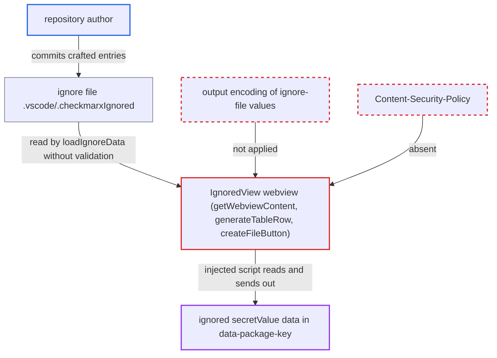

# Ignored Vulnerabilities webview renders repo ignore-file contents as unescaped HTML/JS

| Field | Value |
|---|---|
| ID | `find_01UoStCF3g9CN16nNF7kAD6Z` |
| Severity | **Medium** |
| Status | open |
| CWE | CWE-79 — Cross-site scripting |
| Created | 2026-10-22T13:58:47.638016Z |
| Claude Security | https://claude.ai/security/findings/find_01UoStCF3g9CN16nNF7kAD6Z |

## Description

A malicious repository can run its own JavaScript inside the Checkmarx extension's Ignored Vulnerabilities panel. The script can read secrets the victim ignored in that workspace and send them out. It needs the victim to open the repository, trust the workspace and open the panel. The cause is that `IgnoredView` builds its HTML from unvalidated ignore-file values with no encoding and no Content-Security-Policy.

1. **the attacker** publishes a repository containing a crafted ignore file. The file is `.vscode/.checkmarxIgnored` (or `.checkmarxDevAssistIgnored`), and an entry key such as `` carries the script.
2. **the victim** clones the repository, trusts the workspace and opens Ignored Vulnerabilities. The panel opens from the status-bar count, the Assist view or the command, and the extension declares no untrusted-workspace support.
3. **`IgnoreFileManager.loadIgnoreData`** parses the ignore file with `JSON.parse`. It does no schema or value validation, so the repository controls every key and field that is rendered. ([`packages/core/src/realtimeScanners/common/ignoreFileManager.ts:342-355`](https://github.com/cx-benchmark/ast-vscode-extension/blob/55c034d5a357f2ab653f140c773e5098456060c2/packages/core/src/realtimeScanners/common/ignoreFileManager.ts#L342-L355))
4. **`generateTableRow`** writes the entry key and `severity` into the page unencoded. For a `type` with no formatter, `displayName` is the raw key and is placed inside `
`; `severity` goes into an `alt` attribute. ([`packages/core/src/views/ignoredView/ignoredView.ts:416-433`](https://github.com/cx-benchmark/ast-vscode-extension/blob/55c034d5a357f2ab653f140c773e5098456060c2/packages/core/src/views/ignoredView/ignoredView.ts#L416-L433))
5. **`createFileButton`** writes `files[].path` and `line` into HTML text and an inline `onclick` handler. The path lands in a single-quoted string in `openFile('…', line)` and `line` is added unquoted, so a path can break out of the string. ([`packages/core/src/views/ignoredView/ignoredViewUtils.ts:381-403`](https://github.com/cx-benchmark/ast-vscode-extension/blob/55c034d5a357f2ab653f140c773e5098456060c2/packages/core/src/views/ignoredView/ignoredViewUtils.ts#L381-L403))
6. **the webview built by `getWebviewContent`** runs the injected markup as script. The panel has `enableScripts: true` and no Content-Security-Policy, and the page already depends on inline handlers. ([`packages/core/src/views/ignoredView/ignoredView.ts:270-346`](https://github.com/cx-benchmark/ast-vscode-extension/blob/55c034d5a357f2ab653f140c773e5098456060c2/packages/core/src/views/ignoredView/ignoredView.ts#L270-L346))
7. **the injected script** reads page data and sends it out. The base64 `data-package-key` values hold the full `secretValue` of every secret the victim ignored, and the script can send them out with `fetch`. ([`packages/core/src/realtimeScanners/common/ignoreFileManager.ts:530-545`](https://github.com/cx-benchmark/ast-vscode-extension/blob/55c034d5a357f2ab653f140c773e5098456060c2/packages/core/src/realtimeScanners/common/ignoreFileManager.ts#L530-L545))

## Assessment

The attacker only needs to get the victim to open a repository they control. The victim is an authenticated Checkmarx user with Assist or standalone enabled. They must trust the workspace and open Ignored Vulnerabilities. A payload in the entry key runs as soon as the panel renders. A payload in `path` runs on render (HTML text) or when the file button is clicked (`onclick`). A second route needs no committed ignore file. On POSIX systems, a repository file whose name contains markup is written into `files[].path` by `normalizePath` when the user ignores a finding in that file. The report names no network path; the code reads a local workspace file.

Impact: The attacker's script runs in the extension's webview with its message bridge. It can read the page, including the full `secretValue` of secrets the victim ignored in this workspace, and send it out. It can also post `openFile`, `revive` and `reviveMultiple` messages, load remote script and draw a fake Checkmarx UI to phish credentials. The report finds no file write, shell or command-URI route, and `localResourceRoots` blocks local file reads, so the impact is partial.

## Recommendation

(1) Strings from the ignore file (entry key, `severity`, `files[].path`, `files[].line`) are placed into HTML text, attributes and an inline JavaScript handler without encoding. Repository-authored data therefore becomes executable markup in a scriptable webview.

Fix criteria: No ignore-file value reaches the page as raw HTML or inside an inline handler. Text and attributes are entity-encoded, or set with `textContent` or `setAttribute` from the webview script. File buttons carry their path in an encoded data attribute read by `ignoredView.js`. `line` is coerced to an integer. Test: an entry whose key is `` and whose path is `x');alert(1);//` renders as literal text, and no script runs on render or on click.

(2) The webview is script-enabled, has no Content-Security-Policy, and uses inline `onclick` and `onchange` handlers, so any injected markup runs.

Fix criteria: The document sets a CSP such as `default-src 'none'; script-src 'nonce-…'; style-src/img-src ${webview.cspSource}`. All behaviour is attached with `addEventListener` in `ignoredView.js`, and no inline handlers remain. Test: an injected inline `<script>` or `onerror` attribute is blocked by the CSP.

## Evidence

**https://github.com/cx-benchmark/ast-vscode-extension**

- [`packages/core/src/views/ignoredView/ignoredView.ts:416-433`](https://github.com/cx-benchmark/ast-vscode-extension/blob/55c034d5a357f2ab653f140c773e5098456060c2/packages/core/src/views/ignoredView/ignoredView.ts#L416-L433)
- [`packages/core/src/views/ignoredView/ignoredViewUtils.ts:381-403`](https://github.com/cx-benchmark/ast-vscode-extension/blob/55c034d5a357f2ab653f140c773e5098456060c2/packages/core/src/views/ignoredView/ignoredViewUtils.ts#L381-L403)
- [`packages/core/src/views/ignoredView/ignoredView.ts:270-346`](https://github.com/cx-benchmark/ast-vscode-extension/blob/55c034d5a357f2ab653f140c773e5098456060c2/packages/core/src/views/ignoredView/ignoredView.ts#L270-L346)
- [`packages/core/src/realtimeScanners/common/ignoreFileManager.ts:342-355`](https://github.com/cx-benchmark/ast-vscode-extension/blob/55c034d5a357f2ab653f140c773e5098456060c2/packages/core/src/realtimeScanners/common/ignoreFileManager.ts#L342-L355)
- [`packages/core/src/realtimeScanners/common/ignoreFileManager.ts:530-545`](https://github.com/cx-benchmark/ast-vscode-extension/blob/55c034d5a357f2ab653f140c773e5098456060c2/packages/core/src/realtimeScanners/common/ignoreFileManager.ts#L530-L545)

