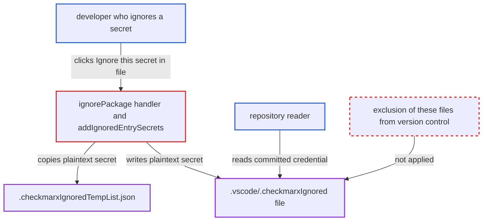

# Ignoring a detected secret stores its plaintext value in workspace .vscode ignore files

| Field | Value |
|---|---|
| ID | `find_01NNMX2nckq48oJ7EgbqjDAw` |
| Severity | **Medium** |
| Status | open |
| CWE | CWE-313 — Cleartext storage |
| Created | 2026-10-22T14:07:48.894847Z |
| Claude Security | https://claude.ai/security/findings/find_01NNMX2nckq48oJ7EgbqjDAw |

## Description

A person who can read a repository can learn a real credential that the developer had deliberately kept out of it. This happens when a developer clicks "Ignore this secret in file" and later commits or shares `.vscode/`. `addIgnoredEntrySecrets` writes the plaintext secret into the `.vscode` ignore files, and nothing keeps those files out of version control.

1. **the CLI realtime scanner** returns the detected secret with its real value. `convertSecretToResult` sets `SecretValue: secret.Value`, the unmasked 2ms match. The report assumes `github.com/checkmarx/2ms/v3` v3.21.0 fills it with the unredacted match. ([`internal/services/realtimeengine/secretsrealtime/secrets-realtime.go:177-194`](https://github.com/cx-benchmark/ast-cli/blob/fd7806d4fa55005863ea1cb272ed9e9aadd49866/internal/services/realtimeengine/secretsrealtime/secrets-realtime.go#L177-L194))
2. **the developer** clicks "Ignore this secret in file" on the finding. The `ignorePackage` handler passes `item.secretValue` to `addIgnoredEntrySecrets`. ([`packages/core/src/commands/openAIChatCommand.ts:595-604`](https://github.com/cx-benchmark/ast-vscode-extension/blob/55c034d5a357f2ab653f140c773e5098456060c2/packages/core/src/commands/openAIChatCommand.ts#L595-L604))
3. **`addIgnoredEntrySecrets`** builds the ignore entry from the raw secret and saves it. The key is `${title}:${secretValue}:${relativePath}` and `secretValue` is also stored as a field, so `saveIgnoreFile()` writes the credential to the ignore file twice. ([`packages/core/src/realtimeScanners/common/ignoreFileManager.ts:530-575`](https://github.com/cx-benchmark/ast-vscode-extension/blob/55c034d5a357f2ab653f140c773e5098456060c2/packages/core/src/realtimeScanners/common/ignoreFileManager.ts#L530-L575))
4. **`updateTempList`** copies the secret into the temp list file. It writes `{Title, SecretValue: entry.secretValue}` to `.checkmarxIgnoredTempList.json` with `fs.writeFileSync`. ([`packages/core/src/realtimeScanners/common/ignoreFileManager.ts:745-819`](https://github.com/cx-benchmark/ast-vscode-extension/blob/55c034d5a357f2ab653f140c773e5098456060c2/packages/core/src/realtimeScanners/common/ignoreFileManager.ts#L745-L819))
5. **the extension** leaves the files in `<workspace>/.vscode/` with default permissions and no VCS exclusion. The files are written with no mode. Nothing adds them to `.gitignore` or warns the user that the secret itself is stored. ([`packages/core/src/realtimeScanners/common/ignoreFileManager.ts:351-361`](https://github.com/cx-benchmark/ast-vscode-extension/blob/55c034d5a357f2ab653f140c773e5098456060c2/packages/core/src/realtimeScanners/common/ignoreFileManager.ts#L351-L361))
6. **a repository reader** reads the credential from the committed ignore files. This works only if the developer later commits or shares `.vscode/` and the repository does not exclude these files. No exploit code is needed.

## Assessment

A developer opens a file that is kept out of version control, such as a gitignored `.env`. The realtime scanner flags a real credential, and the developer clicks "Ignore this secret in file". The secret leaves the machine only if the developer later commits or shares `.vscode/` and the repository does not exclude these files. After that, anyone who can read the repository can see the credential. That means collaborators, or anyone at all if the repository is public. For a secret in a file that is already tracked, the copy adds nothing new. The `Scan` upload is not affected, because the CLI excludes `.vscode` by default.

Impact: The developer's workspace gets a durable cleartext copy of the credential in the JSON key and in a field. The copy sits in `.vscode/` in files whose names do not suggest they hold secrets. If those files reach a repository, its readers learn a secret that was meant to stay out of it.

Subsequent-system impact: The disclosed value is a credential for another service, such as cloud, SaaS or a database. With `WithValidation: true` it may be one that 2ms confirmed as live. Whoever reads it can access whatever that credential grants. The report does not say what scope the credential has.

## Recommendation

(1) The secrets ignore entry uses the raw secret as its identity and payload, and the CLI's ignore matching requires that plaintext. A suppression record therefore becomes a cleartext copy of the credential.

Fix criteria: No ignore file or temp list contains the secret value. A suppressed secret is identified by a one-way digest of rule and value, or by rule, path and location. The CLI's `--ignored-file-path` matching accepts that form. To verify, ignore a detected secret and grep `.vscode/.checkmarxIgnored*` for the value, which must not appear. The finding must also stay suppressed on rescan.

(2) Suppression state is kept inside the workspace's `.vscode/` folder, which is often committed, and nothing keeps it out of version control.

Fix criteria: Suppression data derived from secrets is either kept outside the repository, for example in extension storage, or provably excluded from version control. To verify, a fresh clone of a repository whose `.vscode/` was committed after ignoring a secret must contain no secret-derived data.

## Evidence

**https://github.com/cx-benchmark/ast-vscode-extension**

- [`packages/core/src/realtimeScanners/common/ignoreFileManager.ts:530-575`](https://github.com/cx-benchmark/ast-vscode-extension/blob/55c034d5a357f2ab653f140c773e5098456060c2/packages/core/src/realtimeScanners/common/ignoreFileManager.ts#L530-L575)
- [`packages/core/src/realtimeScanners/common/ignoreFileManager.ts:745-819`](https://github.com/cx-benchmark/ast-vscode-extension/blob/55c034d5a357f2ab653f140c773e5098456060c2/packages/core/src/realtimeScanners/common/ignoreFileManager.ts#L745-L819)
- [`packages/core/src/realtimeScanners/common/ignoreFileManager.ts:351-361`](https://github.com/cx-benchmark/ast-vscode-extension/blob/55c034d5a357f2ab653f140c773e5098456060c2/packages/core/src/realtimeScanners/common/ignoreFileManager.ts#L351-L361)
- [`packages/core/src/commands/openAIChatCommand.ts:595-604`](https://github.com/cx-benchmark/ast-vscode-extension/blob/55c034d5a357f2ab653f140c773e5098456060c2/packages/core/src/commands/openAIChatCommand.ts#L595-L604)

**https://github.com/cx-benchmark/ast-cli**

- [`internal/services/realtimeengine/secretsrealtime/secrets-realtime.go:177-194`](https://github.com/cx-benchmark/ast-cli/blob/fd7806d4fa55005863ea1cb272ed9e9aadd49866/internal/services/realtimeengine/secretsrealtime/secrets-realtime.go#L177-L194)
- [`internal/services/realtimeengine/secretsrealtime/secrets-realtime.go:45-63`](https://github.com/cx-benchmark/ast-cli/blob/fd7806d4fa55005863ea1cb272ed9e9aadd49866/internal/services/realtimeengine/secretsrealtime/secrets-realtime.go#L45-L63)

