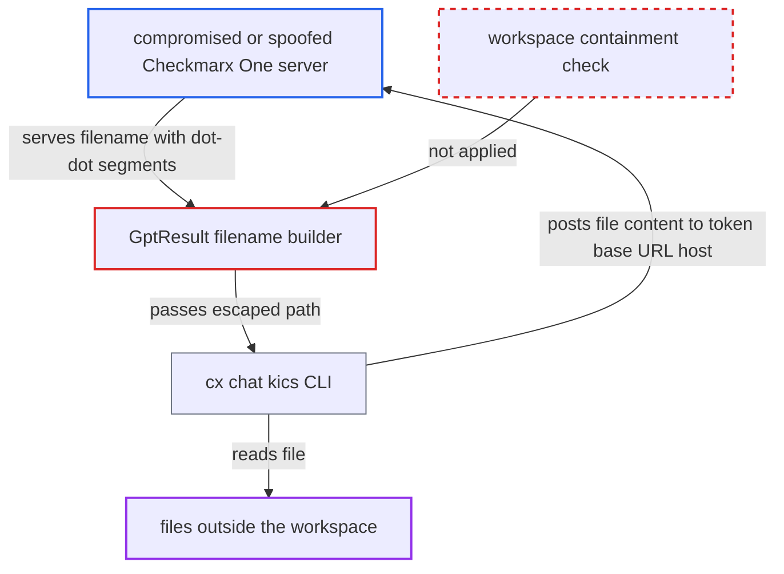

# KICS result filename makes AI chat read files outside the workspace and send them to the server

| Field | Value |
|---|---|
| ID | `find_01GEdUgAF8ZvZcBMKAD3MDTY` |
| Severity | **Medium** |
| Status | open |
| CWE | CWE-22 — Path traversal |
| Created | 2026-10-22T14:05:32.078858Z |
| Claude Security | https://claude.ai/security/findings/find_01GEdUgAF8ZvZcBMKAD3MDTY |

## Description

A compromised or spoofed Checkmarx One server can make the VS Code extension read a file outside the scanned workspace and send its content to that server. It needs the developer to click in the KICS AI tab, and AI guided remediation must be on with the Checkmarx/Azure AI engine. `GptResult` joins the server-supplied `data.filename` to the workspace path and never checks that the result stays inside it.

1. **compromised Checkmarx One endpoint** serves a KICS result whose `data.filename` climbs out of the workspace. An example value is `../../.ssh/id_rsa` or `../../../../etc/passwd`. The server also has to enable AI guided remediation with the Checkmarx/Azure AI engine.
2. **`cx results show`** writes the filename unchanged into `ast-results.json`. `exportJSONResults` marshals the API data as received. The leading-slash trim applies only to SARIF output and removes just one leading separator. ([`internal/commands/result.go:1893-1908`](https://github.com/cx-benchmark/ast-cli/blob/fd7806d4fa55005863ea1cb272ed9e9aadd49866/internal/commands/result.go#L1893-L1908))
3. **`GptResult`** joins the filename to the first workspace folder path. `AstResult` copied `data.filename` unchanged. `path.join` with `..` segments then gives a path outside the workspace, and nothing checks containment. ([`packages/core/src/models/gptResult.ts:27-45`](https://github.com/cx-benchmark/ast-vscode-extension/blob/55c034d5a357f2ab653f140c773e5098456060c2/packages/core/src/models/gptResult.ts#L27-L45))
4. **developer** opens the result and clicks a suggested question in the KICS AI tab. `WebViewCommand.runGpt` then passes `result.filename` to `cx.runGpt`. ([`packages/core/src/commands/webViewCommand.ts:443-449`](https://github.com/cx-benchmark/ast-vscode-extension/blob/55c034d5a357f2ab653f140c773e5098456060c2/packages/core/src/commands/webViewCommand.ts#L443-L449))
5. **`runGpt` in `cx/cx.ts`** starts `cx chat kics --result-file <path>`. It only checks that some workspace folder is open, then calls `CxWrapper.kicsChat` with the path. ([`packages/core/src/cx/cx.ts:79-106`](https://github.com/cx-benchmark/ast-vscode-extension/blob/55c034d5a357f2ab653f140c773e5098456060c2/packages/core/src/cx/cx.ts#L79-L106))
6. **the CLI `cx chat kics`** reads the file with `os.ReadFile` and puts its whole content into the prompt. There is no path check. `buildKicsMessages` embeds the full content through `assistantInputFormat`. ([`internal/commands/chat-kics.go:107-115`](https://github.com/cx-benchmark/ast-cli/blob/fd7806d4fa55005863ea1cb272ed9e9aadd49866/internal/commands/chat-kics.go#L107-L115))
7. **`sendRequest` in the CLI** posts the prompt to `<base URL claim of the CxOne token>/api/ai-proxy/redirect/...`. This host is the same server that supplied the filename, so the attacker receives the file content. ([`internal/commands/chat-sast.go:144-165`](https://github.com/cx-benchmark/ast-cli/blob/fd7806d4fa55005863ea1cb272ed9e9aadd49866/internal/commands/chat-sast.go#L144-L165))

## Assessment

The attacker is a compromised or spoofed Checkmarx One endpoint, an actor the threat model names. It serves a KICS result, or a secret-detection result (`sscs-secret-detection`), with a crafted `data.filename`. It also turns on AI guided remediation with the Checkmarx/Azure AI engine through the tenant settings. The developer must load the scan, open the result and click a suggested question or ask a question in the KICS AI tab. The attacker has to guess the workspace depth or the target path. A second route needs no click in the AI tab. Each time the details panel opens, `cx utils mask --result-file` reads the same path through `cx.mask`, and the secrets it detects are shown in the webview.

Impact: The attacker can read any file the IDE user can read outside the scanned workspace, such as other repositories and credential or config files, and have it sent to their host. One file is disclosed per result and click. Secret patterns may be redacted if gen-ai-wrapper masks them, but the rest of the file is still sent. There is no write effect and no availability effect.

## Recommendation

(1) `GptResult` turns the server-supplied `data.filename` of KICS and secret-detection results into an absolute local path without keeping it inside the workspace. AI chat and masking then read files the user never scanned.

Fix criteria: Before `cx chat kics` or `cx utils mask` runs, the resolved path, with symlinks resolved, lies inside an open workspace folder. Any other path is refused and the CLI is never called. A KICS result with `data.filename` `../../../etc/passwd` produces an error and starts no CLI process.

(2) `cx chat kics` and `cx utils mask` call `os.ReadFile` on any path they are given and send the whole content to the AI endpoint. The CLI adds no defence against a bad path from the IDE.

Fix criteria: As defence in depth, the CLI refuses a `--result-file` that lies outside a given source root or the current working directory once the path is cleaned and symlinks are evaluated. It fails before contacting any AI endpoint. Running `cx chat kics --result-file ../../etc/passwd` errors and sends no request.

## Evidence

**https://github.com/cx-benchmark/ast-vscode-extension**

- [`packages/core/src/models/gptResult.ts:27-45`](https://github.com/cx-benchmark/ast-vscode-extension/blob/55c034d5a357f2ab653f140c773e5098456060c2/packages/core/src/models/gptResult.ts#L27-L45)
- [`packages/core/src/models/results.ts:100-116`](https://github.com/cx-benchmark/ast-vscode-extension/blob/55c034d5a357f2ab653f140c773e5098456060c2/packages/core/src/models/results.ts#L100-L116)
- [`packages/core/src/commands/webViewCommand.ts:292-303`](https://github.com/cx-benchmark/ast-vscode-extension/blob/55c034d5a357f2ab653f140c773e5098456060c2/packages/core/src/commands/webViewCommand.ts#L292-L303)
- [`packages/core/src/commands/webViewCommand.ts:443-449`](https://github.com/cx-benchmark/ast-vscode-extension/blob/55c034d5a357f2ab653f140c773e5098456060c2/packages/core/src/commands/webViewCommand.ts#L443-L449)
- [`packages/core/src/cx/cx.ts:79-106`](https://github.com/cx-benchmark/ast-vscode-extension/blob/55c034d5a357f2ab653f140c773e5098456060c2/packages/core/src/cx/cx.ts#L79-L106)
- [`packages/core/src/views/resultsView/astDetailsView.ts:281-292`](https://github.com/cx-benchmark/ast-vscode-extension/blob/55c034d5a357f2ab653f140c773e5098456060c2/packages/core/src/views/resultsView/astDetailsView.ts#L281-L292)

**https://github.com/cx-benchmark/ast-cli**

- [`internal/commands/result.go:1893-1908`](https://github.com/cx-benchmark/ast-cli/blob/fd7806d4fa55005863ea1cb272ed9e9aadd49866/internal/commands/result.go#L1893-L1908)
- [`internal/commands/chat-kics.go:107-115`](https://github.com/cx-benchmark/ast-cli/blob/fd7806d4fa55005863ea1cb272ed9e9aadd49866/internal/commands/chat-kics.go#L107-L115)
- [`internal/commands/chat-kics.go:202-216`](https://github.com/cx-benchmark/ast-cli/blob/fd7806d4fa55005863ea1cb272ed9e9aadd49866/internal/commands/chat-kics.go#L202-L216)
- [`internal/commands/chat-sast.go:144-165`](https://github.com/cx-benchmark/ast-cli/blob/fd7806d4fa55005863ea1cb272ed9e9aadd49866/internal/commands/chat-sast.go#L144-L165)
- [`internal/commands/util/maskSecret.go:41-60`](https://github.com/cx-benchmark/ast-cli/blob/fd7806d4fa55005863ea1cb272ed9e9aadd49866/internal/commands/util/maskSecret.go#L41-L60)

