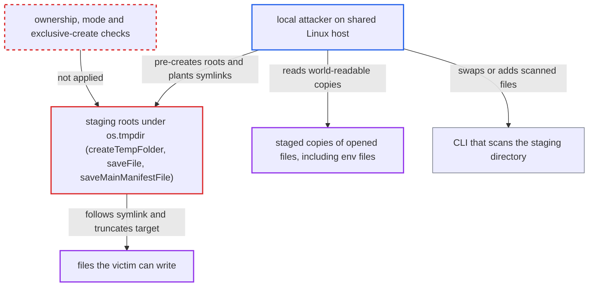

# Realtime scanners stage editor content in fixed shared temp directories, enabling symlink overwrite and disclosure

| Field | Value |
|---|---|
| ID | `find_01VpwCq6cCJFsF5J8ENwe8eU` |
| Severity | **Medium** |
| Status | open |
| CWE | CWE-377 — Insecure temporary file |
| Created | 2026-10-22T14:06:19.432744Z |
| Claude Security | https://claude.ai/security/findings/find_01VpwCq6cCJFsF5J8ENwe8eU |

## Description

On a shared Linux host, a local unprivileged user can make the extension overwrite any file the victim can write. They can also read the text of files the victim opens, including `.env` files with credentials. The realtime scanners stage editor text in fixed folders under `os.tmpdir()`, and `createTempFolder()` accepts a folder already owned by someone else. Staged files are written with default flags and permissions.

1. **local attacker** creates a staging root before the victim's extension does. The root names are fixed and known, such as `Cx-oss-realtime-scanner` and `Cx-secret-realtime-scanner`, directly under `os.tmpdir()`, which is `/tmp` on a shared Linux host. ([`packages/core/src/realtimeScanners/common/baseScannerService.ts:143-157`](https://github.com/cx-benchmark/ast-vscode-extension/blob/55c034d5a357f2ab653f140c773e5098456060c2/packages/core/src/realtimeScanners/common/baseScannerService.ts#L143-L157))
2. **local attacker** plants symlinks at every predictable staging path. File names come from `generateFileHash()`, which hashes the path plus the current minute and second, so at most 3600 suffixes exist per path. Each link points at a file the victim can write. ([`packages/core/src/realtimeScanners/scanners/oss/ossScannerService.ts:744-759`](https://github.com/cx-benchmark/ast-vscode-extension/blob/55c034d5a357f2ab653f140c773e5098456060c2/packages/core/src/realtimeScanners/scanners/oss/ossScannerService.ts#L744-L759))
3. **`createTempFolder()`** accepts the existing attacker-owned directory. `fs.mkdirSync` with `{recursive:true}` succeeds silently on a pre-existing directory owned by another user, and no ownership, mode or `lstat` check follows. ([`packages/core/src/realtimeScanners/common/baseScannerService.ts:121-123`](https://github.com/cx-benchmark/ast-vscode-extension/blob/55c034d5a357f2ab653f140c773e5098456060c2/packages/core/src/realtimeScanners/common/baseScannerService.ts#L121-L123))
4. **the extension's scanners** write the victim's manifest or open-file text to the staging path. `fs.writeFileSync` and `fs.copyFileSync` follow the planted symlink and truncate its target. OSS does this for every workspace manifest when a workspace is opened. ([`packages/core/src/realtimeScanners/scanners/oss/ossScannerService.ts:253-285`](https://github.com/cx-benchmark/ast-vscode-extension/blob/55c034d5a357f2ab653f140c773e5098456060c2/packages/core/src/realtimeScanners/scanners/oss/ossScannerService.ts#L253-L285))
5. **local attacker** reads the staged copies of files the victim opens. The root and staged files get default modes (0755 and 0644 under the usual umask), so any local user can read them. The Secrets scanner stages every opened non-manifest file. ([`packages/core/src/realtimeScanners/scanners/secrets/secretsScannerService.ts:95-99`](https://github.com/cx-benchmark/ast-vscode-extension/blob/55c034d5a357f2ab653f140c773e5098456060c2/packages/core/src/realtimeScanners/scanners/secrets/secretsScannerService.ts#L95-L99))

## Assessment

The attacker is an unprivileged user on the same Linux host, such as a shared workstation or a Remote-SSH dev server, where `os.tmpdir()` is `/tmp`. macOS `$TMPDIR` and Windows `%TEMP%` are per-user and not affected. For the overwrite, the attacker must create the root before the victim's first scan since `/tmp` was cleared. `fs.protected_symlinks` does not stop this, because the link's owner also owns the directory holding it. For disclosure, the attacker watches `/tmp/Cx-secret-realtime-scanner` with inotify and opens each staged copy as the victim opens files. Disclosure also works when the victim created the root, because of the default modes. Owning the staging directory also lets the attacker replace or add files the CLI reads. For containers the CLI scans the whole containing directory. No action beyond normal IDE use is needed. After login on an Assist-enabled tenant, the extension turns on all realtime scanners, and OSS scans every workspace manifest at activation.

Impact: The attacker can have any file the victim can write truncated and replaced with the victim's manifest or open-file text, such as dotfiles, SSH keys or source. The attacker does not choose the content, and the loss is limited to the clobbered files. The attacker can also read the full text of files the victim opens or edits while they are staged, and can falsify realtime scan verdicts.

## Recommendation

(1) Staging roots are fixed names in the shared system temp directory. They are created with `mkdirSync({recursive:true})`, which accepts a directory already owned by another user. Staged files get default, world-readable permissions.

Fix criteria: Each scan stages files in a directory only the current user can access. For example, use `mkdtemp` with mode 0700 under a per-user location such as the extension's storage URI. Alternatively, use the temp dir only after verifying the directory is owned by the current uid and not group or other writable. Staged files are created 0600. Test: with `/tmp/Cx-*-realtime-scanner` pre-created by another user, the extension never writes into it, and other uids cannot read staged files.

(2) Destination writes with `writeFileSync` and `copyFileSync` follow symbolic links. Staging names are predictable from the path and the current minute and second.

Fix criteria: Staging files are opened with exclusive creation, which fails if the path exists or is a symlink, and they use unpredictable names. Test: planting a symlink at any computed staging path leaves its target unmodified, and the scan aborts or uses a fresh path.

## Evidence

**https://github.com/cx-benchmark/ast-vscode-extension**

- [`packages/core/src/realtimeScanners/common/baseScannerService.ts:143-157`](https://github.com/cx-benchmark/ast-vscode-extension/blob/55c034d5a357f2ab653f140c773e5098456060c2/packages/core/src/realtimeScanners/common/baseScannerService.ts#L143-L157)
- [`packages/core/src/realtimeScanners/common/baseScannerService.ts:121-123`](https://github.com/cx-benchmark/ast-vscode-extension/blob/55c034d5a357f2ab653f140c773e5098456060c2/packages/core/src/realtimeScanners/common/baseScannerService.ts#L121-L123)
- [`packages/core/src/realtimeScanners/common/baseScannerService.ts:188-205`](https://github.com/cx-benchmark/ast-vscode-extension/blob/55c034d5a357f2ab653f140c773e5098456060c2/packages/core/src/realtimeScanners/common/baseScannerService.ts#L188-L205)
- [`packages/core/src/realtimeScanners/scanners/oss/ossScannerService.ts:744-759`](https://github.com/cx-benchmark/ast-vscode-extension/blob/55c034d5a357f2ab653f140c773e5098456060c2/packages/core/src/realtimeScanners/scanners/oss/ossScannerService.ts#L744-L759)
- [`packages/core/src/realtimeScanners/scanners/oss/ossScannerService.ts:253-285`](https://github.com/cx-benchmark/ast-vscode-extension/blob/55c034d5a357f2ab653f140c773e5098456060c2/packages/core/src/realtimeScanners/scanners/oss/ossScannerService.ts#L253-L285)
- [`packages/core/src/realtimeScanners/scanners/secrets/secretsScannerService.ts:95-99`](https://github.com/cx-benchmark/ast-vscode-extension/blob/55c034d5a357f2ab653f140c773e5098456060c2/packages/core/src/realtimeScanners/scanners/secrets/secretsScannerService.ts#L95-L99)
- [`packages/core/src/realtimeScanners/scanners/asca/ascaScannerService.ts:90-100`](https://github.com/cx-benchmark/ast-vscode-extension/blob/55c034d5a357f2ab653f140c773e5098456060c2/packages/core/src/realtimeScanners/scanners/asca/ascaScannerService.ts#L90-L100)
- [`packages/core/src/realtimeScanners/scanners/iac/iacScannerService.ts:129-137`](https://github.com/cx-benchmark/ast-vscode-extension/blob/55c034d5a357f2ab653f140c773e5098456060c2/packages/core/src/realtimeScanners/scanners/iac/iacScannerService.ts#L129-L137)
- [`packages/core/src/realtimeScanners/scanners/containers/containersScannerService.ts:125-168`](https://github.com/cx-benchmark/ast-vscode-extension/blob/55c034d5a357f2ab653f140c773e5098456060c2/packages/core/src/realtimeScanners/scanners/containers/containersScannerService.ts#L125-L168)
- [`packages/checkmarx/src/welcomePage/welcomeWebview.ts:387-391`](https://github.com/cx-benchmark/ast-vscode-extension/blob/55c034d5a357f2ab653f140c773e5098456060c2/packages/checkmarx/src/welcomePage/welcomeWebview.ts#L387-L391)
- [`packages/core/src/realtimeScanners/scanners/oss/ossScannerCommand.ts:154-171`](https://github.com/cx-benchmark/ast-vscode-extension/blob/55c034d5a357f2ab653f140c773e5098456060c2/packages/core/src/realtimeScanners/scanners/oss/ossScannerCommand.ts#L154-L171)

**https://github.com/cx-benchmark/ast-cli**

- [`internal/services/realtimeengine/containersrealtime/containers-realtime.go:136-140`](https://github.com/cx-benchmark/ast-cli/blob/fd7806d4fa55005863ea1cb272ed9e9aadd49866/internal/services/realtimeengine/containersrealtime/containers-realtime.go#L136-L140)

