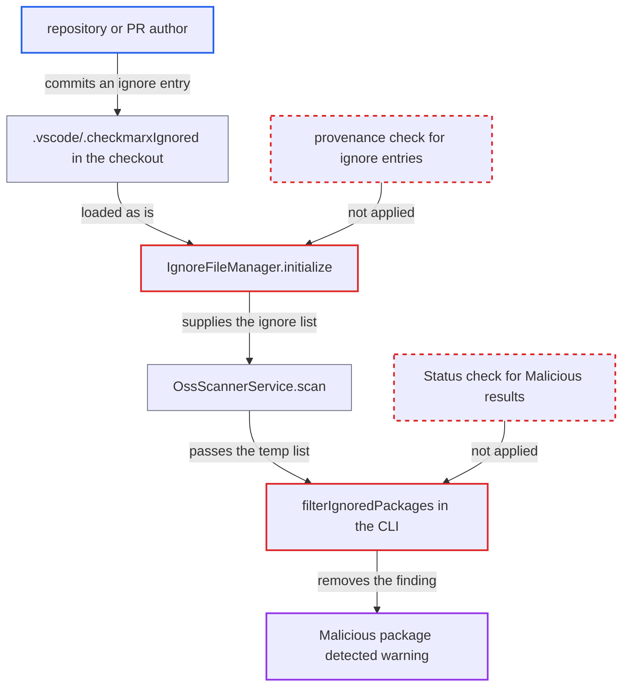

# Repository-shipped .vscode ignore list suppresses IDE realtime malicious-package warnings

| Field | Value |
|---|---|
| ID | `find_01XUqaAE3JLZfR42kAtLYysL` |
| Severity | **Medium** |
| Status | open |
| CWE | CWE-807 — Untrusted input in security decision |
| Created | 2026-10-22T14:07:48.811309Z |
| Claude Security | https://claude.ai/security/findings/find_01XUqaAE3JLZfR42kAtLYysL |

## Description

A repository or pull request author can hide Checkmarx's "malicious package" warning from a developer who opens the project in VS Code. The package shows only a neutral ignored icon. The developer must open the folder and accept VS Code's Workspace Trust prompt. The cause is that `IgnoreFileManager.initialize()` loads the checked-in `.vscode/.checkmarxIgnored` with no provenance check, and `filterIgnoredPackages` drops listed packages without checking `Status`.

1. **repository author** commits a malicious dependency and an ignore entry for it. The entry sits in `.vscode/.checkmarxIgnored` and names the same package, for example `npm:evil-pkg:1.0.0`, next to a dependency that Checkmarx classifies `Malicious`.
2. **`IgnoreFileManager.initialize()`** loads the ignore file from the opened checkout at activation. It reads the workspace's existing file as it is, with no prompt and no check of who created the entries. ([`packages/core/src/realtimeScanners/common/ignoreFileManager.ts:70-77`](https://github.com/cx-benchmark/ast-vscode-extension/blob/55c034d5a357f2ab653f140c773e5098456060c2/packages/core/src/realtimeScanners/common/ignoreFileManager.ts#L70-L77))
3. **`OssScannerService.scan()`** passes the workspace temp list to the CLI. When `ignoreData` is not empty, the call `cx.ossScanResults(mainTempPath, ignoredPackagesFile)` includes the repository-supplied list. ([`packages/core/src/realtimeScanners/scanners/oss/ossScannerService.ts:174-187`](https://github.com/cx-benchmark/ast-vscode-extension/blob/55c034d5a357f2ab653f140c773e5098456060c2/packages/core/src/realtimeScanners/scanners/oss/ossScannerService.ts#L174-L187))
4. **`filterIgnoredPackages` in the CLI** removes every listed package from the results. It matches on the manager, name and version id alone and never looks at `Status`, so a `Malicious` result is dropped before it reaches the extension. ([`internal/services/realtimeengine/ossrealtime/oss-realtime.go:103-150`](https://github.com/cx-benchmark/ast-cli/blob/fd7806d4fa55005863ea1cb272ed9e9aadd49866/internal/services/realtimeengine/ossrealtime/oss-realtime.go#L103-L150))
5. **the editor** shows a neutral ignored icon instead of the error. The `Malicious package detected` diagnostic does not appear, and the hover data has status `ok`. ([`packages/core/src/realtimeScanners/scanners/oss/ossScannerService.ts:535-575`](https://github.com/cx-benchmark/ast-vscode-extension/blob/55c034d5a357f2ab653f140c773e5098456060c2/packages/core/src/realtimeScanners/scanners/oss/ossScannerService.ts#L535-L575))

## Assessment

The attacker writes a repository or pull request that a developer opens in VS Code. It contains a dependency Checkmarx classes as `Malicious` and a matching entry in `.vscode/.checkmarxIgnored` (or `.checkmarxDevAssistIgnored`). The extension declares no `untrustedWorkspaces` capability, so the developer must open the folder and accept VS Code's Workspace Trust prompt. Two other routes exist. Any secrets scan rebuilds the temp list from `.checkmarxIgnored` (`updateTempList`), so shipping that one file is enough. The containers scanner applies the same list to image findings, so entries with `ImageName` and `ImageTag` hide container-image findings the same way. Real harm needs the developer to then install the dependency.

Impact: A package that Checkmarx reports as malicious, or a vulnerable container image, is shown as ignored instead of flagged. Only the verdict shown in the IDE is affected. The extension discloses nothing and runs nothing. The status-bar ignored count and the Ignored view still list the entry. The extension is an advisory display, not a blocking gate.

## Recommendation

(1) The ignore state is stored in files inside the untrusted workspace and loaded at activation with no provenance check. Repository content can therefore pre-triage its own findings.

Fix criteria: Ignore entries that did not come from the local user's own action no longer silently suppress findings. The authoritative state is kept outside the checkout, for example in extension workspace storage, or entries found in a newly opened workspace need explicit acknowledgement. Test: open a fresh clone that ships `.vscode/.checkmarxIgnored` naming a malicious package. The `Malicious package detected` diagnostic still appears until the user accepts the entry.

(2) The ignore filtering in the extension and in `filterIgnoredPackages` never checks the result status, so even a `Malicious` verdict can be suppressed.

Fix criteria: A result with status `Malicious` stays visible whatever any ignore list contains, or is at least shown with a distinct malicious-but-ignored indicator. Test: use an ignore list that names a Malicious-flagged package. The editor still flags it.

## Evidence

**https://github.com/cx-benchmark/ast-vscode-extension**

- [`packages/core/src/realtimeScanners/common/ignoreFileManager.ts:342-368`](https://github.com/cx-benchmark/ast-vscode-extension/blob/55c034d5a357f2ab653f140c773e5098456060c2/packages/core/src/realtimeScanners/common/ignoreFileManager.ts#L342-L368)
- [`packages/core/src/realtimeScanners/common/ignoreFileManager.ts:70-77`](https://github.com/cx-benchmark/ast-vscode-extension/blob/55c034d5a357f2ab653f140c773e5098456060c2/packages/core/src/realtimeScanners/common/ignoreFileManager.ts#L70-L77)
- [`packages/core/src/realtimeScanners/scanners/oss/ossScannerService.ts:174-187`](https://github.com/cx-benchmark/ast-vscode-extension/blob/55c034d5a357f2ab653f140c773e5098456060c2/packages/core/src/realtimeScanners/scanners/oss/ossScannerService.ts#L174-L187)
- [`packages/core/src/realtimeScanners/scanners/oss/ossScannerService.ts:535-575`](https://github.com/cx-benchmark/ast-vscode-extension/blob/55c034d5a357f2ab653f140c773e5098456060c2/packages/core/src/realtimeScanners/scanners/oss/ossScannerService.ts#L535-L575)
- [`packages/core/src/realtimeScanners/scanners/secrets/secretsScannerService.ts:101-106`](https://github.com/cx-benchmark/ast-vscode-extension/blob/55c034d5a357f2ab653f140c773e5098456060c2/packages/core/src/realtimeScanners/scanners/secrets/secretsScannerService.ts#L101-L106)
- [`packages/core/src/realtimeScanners/scanners/containers/containersScannerService.ts:173-185`](https://github.com/cx-benchmark/ast-vscode-extension/blob/55c034d5a357f2ab653f140c773e5098456060c2/packages/core/src/realtimeScanners/scanners/containers/containersScannerService.ts#L173-L185)

**https://github.com/cx-benchmark/ast-cli**

- [`internal/services/realtimeengine/ossrealtime/oss-realtime.go:103-150`](https://github.com/cx-benchmark/ast-cli/blob/fd7806d4fa55005863ea1cb272ed9e9aadd49866/internal/services/realtimeengine/ossrealtime/oss-realtime.go#L103-L150)

