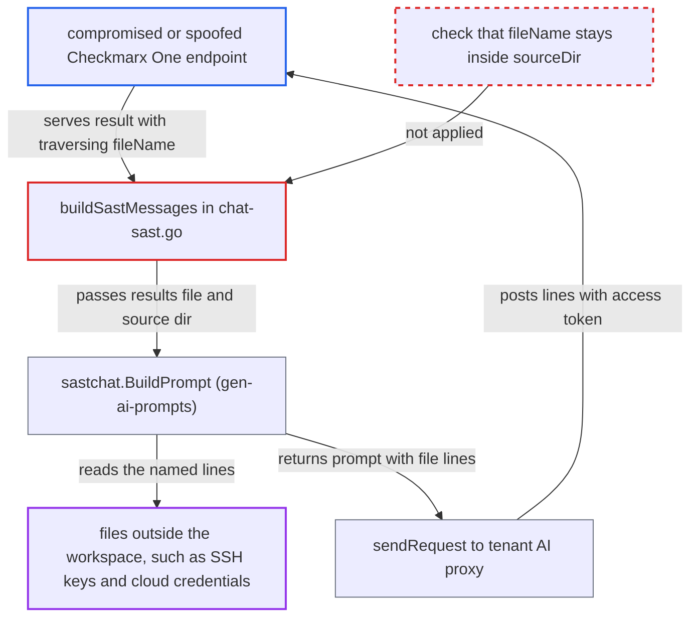

# SAST AI chat reads server-supplied result file paths outside the source directory

| Field | Value |
|---|---|
| ID | `find_017ocJomocYM3FWkatrzQLUp` |
| Severity | **Medium** |
| Status | open |
| CWE | CWE-22 — Path traversal |
| Created | 2026-10-22T13:59:07.863584Z |
| Claude Security | https://claude.ai/security/findings/find_017ocJomocYM3FWkatrzQLUp |

## Description

A compromised or spoofed Checkmarx One endpoint can make the CLI read files outside the developer's workspace, such as SSH keys or cloud credential files. The file lines are then sent to that endpoint. It needs the developer to open a result and click the start-chat button. `buildSastMessages` never checks that file names stay inside `--source-dir`.

1. **compromised Checkmarx One endpoint** serves a SAST result whose node `fileName` contains `..` segments. `ScanResultNode.UnmarshalJSON` copies `fileName` unchanged, so the value ends up in the `ast-results.json` file that the extension saves. ([`internal/wrappers/results-modifier.go:81-103`](https://github.com/cx-benchmark/ast-cli/blob/fd7806d4fa55005863ea1cb272ed9e9aadd49866/internal/wrappers/results-modifier.go#L81-L103))
2. **developer** opens that result in VS Code and clicks the `startSastChat` button. This is the one user action the attack needs, and it also needs AI Guided Remediation enabled with an azure/checkmarx engine. ([`packages/core/src/commands/webViewCommand.ts:352-360`](https://github.com/cx-benchmark/ast-vscode-extension/blob/55c034d5a357f2ab653f140c773e5098456060c2/packages/core/src/commands/webViewCommand.ts#L352-L360))
3. **VS Code extension** runs `cx chat sast` with `ast-results.json` as the results file and the first workspace folder as `--source-dir`. The traversal in the file name starts from that workspace root. ([`packages/core/src/cx/cx.ts:51-76`](https://github.com/cx-benchmark/ast-vscode-extension/blob/55c034d5a357f2ab653f140c773e5098456060c2/packages/core/src/cx/cx.ts#L51-L76))
4. **the function `buildSastMessages`** passes the results file, `--sast-result-id` and `--source-dir` to `sastchat.BuildPrompt` without checking the file names. Nothing confirms that each node `fileName` resolves inside `sourceDir`. ([`internal/commands/chat-sast.go:120-141`](https://github.com/cx-benchmark/ast-cli/blob/fd7806d4fa55005863ea1cb272ed9e9aadd49866/internal/commands/chat-sast.go#L120-L141))
5. **`sastchat.BuildPrompt` from gen-ai-prompts** joins `sourceDir` with each `fileName`, reads the file and puts the lines from `methodLine` to `line` into the user prompt. The report assumes this dependency does no containment check. The test fixture and the `open invalidDir` error expected by `TestChatSastInvalidSourceDir` match that. ([`internal/commands/chat-sast_test.go:99-111`](https://github.com/cx-benchmark/ast-cli/blob/fd7806d4fa55005863ea1cb272ed9e9aadd49866/internal/commands/chat-sast_test.go#L99-L111))
6. **the function `sendRequest`** posts the prompt with the file lines to the tenant AI proxy, using `SecureCall` and the CxOne access token. For the azure/checkmarx engine the URL is built from the base URL in the token, so it reaches the same Checkmarx One host that served the results, which is the attacker's host. ([`internal/commands/chat-kics.go:149-181`](https://github.com/cx-benchmark/ast-cli/blob/fd7806d4fa55005863ea1cb272ed9e9aadd49866/internal/commands/chat-kics.go#L149-L181))

## Assessment

The attacker is a compromised or spoofed Checkmarx One endpoint. It serves a SAST result whose node `fileName` holds `..` segments leading to a target file, with `methodLine` and `line` inside that file's length. It also enables AI Guided Remediation with an azure/checkmarx engine through the tenant setting `aiGuidedRemediationAiEngine`. The developer must load the scan in VS Code, open that result and click the start-chat button. The attacker must guess the workspace depth or the absolute path of the target. A name such as `/../../.aws/credentials` escapes the workspace. Absolute names alone do not escape, because the join keeps them under `sourceDir`.

Impact: The attacker can read any file on the developer's machine that the IDE user can read, including files outside the scanned workspace. Each result discloses only the line range the attacker names. The report finds no write access, no code execution and no availability impact on this path.

## Recommendation

`buildSastMessages` passes server-supplied `data.nodes[].fileName` values to `sastchat.BuildPrompt`, which joins them to `--source-dir` and reads them. The path is never cleaned or bounded to the source root.

Fix criteria: Before any file is read for the prompt, each node file name of the selected result resolves, after cleaning and symlink evaluation, to a path inside the cleaned `--source-dir`. A name with `..` segments that escape, or that otherwise resolves outside the root, makes the command fail before it contacts any AI endpoint. To verify, use a results file whose node `fileName` is `/../../../etc/hostname`. The command must return an error and send no request.

## Evidence

**https://github.com/cx-benchmark/ast-cli**

- [`internal/commands/chat-sast.go:120-141`](https://github.com/cx-benchmark/ast-cli/blob/fd7806d4fa55005863ea1cb272ed9e9aadd49866/internal/commands/chat-sast.go#L120-L141)
- [`internal/commands/chat-sast.go:55-96`](https://github.com/cx-benchmark/ast-cli/blob/fd7806d4fa55005863ea1cb272ed9e9aadd49866/internal/commands/chat-sast.go#L55-L96)
- [`internal/commands/chat-sast.go:144-163`](https://github.com/cx-benchmark/ast-cli/blob/fd7806d4fa55005863ea1cb272ed9e9aadd49866/internal/commands/chat-sast.go#L144-L163)
- [`internal/commands/chat-kics.go:149-181`](https://github.com/cx-benchmark/ast-cli/blob/fd7806d4fa55005863ea1cb272ed9e9aadd49866/internal/commands/chat-kics.go#L149-L181)
- [`internal/wrappers/results-modifier.go:81-103`](https://github.com/cx-benchmark/ast-cli/blob/fd7806d4fa55005863ea1cb272ed9e9aadd49866/internal/wrappers/results-modifier.go#L81-L103)
- [`internal/commands/chat-sast_test.go:99-111`](https://github.com/cx-benchmark/ast-cli/blob/fd7806d4fa55005863ea1cb272ed9e9aadd49866/internal/commands/chat-sast_test.go#L99-L111)

**https://github.com/cx-benchmark/ast-vscode-extension**

- [`packages/core/src/cx/cx.ts:51-76`](https://github.com/cx-benchmark/ast-vscode-extension/blob/55c034d5a357f2ab653f140c773e5098456060c2/packages/core/src/cx/cx.ts#L51-L76)
- [`packages/core/src/models/gptResult.ts:22-41`](https://github.com/cx-benchmark/ast-vscode-extension/blob/55c034d5a357f2ab653f140c773e5098456060c2/packages/core/src/models/gptResult.ts#L22-L41)
- [`packages/core/src/commands/webViewCommand.ts:352-360`](https://github.com/cx-benchmark/ast-vscode-extension/blob/55c034d5a357f2ab653f140c773e5098456060c2/packages/core/src/commands/webViewCommand.ts#L352-L360)

