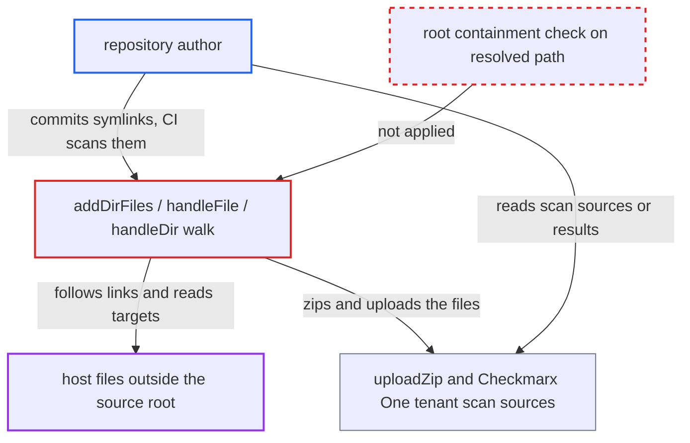

# Source zipping follows repository symlinks, uploading host files outside the scanned directory

| Field | Value |
|---|---|
| ID | `find_01QWi8AsJbB6Xh8Wxmsyk6SK` |
| Severity | **Medium** |
| Status | open |
| CWE | CWE-59 — Link following |
| Created | 2026-10-22T14:06:13.573223Z |
| Claude Security | https://claude.ai/security/findings/find_01QWi8AsJbB6Xh8Wxmsyk6SK |

## Description

A repository author can make the Checkmarx CLI (`cx`) copy files from the scanning machine into the uploaded scan archive. This includes the CLI's own credentials and other CI secrets. It needs the author's branch or PR to be scanned with `cx scan create -s .`. The walk in `addDirFiles`, `handleDir` and `handleFile` follows symlinks and never checks that the target stays inside the source root.

1. **repository author** commits symbolic links with chosen names and targets. Git on Linux and macOS stores symlinks with any target and recreates them on checkout, for example `env.json -> /proc/self/environ`, `cfg -> /etc` or `home -> /home`.
2. **victim's CI job or developer** runs `cx scan create -s .` on the checkout. The VS Code extension reaches the same walk when a developer clicks scan on the opened repository. ([`packages/core/src/views/resultsView/createScanProvider.ts:65-71`](https://github.com/cx-benchmark/ast-vscode-extension/blob/55c034d5a357f2ab653f140c773e5098456060c2/packages/core/src/views/resultsView/createScanProvider.ts#L65-L71))
3. **the walker `addDirFiles`** treats links to directories as directories. `util.IsDirOrSymLinkToDir` accepts any absolute or `..` target on the host, and no entry's resolved path is compared with the source root. ([`internal/commands/scan.go:1838-1861`](https://github.com/cx-benchmark/ast-cli/blob/fd7806d4fa55005863ea1cb272ed9e9aadd49866/internal/commands/scan.go#L1838-L1861))
4. **the handler `handleFile`** reads the link target into the zip. The include filters see only the link's own name, such as `env.json`. `ioutil.ReadFile` then follows the link, and dangling links are skipped silently. ([`internal/commands/scan.go:1863-1909`](https://github.com/cx-benchmark/ast-cli/blob/fd7806d4fa55005863ea1cb272ed9e9aadd49866/internal/commands/scan.go#L1863-L1909))
5. **the handler `handleDir`** descends into linked directories. It recurses with `newParent = parentDir + linkName + "/"`, so the whole target tree is walked and every file passing the include filters is zipped. ([`internal/commands/scan.go:1911-1959`](https://github.com/cx-benchmark/ast-cli/blob/fd7806d4fa55005863ea1cb272ed9e9aadd49866/internal/commands/scan.go#L1911-L1959))
6. **the function `uploadZip`** uploads the archive to the Checkmarx One presigned upload URL. This moves the host files off the machine and into the victim's configured tenant. ([`internal/commands/scan.go:2350-2394`](https://github.com/cx-benchmark/ast-cli/blob/fd7806d4fa55005863ea1cb272ed9e9aadd49866/internal/commands/scan.go#L2350-L2394))
7. **repository author** reads the stored files from the scan sources or results in the tenant. This works for an author who is an org developer or tenant user able to see that project's scan sources or results.

## Assessment

The attacker is a repository or PR author who can also read the project's scan sources or results in the victim's Checkmarx One tenant, for example an org developer whose branch CI scans. The victim's CI job, or a developer clicking scan in the IDE, runs `cx scan create -s .`. Git symlink checkout must work, which is the default on Linux and macOS. No defense has to be evaded. The attacker can use file links, which pick any name and bypass the include filters. Directory links such as `~` or `/etc` collect files matching the default filters (`*.json`, `*.yaml`, `*.env`, `*.properties`, `*.xml` and similar). These reach `~/.docker/config.json`, `~/.m2/settings.xml`, `~/.gradle/gradle.properties` and `~/.checkmarx/checkmarxcli.yaml`. Links like `args.json -> /proc/self/cmdline` capture the command line. A second path, the `.git` wholesale copy in `addDirFilesIgnoreFilter`, also follows file links. A cloned repository cannot reach it, because git refuses `.git` path components, so only trees delivered by other means can.

Impact: The attacker can get any file readable by the user running `cx` into the uploaded archive. That includes the process environment and command line (`CX_CLIENT_SECRET`, `CX_APIKEY`, other CI secrets), the CLI's plaintext credential file, registry and build-tool credentials, and other checked-out projects. The data goes only to the victim's configured tenant. Host integrity and availability are not affected.

## Recommendation

The directory walk (`addDirFiles`, `handleDir`, `handleFile`, `addDirFilesIgnoreFilter`, `util.IsDirOrSymLinkToDir`) follows symbolic links. It reads or descends their targets without checking that the resolved path stays inside the source root.

Fix criteria: No symlink in the scanned tree can cause a file whose real path is outside the canonical source root to be read or added to the zip. This holds for both the filtered walk and the `.git` wholesale copy. In-root links may still be followed. To verify, scan a directory containing `x.json -> /etc/hostname`, `e.json -> /proc/self/environ` and `d -> /etc`. None of those targets' content may appear in the produced zip, while an in-root link still does.

## Evidence

**https://github.com/cx-benchmark/ast-cli**

- [`internal/commands/scan.go:1838-1861`](https://github.com/cx-benchmark/ast-cli/blob/fd7806d4fa55005863ea1cb272ed9e9aadd49866/internal/commands/scan.go#L1838-L1861)
- [`internal/commands/scan.go:1863-1909`](https://github.com/cx-benchmark/ast-cli/blob/fd7806d4fa55005863ea1cb272ed9e9aadd49866/internal/commands/scan.go#L1863-L1909)
- [`internal/commands/util/utils.go:145-169`](https://github.com/cx-benchmark/ast-cli/blob/fd7806d4fa55005863ea1cb272ed9e9aadd49866/internal/commands/util/utils.go#L145-L169)
- [`internal/commands/scan.go:1911-1959`](https://github.com/cx-benchmark/ast-cli/blob/fd7806d4fa55005863ea1cb272ed9e9aadd49866/internal/commands/scan.go#L1911-L1959)
- [`internal/commands/scan.go:2350-2394`](https://github.com/cx-benchmark/ast-cli/blob/fd7806d4fa55005863ea1cb272ed9e9aadd49866/internal/commands/scan.go#L2350-L2394)
- [`internal/params/filters.go:3-197`](https://github.com/cx-benchmark/ast-cli/blob/fd7806d4fa55005863ea1cb272ed9e9aadd49866/internal/params/filters.go#L3-L197)
- [`internal/commands/scan.go:1811-1836`](https://github.com/cx-benchmark/ast-cli/blob/fd7806d4fa55005863ea1cb272ed9e9aadd49866/internal/commands/scan.go#L1811-L1836)

**https://github.com/cx-benchmark/ast-vscode-extension**

- [`packages/core/src/views/resultsView/createScanProvider.ts:65-71`](https://github.com/cx-benchmark/ast-vscode-extension/blob/55c034d5a357f2ab653f140c773e5098456060c2/packages/core/src/views/resultsView/createScanProvider.ts#L65-L71)

