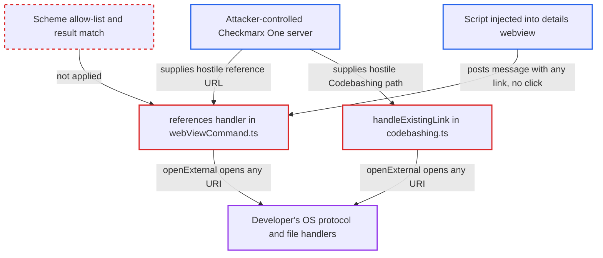

# Webview 'references' and Codebashing handlers pass server-supplied URIs of any scheme to openExternal

| Field | Value |
|---|---|
| ID | `find_01Rbpvpriez2cXDDTKcHQ1bw` |
| Severity | **Medium** |
| Status | open |
| CWE | CWE-610 — Externally controlled reference |
| Created | 2026-10-22T14:04:56.695038Z |
| Claude Security | https://claude.ai/security/findings/find_01Rbpvpriez2cXDDTKcHQ1bw |

## Description

A party who controls the Checkmarx One server a developer uses can make the developer's OS open any URI, such as a `file:` path, `search-ms:` or another protocol handler. This can lead to code execution as the developer. It needs the developer to click a reference link or the Codebashing icon. The handlers `references` in `webViewCommand.ts` and `handleExistingLink` in `codebashing.ts` pass server-supplied URIs to `openExternal` with no scheme check.

1. **attacker running the Checkmarx One endpoint** returns an SCA result with a hostile `packageData[].url`. The value is a URI such as `file://attacker.example/share/x.exe` or `search-ms:`, and the CLI copies it to the extension's JSON unchanged. ([`internal/wrappers/results-json.go:85-89`](https://github.com/cx-benchmark/ast-cli/blob/fd7806d4fa55005863ea1cb272ed9e9aadd49866/internal/wrappers/results-json.go#L85-L89))
2. **`scaReferences()` in `models/results.ts`** writes each server URL into the `id` attribute of a References link. That id is later sent back as the link to open, and its label is server text. ([`packages/core/src/models/results.ts:572-577`](https://github.com/cx-benchmark/ast-vscode-extension/blob/55c034d5a357f2ab653f140c773e5098456060c2/packages/core/src/models/results.ts#L572-L577))
3. **developer** opens the result and clicks the reference link. The click handler in `media/view.js` posts `{command:'references', link: e.target.id}` with the raw server URL. ([`packages/core/media/view.js:114-122`](https://github.com/cx-benchmark/ast-vscode-extension/blob/55c034d5a357f2ab653f140c773e5098456060c2/packages/core/media/view.js#L114-L122))
4. **the `references` message handler in `webViewCommand.ts`** calls `vscode.env.openExternal(vscode.Uri.parse(data.link))`. No scheme allow-list, no host check, and no comparison with the result the panel was opened for. ([`packages/core/src/commands/webViewCommand.ts:278-280`](https://github.com/cx-benchmark/ast-vscode-extension/blob/55c034d5a357f2ab653f140c773e5098456060c2/packages/core/src/commands/webViewCommand.ts#L278-L280))
5. **the developer's operating system** launches the handler registered for the URI's scheme. VS Code's `env.openExternal` rejects only empty and `command:` URIs, and the trusted-domains prompt covers only http and https, so the OS opens the file or protocol with the developer's privileges.

## Assessment

The attacker controls the Checkmarx One endpoint the developer uses. The threat model lists this as an actor. A man-in-the-middle could do the same only if the developer runs with the non-default `--insecure`. The server returns an SCA result whose `packageData[0].url` is a hostile URI, and the developer must click the reference link. The second route is Codebashing. A `cb-url` claim in the access token, read with `ParseUnverified`, or a lesson path from the server yields a hostile link, and the developer clicks the Codebashing icon. A third route needs no click. The details webview has no Content-Security-Policy and exposes the global `vscode` binding. Any markup injected into it could post `{command:'references', link}` with an arbitrary URI. That injection is a separate defect, and the report does not describe it further. The report assumes the `env.openExternal` behaviour of current VS Code desktop releases. The extension pins only `engines.vscode: ^1.63.0`.

Impact: The attacker chooses which file or protocol handler the developer's OS opens. The worst case is code execution as the developer, through a local executable, a UNC or WebDAV payload the user accepts at the OS warning, or a vulnerable registered handler. On Windows a UNC URI also makes the host authenticate over SMB, which leaks the user's NTLM hash. A remote executable still triggers an OS open-file warning. The extension reads nothing back.

## Recommendation

(1) The `references` handler in `webViewCommand.ts` forwards the webview-supplied `data.link` to `vscode.env.openExternal`. It neither restricts the scheme nor checks that the link belongs to the result shown.

Fix criteria: Only `http:` or `https:` URIs, and only URLs among the reference links of the result the panel was opened for, reach `openExternal`. For example, the extension keeps the URLs and the webview sends only an index. A result with `packageData[].url` set to `file:///...` or `search-ms:...` is refused and logged instead of opened. A crafted `postMessage({command:'references', link:'file://host/share/x.exe'})` is also refused and logged.

(2) `codebashing.ts` opens `codeBashingArray.path` without a scheme check. The CLI builds that path from an unverified `cb-url` token claim and a server-returned lesson path, so the server decides what the OS launches.

Fix criteria: The Codebashing link is opened only when it parses as an `https:` URL, optionally on the expected Codebashing host. A `cb-url` claim or lesson path that produces a `file:` or custom-scheme URI is rejected with an error shown. It never reaches `openExternal`.

## Evidence

**https://github.com/cx-benchmark/ast-vscode-extension**

- [`packages/core/src/commands/webViewCommand.ts:278-280`](https://github.com/cx-benchmark/ast-vscode-extension/blob/55c034d5a357f2ab653f140c773e5098456060c2/packages/core/src/commands/webViewCommand.ts#L278-L280)
- [`packages/core/src/models/results.ts:572-577`](https://github.com/cx-benchmark/ast-vscode-extension/blob/55c034d5a357f2ab653f140c773e5098456060c2/packages/core/src/models/results.ts#L572-L577)
- [`packages/core/media/view.js:114-122`](https://github.com/cx-benchmark/ast-vscode-extension/blob/55c034d5a357f2ab653f140c773e5098456060c2/packages/core/media/view.js#L114-L122)
- [`packages/core/src/codebashing/codebashing.ts:36-40`](https://github.com/cx-benchmark/ast-vscode-extension/blob/55c034d5a357f2ab653f140c773e5098456060c2/packages/core/src/codebashing/codebashing.ts#L36-L40)
- [`packages/core/src/views/resultsView/astDetailsView.ts:387-389`](https://github.com/cx-benchmark/ast-vscode-extension/blob/55c034d5a357f2ab653f140c773e5098456060c2/packages/core/src/views/resultsView/astDetailsView.ts#L387-L389)

**https://github.com/cx-benchmark/ast-cli**

- [`internal/wrappers/results-json.go:85-89`](https://github.com/cx-benchmark/ast-cli/blob/fd7806d4fa55005863ea1cb272ed9e9aadd49866/internal/wrappers/results-json.go#L85-L89)
- [`internal/wrappers/codebashing-http.go:79-80`](https://github.com/cx-benchmark/ast-cli/blob/fd7806d4fa55005863ea1cb272ed9e9aadd49866/internal/wrappers/codebashing-http.go#L79-L80)
- [`internal/wrappers/codebashing-http.go:96-106`](https://github.com/cx-benchmark/ast-cli/blob/fd7806d4fa55005863ea1cb272ed9e9aadd49866/internal/wrappers/codebashing-http.go#L96-L106)

