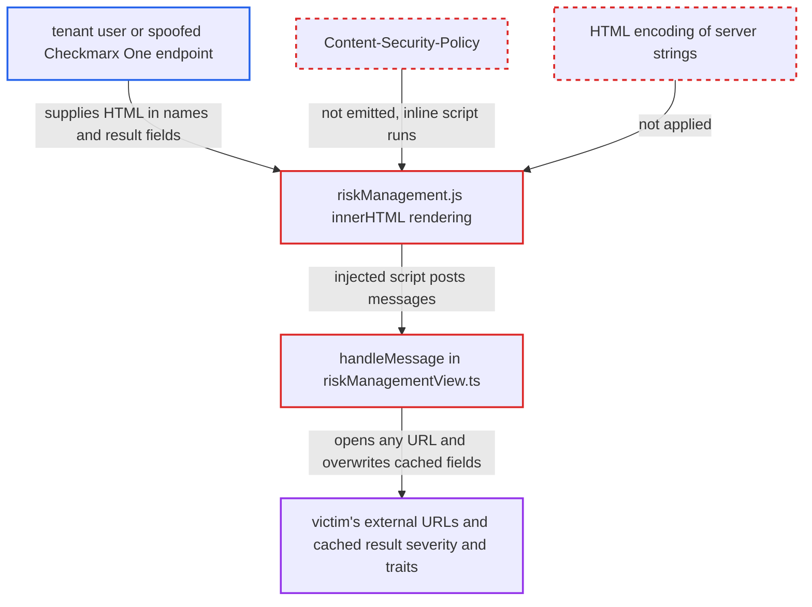

# Stored XSS in ASPM Risk Management webview via unescaped server data, no CSP

| Field | Value |
|---|---|
| ID | `find_015z1jcJew8ng34oRCNncAbk` |
| Severity | **Low** |
| Status | open |
| CWE | CWE-79 — Cross-site scripting |
| Created | 2026-10-22T13:58:47.538244Z |
| Claude Security | https://claude.ai/security/findings/find_015z1jcJew8ng34oRCNncAbk |

## Description

A tenant user who can name an ASPM application or project, or a compromised or spoofed Checkmarx One endpoint, can run JavaScript in the extension's Risk Management sidebar. The script can open any URL in the victim's browser and change the severity and traits shown for cached results. The code at fault is `riskManagement.js`, which writes server strings into `innerHTML` unescaped, and the webview, which has no Content-Security-Policy.

1. **attacker** sets an HTML payload as an ASPM application name, project name or result field. The attacker is a tenant user, or a compromised or spoofed Checkmarx One endpoint. A name such as `` contains no spaces, so it survives the project-name token extraction.
2. **victim** selects the linked project's latest scan and opens the Checkmarx sidebar. The tenant needs the risk-management feature flag on, and the victim's project must be linked to the application.
3. **the method `updateContent`** fetches the risk-management data and posts it to the webview unchanged. `cx.getRiskManagementResults` passes the CLI payload through. The CLI decodes the server JSON without filtering. ([`packages/core/src/views/riskManagementView/riskManagementView.ts:149-169`](https://github.com/cx-benchmark/ast-vscode-extension/blob/55c034d5a357f2ab653f140c773e5098456060c2/packages/core/src/views/riskManagementView/riskManagementView.ts#L149-L169))
4. **the script `riskManagement.js`** builds markup from the server strings and assigns it to `innerHTML`. Values such as `app.applicationName`, `result.name`, `result.severity`, trait values and `result.type` are interpolated with no HTML encoding. `severity` also lands in a class attribute, and trait values land in `id` and `data-value` attributes. ([`packages/core/media/riskManagement.js:381-395`](https://github.com/cx-benchmark/ast-vscode-extension/blob/55c034d5a357f2ab653f140c773e5098456060c2/packages/core/media/riskManagement.js#L381-L395))
5. **the method `getAspmWebviewContent`** builds a document with no Content-Security-Policy. The nonce is placed on script tags but never enforced. The injected inline handler therefore runs. Line 345 also interpolates the first token of the project name into the HTML on the extension-host side. ([`packages/core/src/views/riskManagementView/riskManagementView.ts:304-386`](https://github.com/cx-benchmark/ast-vscode-extension/blob/55c034d5a357f2ab653f140c773e5098456060c2/packages/core/src/views/riskManagementView/riskManagementView.ts#L304-L386))
6. **injected script** posts messages through the global `vscode` API object to `handleMessage`. `openLearnMore` and `openPromotionalLink` pass any URL of any scheme to `vscode.env.openExternal`. `openVulnerabilityDetails` lets the webview overwrite `riskScore`, `traits` and `severity` on the cached result. ([`packages/core/src/views/riskManagementView/riskManagementView.ts:59-96`](https://github.com/cx-benchmark/ast-vscode-extension/blob/55c034d5a357f2ab653f140c773e5098456060c2/packages/core/src/views/riskManagementView/riskManagementView.ts#L59-L96))

## Assessment

The attacker is either a tenant user who can name an ASPM application or project, or a compromised or spoofed Checkmarx One endpoint, which the threat model treats as untrusted. The tenant needs the risk-management feature flag on (`result.go:408-412`), and the victim's project must be linked to the application. The victim only has to select that project's latest scan and open the Checkmarx sidebar. The report does not show whether Checkmarx One accepts markup characters in application or project names. A malicious endpoint can return any string.

Impact: The attacker runs arbitrary JavaScript in the extension's webview. That script can spoof Checkmarx UI to phish credentials and load remote content. It can also make the extension open any external URI of any scheme, and alter the cached severity and traits shown in the details view. The attack is limited to what the `handleMessage` handlers expose. No file write or extension-host code execution is exposed directly.

## Recommendation

(1) Server-controlled strings (`applicationName`, result `name`, `type` and `severity`, trait values, project name) are inserted into webview HTML through `innerHTML` and template literals without output encoding.

Fix criteria: Every server-derived value in `riskManagement.js` and `riskManagementView.ts` is rendered as text (`textContent` or DOM APIs) or HTML-entity encoded for its text or attribute context. An ASPM application, trait or result named `` displays literally and runs nothing.

(2) The webview document has no Content-Security-Policy although `enableScripts` is on, so injected markup can run inline handlers and load remote resources.

Fix criteria: `getAspmWebviewContent` and `getPromoWebviewContent` emit a restrictive CSP (`default-src 'none'`, nonce-only `script-src` applied to every script tag, other sources limited to `webview.cspSource`). An injected inline handler or `<script>` is blocked.

(3) `handleMessage` opens any webview-supplied URL with `vscode.env.openExternal` and lets the webview overwrite cached result fields, so a compromised webview can act beyond its sandbox.

Fix criteria: `openLearnMore` and `openPromotionalLink` open only extension-known URLs (for example a fixed `https:` allow-list), and `openVulnerabilityDetails` uses the cached result's own data. A message with a `file:` or custom-scheme URL is rejected.

## Evidence

**https://github.com/cx-benchmark/ast-vscode-extension**

- [`packages/core/media/riskManagement.js:381-395`](https://github.com/cx-benchmark/ast-vscode-extension/blob/55c034d5a357f2ab653f140c773e5098456060c2/packages/core/media/riskManagement.js#L381-L395)
- [`packages/core/media/riskManagement.js:436-444`](https://github.com/cx-benchmark/ast-vscode-extension/blob/55c034d5a357f2ab653f140c773e5098456060c2/packages/core/media/riskManagement.js#L436-L444)
- [`packages/core/media/riskManagement.js:549-553`](https://github.com/cx-benchmark/ast-vscode-extension/blob/55c034d5a357f2ab653f140c773e5098456060c2/packages/core/media/riskManagement.js#L549-L553)
- [`packages/core/src/views/riskManagementView/riskManagementView.ts:304-386`](https://github.com/cx-benchmark/ast-vscode-extension/blob/55c034d5a357f2ab653f140c773e5098456060c2/packages/core/src/views/riskManagementView/riskManagementView.ts#L304-L386)
- [`packages/core/src/views/riskManagementView/riskManagementView.ts:149-169`](https://github.com/cx-benchmark/ast-vscode-extension/blob/55c034d5a357f2ab653f140c773e5098456060c2/packages/core/src/views/riskManagementView/riskManagementView.ts#L149-L169)
- [`packages/core/src/views/riskManagementView/riskManagementView.ts:59-96`](https://github.com/cx-benchmark/ast-vscode-extension/blob/55c034d5a357f2ab653f140c773e5098456060c2/packages/core/src/views/riskManagementView/riskManagementView.ts#L59-L96)
- [`packages/core/src/cx/cx.ts:914-929`](https://github.com/cx-benchmark/ast-vscode-extension/blob/55c034d5a357f2ab653f140c773e5098456060c2/packages/core/src/cx/cx.ts#L914-L929)

**https://github.com/cx-benchmark/ast-cli**

- [`internal/wrappers/risk-management-http.go:29-62`](https://github.com/cx-benchmark/ast-cli/blob/fd7806d4fa55005863ea1cb272ed9e9aadd49866/internal/wrappers/risk-management-http.go#L29-L62)

