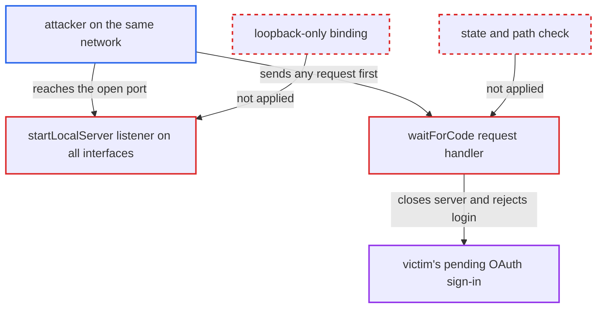

# VS Code OAuth callback server binds all interfaces and lets any request end the login

| Field | Value |
|---|---|
| ID | `find_017gxzva4csC6o1qhXPcRiZc` |
| Severity | **Low** |
| Status | open |
| CWE | CWE-1327 — Binding to unrestricted IP |
| Created | 2026-10-22T14:04:56.781770Z |
| Claude Security | https://claude.ai/security/findings/find_017gxzva4csC6o1qhXPcRiZc |

## Description

Someone on the same network as a developer can abort that developer's OAuth sign-in in the VS Code extension. They can do it again on every retry. The attack needs no login, but the attacker must send a request before the browser's redirect arrives. The cause is that the callback server in `AuthService.authenticate()` listens on every interface. Its `waitForCode()` handler also treats the first request it receives as the real callback.

1. **the victim** starts an OAuth sign-in in the extension. The login webview's `authenticate` message with `authMethod === 'oauth'` calls `authService.authenticate(baseUri, tenant)`, and `reAuthenticateWithStoredOAuth` reaches it too. ([`packages/checkmarx/src/webview/authenticationWebview.ts:368-377`](https://github.com/cx-benchmark/ast-vscode-extension/blob/55c034d5a357f2ab653f140c773e5098456060c2/packages/checkmarx/src/webview/authenticationWebview.ts#L368-L377))
2. **`findAvailablePort()`** picks a random port from 49152-65535 and probes it. The probe calls `server.listen(port)` with no host, so it binds on all interfaces. ([`packages/core/src/services/authService.ts:155-180`](https://github.com/cx-benchmark/ast-vscode-extension/blob/55c034d5a357f2ab653f140c773e5098456060c2/packages/core/src/services/authService.ts#L155-L180))
3. **`startLocalServer()`** opens the callback listener on all interfaces. `server.listen(config.port, ...)` has no host argument, although the `redirect_uri` says `http://localhost:<port>/checkmarx1/callback`. The port stays open for up to 60 seconds. ([`packages/core/src/services/authService.ts:250-268`](https://github.com/cx-benchmark/ast-vscode-extension/blob/55c034d5a357f2ab653f140c773e5098456060c2/packages/core/src/services/authService.ts#L250-L268))
4. **the attacker** scans the victim's address for the open port and sends a request such as `GET /` or `/?code=x`. The authorization URL carries no `state`, so the callback has no per-request secret that the attacker would have to know. ([`packages/core/src/services/authService.ts:208-214`](https://github.com/cx-benchmark/ast-vscode-extension/blob/55c034d5a357f2ab653f140c773e5098456060c2/packages/core/src/services/authService.ts#L208-L214))
5. **the handler in `waitForCode()`** treats that request as the callback and ends the login. It never checks the source address, the path or a `state`. A request without `code` gets a 400, the server closes and the login is rejected with `No authorization code received`, so the real browser redirect hits a closed port. A request with any `code` also closes the server and starts the token exchange with that value. ([`packages/core/src/services/authService.ts:270-299`](https://github.com/cx-benchmark/ast-vscode-extension/blob/55c034d5a357f2ab653f140c773e5098456060c2/packages/core/src/services/authService.ts#L270-L299))
6. **`waitForCode()`** hangs the login when the `Host` header is malformed. `clearTimeout()` runs before `new URL(req.url, 'http://' + req.headers.host)`. A throw there leaves the login pending with no timeout. ([`packages/core/src/services/authService.ts:270-299`](https://github.com/cx-benchmark/ast-vscode-extension/blob/55c034d5a357f2ab653f140c773e5098456060c2/packages/core/src/services/authService.ts#L270-L299))

## Assessment

The attacker needs only a network route to the developer's machine, for example the same Wi-Fi or LAN. No login is needed and no protection has to be defeated. The attack starts when the victim begins a routine OAuth sign-in, which opens a new port on all interfaces for up to 60 seconds. The attacker must win a race: the request has to arrive before the browser redirect. A malformed `Host` header is a second way to break the login, because it leaves the sign-in hanging. A foreign `code` is a further possibility. The PKCE `code_verifier` should stop it, but only if the Keycloak client `ide-integration` enforces PKCE, and the code cannot show that. If it does not, an attacker's code could be accepted, which would be login CSRF. The report calls that case not established and does not rate it.

Impact: The attacker can make the victim's OAuth sign-in fail or hang, and can repeat this on every retry while the host is reachable. This is a limited loss of availability for the sign-in feature. The report establishes no data exposure or session takeover. The real authorization code goes only to the victim's browser, and API-key sign-in is unaffected.

## Recommendation

(1) `startLocalServer()` and the `findAvailablePort()` probe call `listen` with no host. The OAuth callback listener is therefore reachable from other machines, although the `localhost` `redirect_uri` implies loopback only.

Fix criteria: The callback listener and the port probe bind only to loopback (`127.0.0.1` and/or `::1`, matching how `localhost` resolves). During a sign-in, a connection to the port from another host is refused.

(2) `waitForCode()` takes the first request as the callback. It has no `state` correlation and no path check, so any request closes the server and settles the login. It also parses the URL against the client-supplied `Host` header.

Fix criteria: The authorization request sends a random `state`. Only requests to `/checkmarx1/callback` whose `state` matches are accepted. Other requests are answered without closing the server, rejecting the login or clearing the timeout. `req.url` is parsed against a fixed base. A test confirms that a stray request, or one with a bad `Host`, no longer aborts or hangs a pending sign-in.

## Evidence

**https://github.com/cx-benchmark/ast-vscode-extension**

- [`packages/core/src/services/authService.ts:250-268`](https://github.com/cx-benchmark/ast-vscode-extension/blob/55c034d5a357f2ab653f140c773e5098456060c2/packages/core/src/services/authService.ts#L250-L268)
- [`packages/core/src/services/authService.ts:270-299`](https://github.com/cx-benchmark/ast-vscode-extension/blob/55c034d5a357f2ab653f140c773e5098456060c2/packages/core/src/services/authService.ts#L270-L299)
- [`packages/core/src/services/authService.ts:208-214`](https://github.com/cx-benchmark/ast-vscode-extension/blob/55c034d5a357f2ab653f140c773e5098456060c2/packages/core/src/services/authService.ts#L208-L214)
- [`packages/core/src/services/authService.ts:155-180`](https://github.com/cx-benchmark/ast-vscode-extension/blob/55c034d5a357f2ab653f140c773e5098456060c2/packages/core/src/services/authService.ts#L155-L180)
- [`packages/checkmarx/src/webview/authenticationWebview.ts:368-377`](https://github.com/cx-benchmark/ast-vscode-extension/blob/55c034d5a357f2ab653f140c773e5098456060c2/packages/checkmarx/src/webview/authenticationWebview.ts#L368-L377)

**https://github.com/cx-benchmark/ast-cli**

- [`internal/wrappers/oauth_pkce.go:73-106`](https://github.com/cx-benchmark/ast-cli/blob/fd7806d4fa55005863ea1cb272ed9e9aadd49866/internal/wrappers/oauth_pkce.go#L73-L106)

